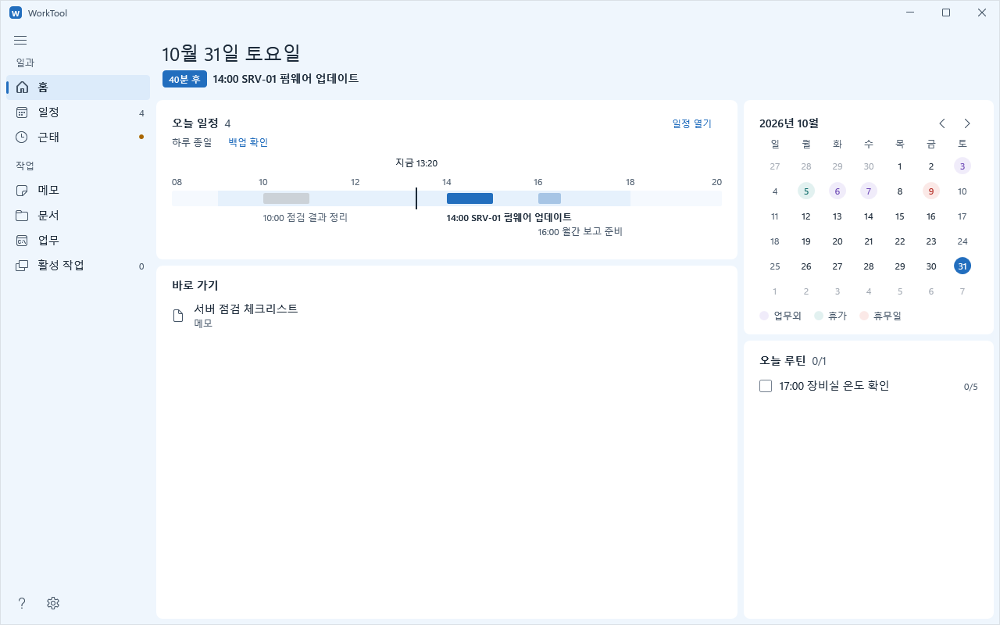
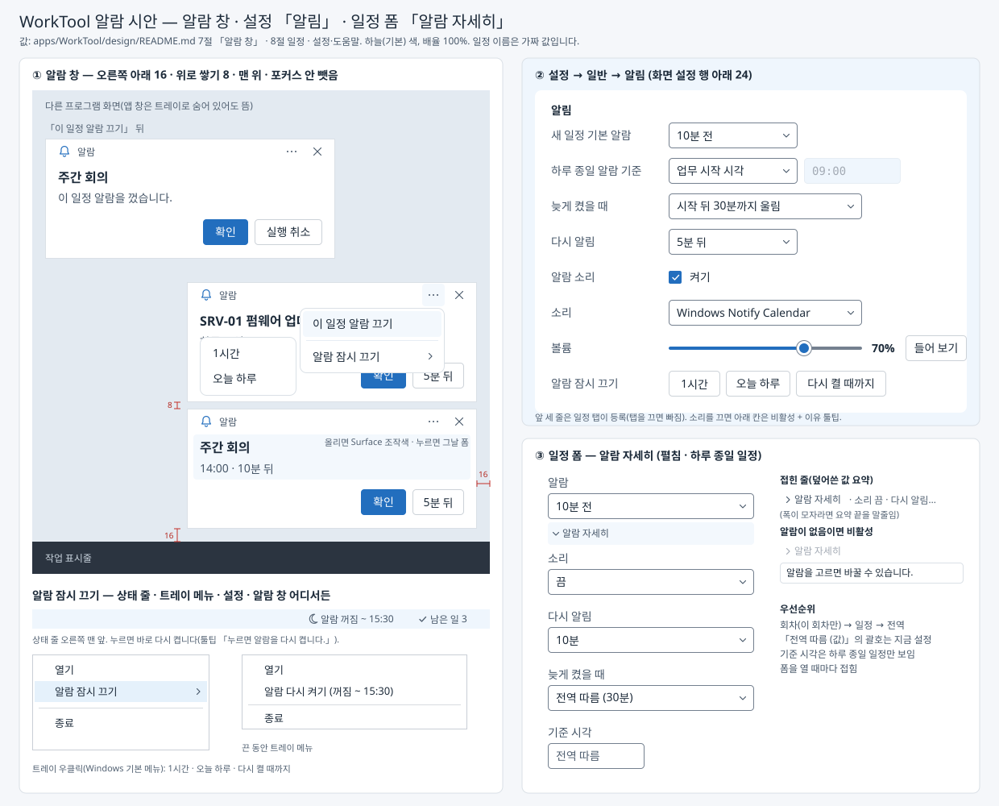

# WorkTool 디자인 값 3판

## 1. 3판 요약

- 파스텔 바탕 7색 위에 테두리 없는 흰 카드를 놓습니다. 2026-10-31 시안 3(파스텔)으로 확정했습니다.
- 파스텔 하나는 옅은 색(`Tint`)과 강조색(`Accent`) 두 값입니다. 면 · 선 · 조작색은 이 두 값에서 계산합니다. 글자 · 입력 테두리 · 상태색은 일곱 색 모두 같은 고정값입니다.
- 창 아래 상태 줄은 다음 일정 · 남은 일만 두는 높이 24의 얇은 줄입니다(6절 「상태 줄」). 메뉴와 내용 사이 선은 없습니다.
- 왼쪽 메뉴는 늘 아이콘만 보이고, 도움말 · 설정은 타이틀바 오른쪽에서 새 창으로 엽니다. 2026-11-16에 바꾼 것은 13절에 있습니다.
- 달력은 평소 근무일을 표시하지 않고, 업무외 · 휴가 · 휴무일만 숫자 바탕을 옅게 칠합니다.
- 화면 제목과 홈 날짜(20 · 24)는 보통 굵기입니다. 맑은 고딕 Bold가 무겁기 때문입니다. 메모 본문의 제목은 4절 메모 단계를 따릅니다.
- 화면 값은 이 문서가 기준입니다. 없는 값은 [apps/design.md](../../design.md)를 따르고, 새 값이 필요하면 이 문서에 먼저 더합니다. 2판에서 바뀐 내용은 12절에 있습니다.
- 그림자 · 흐림 · 그라데이션 · 애니메이션과 둥근 안쪽 Clip은 쓰지 않습니다.

그림 경로: `apps/WorkTool/design/v3-home.png`. 나머지 화면은 같은 폴더의 `v3-schedule.png` · `v3-attendance.png` · `v3-memo.png` · `v3-docs.png` · `v3-active-tasks.png` · `v3-settings.png`입니다. 이 그림들은 2026-11-16 전 짜임(펼친 메뉴 200 · 메뉴 아래 도움말 · 설정 · 상태 줄 없음 · 설정이 메인 창 안)입니다. 창 틀은 6절이 기준이고, 카드 안 내용은 그림을 따릅니다.

**읽는 약속**

- 단위는 px = WPF DIP, 배율 100%입니다. 좌표는 바깥 테두리의 왼쪽 위 기준입니다. SVG의 `x+0.5`, `width-1`은 1px 선의 중심 좌표이므로 바깥 크기로 환산합니다.
- 색은 `B.*`, 크기·줄 높이는 `F.*`, 글꼴은 `Font.*` 이름으로 참조합니다.
- C · B는 2판 시안 이름입니다(C = 콘솔형, B = 생산성형). 값은 이 문서에 옮겨 적었고, 시안 원본은 저장소에 없습니다. 「C SVG」 같은 말은 그 값의 출처를 뜻합니다.
- 1판 · 2판의 그림과 체험 파일은 과거 기록입니다. 그 안의 값 · 배치를 쓰지 않습니다.

## 2. 색

### 바탕·면·선

`T`는 고른 파스텔의 옅은 색입니다. `섞기(T, 색, 비율)`은 채널마다 `round(T × (1−비율) + 색 × 비율)`입니다. 코드는 `core/Theme.psm1`의 `Get-WtMixedColor`입니다.

| 쓰임새 이름 | 값 |
|---|---|
| `B.Bg.Canvas` 창·타이틀바·메뉴 | 섞기(T, `#FFFFFF`, 0.55) |
| `B.Bg.Surface` 카드·목록·입력·편집 면 | `#FFFFFF` |
| `B.Bg.Subtle` 메모 표 머리·코드·출력·편집 중인 줄·쉬는 날 칸 | 섞기(T, `#FFFFFF`, 0.72) |
| `B.Bg.Raised` 툴팁·메뉴·대화상자 | `#FFFFFF` |
| `B.Border.Default` 찾기 칸·표 머리 아래·떠 있는 면의 선 | 섞기(T, `#D8D8D8`, 0.6) |
| `B.Border.Muted` 행 사이·패널 머리 아래·달력 격자 | 섞기(T, `#EFEFEF`, 0.55) |
| `B.Border.Strong` 기본 버튼·분할 버튼 | 섞기(T, `#C2C2C2`, 0.6) |
| `B.Border.Control` 입력·체크 상자 | `#74808F` |

### 글자·강조·선택·조작 상태

| 쓰임새 이름 | 값 |
|---|---|
| `B.Text.Primary` 본문·제목 | `#1D2B3A` |
| `B.Text.Secondary` 라벨·보조 정보 | `#465668` |
| `B.Text.Tertiary` 날짜·개수·덜 중요한 글자 | `#526172` |
| `B.Text.Disabled` 비활성 글자·아이콘·이달 밖 날짜 | `#A3AAB4` |
| `B.Accent` 기본 강조 채움·선 | 파스텔의 강조색 |
| `B.Accent.Text` 링크·태그 | `B.Accent` |
| `B.Accent.Hover` 기본 강조 버튼 올림 | 섞기(강조색, `#000000`, 0.1272) |
| `B.Accent.Pressed` 기본 강조 버튼 누름 | 섞기(강조색, `#000000`, 0.2399) |
| `B.Accent.Later` 시간 막대의 뒤 일정 | 섞기(강조색, `#FFFFFF`, 0.6) |
| `B.OnAccent` 강조색 위 글자·아이콘 | `#FFFFFF` |
| `B.Bg.Selected` 선택 행·태그·오늘 칸 | 섞기(T, `#FFFFFF`, 0.35) |
| `B.Overlay.Ink` 조작 덧칠 원색 | `#000000` |
| `B.Fill.Hover.Surface` 흰 면 올림 | 섞기(T, `#FFFFFF`, 0.65) |
| `B.Fill.Pressed.Surface` 흰 면 누름 | 섞기(T, `#FFFFFF`, 0.45) |
| `B.Fill.Hover.Canvas` 창 바탕 올림·시간 막대의 근무 구간 | 섞기(T, `#FFFFFF`, 0.3) |
| `B.Fill.Pressed.Canvas` 창 바탕 누름 | 섞기(T, `#FFFFFF`, 0.12) |
| `B.Fill.Selected.Nav` 왼쪽 메뉴 선택 | `T` |
| `B.Fill.Hover.Subtle` 옅은 면 올림 | 섞기(T, `#FFFFFF`, 0.5) |
| `B.Fill.Pressed.Subtle` 옅은 면 누름 | 섞기(T, `#FFFFFF`, 0.3) |

- 조작색은 완성된 단색 브러시로 둡니다. 덧칠을 겹치지 않습니다.
- 비활성: 채움 `B.Bg.Canvas`, 선 `B.Border.Muted`, 글자·아이콘 `B.Text.Disabled`, 불투명도 1입니다. 이유는 툴팁으로 표시합니다. 평소 바탕이 없는 부품(아이콘·링크·위험 버튼, 체크 상자 줄)은 비활성에도 바탕을 칠하지 않고 글자·아이콘 색만 바꿉니다.
- 선택은 `B.Bg.Selected`와 `B.Accent` 막대를 함께 씁니다. 왼쪽 메뉴만 `B.Fill.Selected.Nav`를 씁니다. 선택된 행에 올림 덧칠을 더하지 않습니다.
- 포커스: 바깥 2 `B.Text.Primary` + 안쪽 1 `B.Bg.Surface`, 요소에서 1 띄웁니다. 가장자리 행은 안쪽에 그립니다. 입력 중 외곽선은 C SVG처럼 2 `B.Accent`입니다.

### 상태 4색

아래 순서는 아이콘 / 글자 / 연한 바탕입니다.

- 정상: `B.Status.Success.Icon` `#1E7F47` / `B.Status.Success.Text` `#1A6E3E` / `B.Status.Success.Bg` `#E6F4EC`.
- 경고: `B.Status.Warning.Icon` `#A86500` / `B.Status.Warning.Text` `#8A5300` / `B.Status.Warning.Bg` `#FCF2DE`.
- 오류: `B.Status.Error.Icon` `#C42F29` / `B.Status.Error.Text` `#B42820` / `B.Status.Error.Bg` `#FBE9E7`.
- 정보: `B.Status.Info.Icon` = `B.Accent`, `B.Status.Info.Text` = `B.Text.Primary`, `B.Status.Info.Bg` = `B.Bg.Selected`.
- 예정·취소용 중립: `B.Status.Neutral.Icon` `#6B7380` / `B.Status.Neutral.Text` = `B.Text.Secondary` / `B.Status.Neutral.Bg` `#EEF0F3`. 상태 4색과 구별되는 보조 값입니다.
- 표·목록은 아이콘만 상태색이고 글자는 `B.Text.Primary`입니다. 배지에만 연한 상태 바탕을 쓰며 행 전체를 칠하지 않습니다.

### 달력·시간 막대·코드

- `B.Cal.Work` = `B.Fill.Hover.Canvas`: 시간 막대의 근무 구간.
- `B.Cal.Leave.Text` `#0B6B69`, `B.Cal.Leave.Bg` `#E2F1F0`: 휴가.
- `B.Cal.Overtime.Text` `#6A44B5`, `B.Cal.Overtime.Bg` `#F0ECFA`: 업무외.
- `B.Cal.Holiday` = `B.Status.Error.Text`: 일정 달력의 일요일.
- `B.Cal.Saturday` `#2457B0`: 일정 달력의 토요일.
- `B.Cal.DayOff` = `B.Bg.Subtle`: 주말·휴무일 칸.
- 휴무일 숫자 바탕은 `B.Status.Error.Bg`·`B.Status.Error.Text`입니다.
- `B.Code.Command` `#6639BA`, `B.Code.String` `#0A3069`, `B.Code.Keyword` `#C4243B`, `B.Code.Variable` `#953800`: C SVG에 있는 코드 색입니다.
- 코드 바탕은 `B.Bg.Subtle`, 주석은 `B.Text.Tertiary`, 나머지는 `B.Text.Primary`입니다. 이 목록에 없는 구문별 색은 추가하지 않습니다.
- `B.Code.InlineBg` = `T`(고른 파스텔의 옅은 색 그대로): 메모 본문 속 인라인 코드(`` `code` ``)의 바탕입니다. 흰 본문에서도, 그보다 옅은 콜아웃 바탕(`B.Bg.Selected`) 안에서도 구별됩니다(11-16 화면 판정: 섞기 0.3은 콜아웃 안에서 묻힘). 글자는 `Font.Mono` · `F.Memo.Code` 14 · `B.Text.Primary`이고, 줄 간격은 둘레 본문을 따릅니다. 글자 바탕만 칠하며 안쪽 여백 · 모서리 · 선은 없습니다. 흰 본문 위에서 `B.Bg.Subtle`은 거의 보이지 않아 따로 둡니다. 코드 블록은 위 `B.Bg.Subtle` 그대로입니다.
- 출장 등 C에 별도 색이 없는 종류는 글자로 구별합니다. 1판의 종류 색을 자동으로 가져오지 않습니다.

## 3. 파스텔 7색

설정의 `theme.color`에 저장합니다. 기본은 하늘입니다. 값을 모르면 저장 값은 그대로 두고 하늘로 표시합니다. 2판의 `theme.accent`는 파일에 남아 있어도 읽지 않습니다.

| 이름 | 키 | 옅은 색 `T` | 강조색 |
|---|---|---|---|
| 하늘 (기본) | `sky` | `#DCEBFA` | `#226EBE` |
| 분홍 | `pink` | `#FADDE8` | `#B83D69` |
| 연두 | `green` | `#E1F1CF` | `#3F7D20` |
| 노랑 | `yellow` | `#FBEDBF` | `#856000` |
| 보라 | `purple` | `#E9E0F8` | `#7048B8` |
| 회색 | `gray` | `#E3E7EC` | `#56606D` |
| 검정 | `black` | `#DEDFE2` | `#2B2F36` |

- 색 하나를 더하려면 `core/Theme.psm1`의 `$script:palettes`에 한 줄을 더합니다. 면 · 선은 계산되고, 대비는 검사(`Test-Core.ps1`)가 7색 모두 확인합니다.
- 일곱 색 모두 다음을 지킵니다: 본문 · 보조 · 3차 글자는 모든 면에서 4.5:1 이상, `B.Accent.Text`는 글자가 놓이는 면에서 4.5:1 이상, 입력 테두리는 3:1 이상.
- 하늘의 강조색은 1판 `#2370C2`였습니다. `B.Bg.Selected` 위 글자가 4.5:1에 못 미쳐 `#226EBE`로 어둡게 했습니다.
- 상태색 · 달력 종류색은 파스텔과 관계없이 고정입니다.

## 4. 글자 단계

- `Font.UI` = `Segoe UI Variable Text, Segoe UI, Malgun Gothic`.
- `Font.Mono` = `Consolas, Malgun Gothic`.
- `Font.Icon` = `Segoe Fluent Icons, Segoe MDL2 Assets`.
- 굵기는 Regular 400과 SemiBold 600입니다. 한글 600은 맑은 고딕에서 Bold로 보입니다. 12/600은 작은 달력의 오늘 날짜 · 다음 일정 알약 · 시간 막대의 다음 일정 이름만 예외입니다. 시각·숫자 열은 고정폭 숫자입니다.

### UI 단계 — 크기 / 굵기 / 줄 높이

| 쓰임새 이름 | 값 |
|---|---|
| `F.Caption` 보조·개수 | 12 / 400 / 16 |
| `F.Body` 본문·입력·표·메뉴 | 14 / 400 / 20 |
| `F.BodyStrong` 패널 제목·선택 메뉴·날짜 | 14 / 600 / 20 |
| `F.Subtitle` 상세 제목·스크립트 이름 | 16 / 600 / 24 |
| `F.Title` 화면 제목 | 20 / 400 / 28 |
| `F.Display` 홈 날짜 | 24 / 400 / 32 |
| `F.Code` 코드·값 (`Font.Mono`) | 14 / 400 / 20 |
| `F.Code.Dense` 출력·명령 (`Font.Mono`) | 12 / 400 / 18 |

C의 본문·본문 강조·코드 13은 모두 14로 올립니다. C의 `Text.Reading` 14/22는 별도 단계로 두지 않고 `F.Body` 14/20으로 합칩니다. 메모 본문은 다음 B 단계가 대신합니다. 따라서 UI 크기 단계는 **12 → 14 → 16 → 20 → 24**입니다. C의 메모 제목 22는 B의 24로 대체합니다.

### 메모 — B 단계

| 쓰임새 이름 | 값 |
|---|---|
| `F.Memo.Body` (`Font.UI`) | 15 / 400 / 24 |
| `F.Memo.H1` | 24 / 600 / 32 |
| `F.Memo.H2` | 18 / 600 / 26 |
| `F.Memo.H3` | 16 / 600 / 24 |
| `F.Memo.H4` | 15 / 600 / 24 |
| `F.Memo.H5` | 14 / 600 / 22 |
| `F.Memo.H6` (`B.Text.Secondary`) | 14 / 600 / 22 |
| `F.Memo.Code` (`Font.Mono`) | 14 / 400 / 20 |

- B의 메모 코드 13도 14로 올립니다. UI의 14와 메모의 15는 서로 다른 쓰임새입니다.
- 편집·원문·읽기의 본문 크기와 줄 높이는 같습니다. 코드 블록만 `Font.Mono`와 코드 단계를 씁니다.

## 5. 간격·모서리·선·높이

### 간격

- `F.Space.1` 4, `F.Space.2` 8, `F.Space.3` 12, `F.Space.4` 16, `F.Space.6` 24, `F.Space.8` 32.
- `F.Gap.InGroup` 4 또는 8은 부품별 지정값을 따릅니다. 버튼 사이는 8입니다.
- `F.Gap.Panel` 8: 카드 사이, 창 오른쪽 · 아래 여백입니다. 카드에는 테두리가 없고 이 간격으로 나눕니다.
- `F.Padding.Card` 가로 20 · 세로 16: 카드 안쪽입니다. 일정 달력 · 근태 표는 격자를 넓게 쓰려고 좌우 16입니다. `F.Padding.Panel` 12는 좁은 패널 안쪽입니다.
- SVG에 직접 있는 10(입력 글자 시작), 20·28(부품), 44(메모 본문 옆 여백), 52·60(행)은 일반 간격 단계가 아닌 해당 부품의 전용 값입니다.

### 모서리·선

- `F.Radius.Joined` 0: 표의 선택 행·탭 아래.
- `F.Radius.Small` 2: 체크 상자·달력 칩·작은 막대.
- `F.Radius.Control` 4: 버튼·입력·배지·B 메모 탭.
- `F.Radius.Card` 8: 카드.
- `F.Radius.Overlay` 8: 메뉴·대화상자·펼침 패널.
- `F.Radius.SelectionBar` 1.5: C SVG의 폭 3인 선택 막대만의 예외입니다.
- `F.Line.Border` 1, `F.Line.Focus` 2, `F.Line.FocusInner` 1, `F.Line.Selection` 3, `F.Line.TabActive` 2.
- 선택 막대는 3×16, 현재 시각 선은 2×28입니다.
- 그림자·흐림·그라데이션·애니메이션은 모두 없음입니다. 상태는 즉시 바꿉니다. 둥근 안쪽 Clip·둥근 `ClipToBounds` 처리는 금지하며 테두리만 둥글립니다.

### 높이

- `F.Height.Control` 32: 기본·강조 버튼, 입력, 고르기 칸, 메뉴 항목, 표 행, 한 줄 목록.
- `F.Height.Compact` 28: 작은 찾기 칸·아이콘 버튼·달 이동·분할 버튼.
- `F.Height.Row2` 48: 두 줄 목록. 메모 목록은 2026-11-17부터 한 줄 32입니다(`F.Height.MemoRow` 52는 쓰지 않음).
- `F.Height.PanelHeader` 40, `F.Height.Header` 56(카드 머리줄), `F.Height.Tab` 36(C 공통), `F.Height.StatusBar` 24(창 아래 상태 줄, 6절)입니다.
- 메모는 B의 `F.Height.MemoTabBar` 40, `F.Height.MemoTab` 28을 씁니다. C의 탭 36과 혼용하지 않습니다.
- 높이는 배율·글자 확대 전 기준입니다. 텍스트 확대 시 글자가 잘리면 같은 비율로 늘립니다.

## 6. 창 짜임

### 타이틀바 — B

- `F.Chrome.Height` 32. 바탕 `B.Bg.Canvas`, 찾기 칸·출근 표시·시계는 두지 않습니다.
- 앱 표식은 `(12,8)`의 16×16, 모서리 4, `B.Accent` 바탕·`B.OnAccent` W입니다. W는 B SVG의 10/700인 표식 예외이며 UI 글자 단계가 아닙니다.
- 앱 이름 `WorkTool`: x=36, 기준선 y=20.3, `F.Caption`, `B.Text.Secondary`입니다.
- 오른쪽 창 버튼은 각각 46×32입니다. 최소화 x=`W−138`, 최대화/복원 x=`W−92`, 닫기 x=`W−46`, y=0입니다. 글리프 10, 중앙 x는 `W−115`, `W−69`, `W−23`, 기준선 y=21입니다.
- 창 버튼의 보통·올림·누름·비활성은 7절 아이콘 버튼의 Canvas 상태를 씁니다. 창 단추에 글자 라벨은 없습니다.
- 창 버튼 왼쪽에 도움말 · 설정 단추를 둡니다. 각각 40×32, 글리프 14 `B.Text.Secondary`(옆 창 버튼 10보다 무겁지 않게 16 대신 14), 7절 아이콘 버튼의 Canvas 상태입니다. 설정 x=`W−186`, 도움말 x=`W−226`, y=0입니다(최소화와 사이 8). 툴팁은 `도움말 (F1)` · `설정 (Ctrl+,)`이고, 누르면 8절 「설정·도움말」의 새 창을 엽니다. 이 두 단추 자리는 창 끌기 영역이 아닙니다.
- 닫기는 기본으로 트레이로 숨깁니다(`window.closeToTray` 기본 켬). 설정 → 일반의 닫기 고르기(`끝내기` · `트레이로 숨기기`)는 그대로입니다. 설정 파일에는 바꾼 값만 남으므로, 이 값을 직접 고른 적이 있는 사람은 그 값을 그대로 씁니다. 트레이로 숨길 때 열려 있는 설정 · 도움말 창은 닫습니다(내용은 이미 저장돼 있습니다).
- 트레이 아이콘 우클릭 메뉴(Windows 기본 메뉴): `열기` · `알람 잠시 끄기 ›`(`1시간` · `오늘 하루` · `다시 켤 때까지`) · 구분선 · `종료`. 알람을 끈 동안은 `알람 잠시 끄기 ›` 자리에 `알람 다시 켜기 (꺼짐 ~ 15:30)`를 둡니다.

### 왼쪽 메뉴 — 아이콘 줄

- 늘 아이콘만 보이는 폭 `F.Nav.Width` 48입니다. 펼치기 · 접기는 없고, 맨 위 접기 단추 줄도 없습니다. 메뉴와 내용 사이 선은 없습니다.
- 「핵심 기능은 글자 라벨과 함께 보인다」([apps/design.md](../../design.md) 2장 1)의 예외입니다. 날마다 쓰는 일곱 항목이라 아이콘과 툴팁으로 충분하고, 내용 영역을 넓게 쓰는 편이 낫다고 승호가 골랐습니다(2026-11-16).
- 항목은 x=8, 32×32, 아이콘 16을 가운데에 둡니다. 항목 사이 간격은 없습니다. 첫 항목은 타이틀바 바로 아래 8에서 시작합니다. 앱 표식은 타이틀바에만 둡니다.
- 묶음은 `일과`(홈·일정·근태), `작업`(메모·문서·업무·활성 작업)입니다. 묶음 이름 대신 묶음 사이에 폭 24 · 선 1 `B.Border.Muted` 구분선을 가운데에 두고, 위아래 8을 띄웁니다. 탭을 꺼서 한쪽 묶음이 비면 구분선도 두지 않습니다.
- 선택: 모서리 4의 `B.Fill.Selected.Nav`, 항목 왼쪽 끝(x=8)에 3×16 `B.Accent`. 막대는 세로 중앙입니다. 올림·누름은 Canvas 상태입니다.
- 툴팁은 아이콘 오른쪽(메뉴 밖, 항목과 세로 가운데)에 띄워 아래 항목을 가리지 않습니다. 툴팁은 `이름` 또는 `이름 · 상태`입니다: `일정 · 남은 일 3`, `근태 · 오늘 안 찍음`, `활성 작업 · 2개`. 상태가 없거나 0이면 `일정`처럼 이름만 씁니다. 메뉴에 숫자를 쓰지 않습니다. 남은 일 수는 상태 줄에도 보입니다.
- 점은 지름 6이고, 점의 중심을 아이콘(16×16) 오른쪽 위 모서리에서 오른쪽 4 · 위 4에 둡니다(지금 접힌 메뉴의 근태 점 자리). 근태 점(오늘 안 찍음)은 `B.Status.Warning.Icon`, 활성 작업이 1개 이상이면 `B.Accent` 점입니다. 뜻은 툴팁에 둡니다.
- 도움말 · 설정은 메뉴에 두지 않고 타이틀바 오른쪽에 둡니다(위 「타이틀바」).

### 상태 줄

- 창 맨 아래 전체 폭, 높이 `F.Height.StatusBar` 24, 바탕 `B.Bg.Canvas`, 선 없음입니다. 내용 카드와 상태 줄 사이는 `F.Gap.Panel` 8입니다.
- 글자 `F.Caption` · `B.Text.Secondary`입니다. 항목 앞에 아이콘 12 `B.Text.Tertiary` + 간격 4를 둡니다(누를 수 있는 항목임을 보이고 눈에 걸리게 하려고, 11-16 화면 판정). 아이콘은 일정 탭이 정합니다: 다음 일정 `Calendar E787`, 남은 일 `CheckMark E73E`.
- 왼쪽 항목은 아이콘 시작을 내용 영역 왼쪽 끝(x=`N`=48)에 맞춥니다(줄 안쪽 왼쪽 40 + 단추 안쪽 8). 오른쪽 항목은 글자 끝을 창 오른쪽에서 12에 둡니다(줄 안쪽 오른쪽 4 + 단추 안쪽 8). 같은 쪽 항목 단추는 사이 없이 놓아 글자 사이가 16입니다.
- 왼쪽 항목은 남는 폭을 다 쓸 수 있고, 오른쪽 항목과 겹칠 만큼 길 때만 말줄임합니다.
- 항목은 탭이 등록합니다. 코어는 탭 이름을 모르고 등록 목록만 그립니다(AGENTS.md 「앱(GUI) 원칙」). 항목 = 글 · 툴팁 · 누르면 열 탭과 인자 · 왼쪽/오른쪽 · 순서입니다. 같은 쪽에서는 탭 순서 → 등록 순서로 놓습니다. 탭이 꺼져 있거나 항목을 못 만들면 그 항목만 뺍니다.
- 항목은 누를 수 있는 글자 단추입니다: 높이 24, 좌우 8, 모서리 4, Canvas 올림 · 누름, 손 모양 커서입니다. 폭이 모자라면 왼쪽 항목부터 말줄임하고 오른쪽 항목은 다 보이게 둡니다. 툴팁에는 늘 전체 내용을 씁니다.
- 일정 탭의 항목 두 개:
  - 왼쪽 `다음 14:00 SRV-01 펌웨어 업데이트`. 오늘 남은 일정 중 끝내지 않은 가장 가까운 것이며(홈 다음 일정 줄과 같은 고르기), 진행 중이면 `진행 중 14:00 …`입니다. 없으면 항목을 뺍니다. 툴팁은 홈 「오늘 일정」 막대의 툴팁과 같습니다(제목 · 시각 · 반복 · 알람). 누르면 일정 탭의 오늘을 엽니다.
  - 오른쪽 `남은 일 3`. 숫자는 할 일 보기 단추와 같은 셈(기한 지남 · 오늘 · 마감 임박)입니다. 0이면 `남은 일 없음`입니다. 툴팁은 `기한 지남 1 · 오늘 2 · 마감 임박 0`입니다. 누르면 일정 탭의 할 일 보기를 엽니다.
- 알람을 잠시 끈 동안은 오른쪽 항목 맨 앞에 `알람 꺼짐 ~ 15:30`(오늘 하루면 `알람 꺼짐 · 오늘`, 다시 켤 때까지면 `알람 꺼짐`)을 둡니다. 아이콘은 `QuietHours E708`, 툴팁은 `누르면 알람을 다시 켭니다.`이고 누르면 바로 다시 켭니다. 탭이 아니라 코어가 그리는 항목이라 탭을 꺼도 보입니다.
- 1분마다, 그리고 일정 · 체크 · 휴무일이 바뀌어 할 일 수를 다시 셀 때 다시 씁니다.

### 오른쪽·목록 사이드바

- `F.Sidebar.Schedule.Width` 288: 일정·근태 사이드바입니다.
- `F.Sidebar.Toc.Width` 220: 메모 목차입니다.
- `F.Sidebar.Workflows.Width` 280: 업무 설명입니다.
- `F.Sidebar.MemoList.Width` 280: B 메모 목록입니다. C의 목록 256을 쓰지 않습니다.
- 접기 단추는 28×28·글리프 16입니다. 오른쪽 사이드바는 제목 줄 왼쪽 끝의 `ChevronRight E76C`, 메모 목록은 제목 줄 오른쪽 끝의 `ChevronLeft E76B`입니다.
- 오른쪽 사이드바·메모 목록은 카드입니다. 내용 카드와 간격 `F.Gap.Panel`을 둡니다. 머리 높이는 `F.Height.Header` 56입니다. 접히면 폭 28 레일(`B.Bg.Surface`, 모서리 8)입니다. 다시 열기 단추는 레일 맨 위·제목 줄 높이의 가운데, 28×28·글리프 16입니다. 일정 +는 제목 줄 오른쪽 끝이며 접기 단추와 간격 8 이상입니다. 접혀도 핵심 명령은 남도록([apps/design.md](../../design.md) 8.1) 일정은 레일의 제목 줄 바로 아래에도 + (`Add E710`, 28×28 · 글리프 16, 툴팁 `새로 만들기`)를 두고, 누르면 펼친 +와 같은 메뉴를 오른쪽에 맞춰 엽니다. 고르면 폼이 사이드바를 펼칩니다(11-24: 최소 창에서 새 일정을 만들 길이 안 보였음).
- 홈에는 오른쪽 사이드바가 없습니다. 근태는 폭 288이며 이번 달 출근 일수·휴가·출장·초과근무(작업장·원격·이동)를 요약합니다. 행을 누르면 그 자리가 편집 폼으로 바뀝니다.

### 가장자리·단축키

- 내용 영역은 메뉴 오른쪽부터 시작하고, 창 오른쪽 · 상태 줄 위에 `F.Gap.Panel`을 둡니다. 메모 본문 옆 여백은 B의 44입니다.
- 상태 줄은 다음 일정 · 남은 일만 둡니다(위 「상태 줄」). 저장 상태는 지금처럼 그 화면의 카드 안에 둡니다.
- `Ctrl+Shift+B`: 누를 때마다 일반 화면은 오른쪽 사이드바를, 메모는 목록을 접었다 엽니다. 왼쪽 메뉴는 접히지 않으므로 대상이 아닙니다. 대상이 없는 화면에서는 아무것도 하지 않습니다. 오른쪽 목차는 자체 접기 버튼으로 따로 조절합니다.
- `Ctrl+B`는 메뉴 접기에 쓰지 않습니다. 메모 편집 칸의 굵게만 남습니다.
- `Ctrl+K`는 찾기·명령입니다. 타이틀바에 찾기 칸을 되살리지 않습니다.
- 창 최소 크기는 1024×640입니다. 창 폭 1200 미만이면(메뉴가 48로 좁아진 뒤에도 기준은 그대로) 오른쪽 사이드바가 레일로 접혀 시작하며, 열면 내용 위에 겹칩니다. 겹칠 때만 선 1 `B.Border.Default`를 둡니다. 그림자는 없습니다.

## 7. 공통 부품

### 버튼

- `Btn`: 높이 32, 좌우 여백 12, 아이콘 16, 아이콘↔글자 8, 모서리 4, 선 1 `B.Border.Strong`, 바탕 `B.Bg.Surface`, 글자 `F.Body`·`B.Text.Primary`입니다. 폭은 글자와 이 여백의 합입니다.
- `Btn.Primary`: 같은 크기, 선 없음, `B.Accent`와 `B.OnAccent`. 올림·누름은 `B.Accent.Hover`·`B.Accent.Pressed`입니다. 화면당 하나입니다. 사이드바에 열리는 입력 폼의 `저장`은 폼의 주 버튼이라 따로 셉니다.
- `Btn.Icon`: 28×28, 아이콘 16, 중앙 정렬, 모서리 4, 글자 없음입니다. 입력 옆 파일 선택은 32×32 예외입니다. 타이틀바의 도움말 · 설정은 40×32 · 아이콘 14, 창 버튼은 46×32 · 아이콘 10입니다.
- `Btn.Danger`: `Btn`과 같은 크기, 바탕·선 없음, 글자 `B.Status.Error.Text`입니다. 지우기·닫기처럼 되돌리기 어려운 명령에 씁니다. 강조 버튼으로 세지 않습니다. 탭마다 다른 모양을 쓰지 않습니다: 편집 폼의 `삭제`(일정 · 근태) · `업무 삭제` · `선택 닫기` · `기간 지우기`가 모두 이 모양입니다.
- `Btn.Link`: 높이 28, 좌우 12, 바탕·선 없음, 글자 `F.Caption`·`B.Accent.Text`입니다.
- 기본·아이콘 버튼의 올림·누름은 2절에 등록한 Surface(흰 면)·Canvas(창 바탕)·Subtle(옅은 면) 상태색 중 해당 바탕의 짝을 씁니다. 아이콘은 보통 `B.Text.Secondary`, 눌러도 같은 색입니다. 포커스·비활성은 2절입니다.
- 아이콘만 있으면 이름을 툴팁에 씁니다. 단축키가 정해진 기능에만 괄호로 붙입니다.

### 입력칸·고르기 칸

- `Input`: 높이 32, 작은 목록 찾기만 28, 모서리 4, 선 1 `B.Border.Control`, 바탕 `B.Bg.Surface`, 본문 `F.Body`·`B.Text.Primary`입니다. 글자 시작은 왼쪽에서 10, 세로 중앙입니다.
- 찾기 아이콘은 14, 왼쪽 10; 찾기 글자는 왼쪽 32입니다. 예시 글자는 `B.Text.Tertiary`입니다.
- 올림은 기존 선을 유지하고, 입력 포커스는 2 `B.Accent`입니다. 입력칸에는 2절의 바깥 포커스 테두리를 함께 그리지 않습니다(두 겹이 됨, 11-17 화면 판정). 메모 원문 · 고치는 칸(섬)과 편집 · 읽기 보기의 문서 면은 문서처럼 이어 쓰고 읽는 면이라 포커스 선을 아예 그리지 않습니다(커서로 충분, 11-17 승호: 줄 둘레 파란 네모가 어색. 11-22: 읽기 보기도 같게). 오류는 선과 옆 오류 아이콘에 `B.Status.Error.Icon`, 이유는 툴팁입니다. 비활성은 2절입니다.
- 고르기 칸은 입력과 같은 높이·색입니다. 펼친 면은 `B.Bg.Raised`·1 `B.Border.Default`·모서리 8, 행 높이 32입니다.
- 한 줄 입력칸에 Tab · Shift+Tab으로 들어가면 글 전체를 고릅니다(Windows 대화 상자와 같음, 바로 치면 바뀜). 마우스로 누르면 누른 자리에 커서를 두고, 여러 줄 칸과 메모 편집기는 고르지 않습니다(11-24).
- 시각 입력칸은 `09:00` · `9:00` · `0900` · `900` · `9`를 받아 칸을 떠날 때(또는 저장할 때) `09:00`으로 바꿔 보입니다. 못 읽으면 칸 아래 `시각은 09:00처럼 입력하세요.`입니다. 일정 · 근태 · 설정의 시각 칸이 같습니다(11-24).
- 편집 폼(일정 · 근태 사이드바)은 한 줄 칸에서 Enter, 폼 어디서든 Ctrl+S로 [저장]과 같은 일을 합니다. 여러 줄 칸(근태 메모)의 Enter는 줄 바꿈, 펼친 고르기 칸의 Enter는 고르기입니다. 저장했는데 틀린 칸이 있으면 첫 틀린 칸으로 포커스를 옮기고 글 전체를 고릅니다(11-24).

### 칩 — 삭제 ✕ 포함

- C 메모 태그 칩은 높이 20, 좌우 여백 8, 모서리 4, `F.Caption`, `B.Bg.Selected`·`B.Accent.Text`입니다. 달력 칩은 8절의 높이 20·모서리 2를 씁니다.
- 조건 칩은 높이 24·모서리 4, `B.Bg.Subtle`·선 1 `B.Border.Default`, 글자 12/16입니다. 왼쪽 여백 8, 글자와 ✕ 사이 4, ✕는 `Cancel E711` 10·`B.Text.Secondary`, 오른쪽 끝 누르는 영역 20×24입니다. 폭은 왼쪽 8+글자 폭+간격 4+삭제 영역 20, 칩 사이·줄 사이 4입니다. 삭제를 누르면 그 조건만 해제합니다.
- 올림·누름은 Surface 조작색, 선택은 기존 선택색, 포커스·비활성은 2절입니다.
- 메모 목록의 조건 칩 배치는 8절 메모입니다.

### 목록 줄·탭

- `Row`: 한 줄 높이 32, 두 줄 48, 좌우 12, 바탕 `B.Bg.Surface`, 첫 줄 `F.Body`, 둘째 줄 `F.Caption`·`B.Text.Tertiary`입니다. 행 구분선은 1 `B.Border.Muted`입니다.
- 선택은 2절의 선택 바탕과 3×16 막대, 올림·누름은 Surface 조작색, 포커스·비활성은 2절입니다. 상태색으로 행을 채우지 않습니다.
- C 공통 탭은 높이 36, 바탕 `B.Bg.Canvas`; 선택은 `B.Bg.Surface`와 위 선 2 `B.Accent`입니다. 메모 탭에는 적용하지 않습니다.
- B 메모 탭 줄은 높이 40·아래 선 1 `B.Border.Muted`, 탭은 높이 28·모서리 4입니다. 선택 탭의 옅은 면은 `B.Fill.Hover.Surface`, 아래 활성 선은 2 `B.Accent`입니다. 선택되지 않은 탭은 투명, 글자 `B.Text.Secondary`입니다.
- 메모 탭 폭은 `min(240, max(120, 글자 폭+12+24))`이며 넘친 제목은 말줄임입니다. 글자 시작 왼쪽 12, 닫기 영역 폭 24·글리프 10·중심은 오른쪽에서 12, 활성 선은 좌우 8을 뺀 폭입니다. 첫 탭은 줄 왼쪽에서 9, 위 6입니다.
- 탭이 줄에 다 들어가지 않으면 Windows 탭(TabView)처럼 넓은 탭부터 같은 폭으로 최소 120까지 줄입니다(탭 사이 4, 넘친 제목은 말줄임 · 전체는 툴팁). 120으로도 넘치면 탭 줄을 가로로 스크롤하고(마우스 휠 · 양 끝 스크롤 단추), 지금 탭은 늘 보이게 스크롤합니다. 보기 · More 단추는 스크롤 밖 오른쪽 끝이라 늘 보입니다.
- 스크롤 단추는 넘칠 때만 보이는 ‹ `ChevronLeft E76B` · › `ChevronRight E76C`입니다. 24×28 · 글리프 10 · Surface 조작색이고 포커스를 받지 않습니다. ‹는 줄 왼쪽에서 9, 단추와 탭 · 보기 단추 사이는 4입니다. 누를 때마다 가려진 다음 탭이 다 보이게 옮기고, 끝에 닿은 쪽은 비활성입니다(툴팁 `더 왼쪽에 탭이 없습니다` · `더 오른쪽에 탭이 없습니다`).
- 탭 올림·누름은 Surface 조작색, 포커스·비활성은 2절입니다. 닫기 아이콘은 `Cancel E711`입니다.

### 표

- 근태·활성 작업·문서가 같은 모양을 씁니다. 카드 안쪽 좌우 16에 둡니다. 설정 → 휴무일의 표도 같은 값으로 행을 직접 그립니다(폭 720, 행을 우클릭 · Delete · F2로 다룸).
- 머리: 높이 32, `F.Caption`·`B.Text.Tertiary`, 바탕 없음, 아래 선 1 `B.Border.Default`, 좌우 셀 여백 12입니다.
- 행: 높이 32, 본문 `F.Body`, 좌우 셀 여백 12, 아래 선 1 `B.Border.Muted`입니다. 올림은 Surface 조작색, 선택은 2절의 선택 바탕과 3×16 막대입니다. 칸마다 바탕을 칠하지 않고 행 전체를 칠합니다.
- 보조 값(종류·날짜·크기)은 `F.Caption`·`B.Text.Secondary`로 낮춰도 됩니다. 숫자는 오른쪽 맞춤입니다.
- 고정 폭 열은 글자 크기 배율만큼 함께 넓힙니다(크게 1.12 · 작게 0.93, 남는 폭 열이 그만큼 줄어듦). 5절 「높이」의 같은 비율 규칙을 열 폭에도 씁니다.
- 줄을 누르면 줄 선택만 보이고 칸에는 테두리를 그리지 않습니다. 키보드로 옮긴 칸 포커스만 2절 포커스를 칸 안쪽에 그립니다.
- 묶음 머리는 높이 32, 왼쪽에 펼침 단추 28×28(`ChevronRight E76C` · `ChevronDown E70D`, 글리프 10), 이름 `F.BodyStrong`, 개수 `F.Caption`·`B.Text.Tertiary`, 아래 선 1 `B.Border.Muted`입니다. 바탕은 없습니다.

### 트리

- 줄 높이 28, 모서리 4, 들여쓰기 16, 펼침 단추 폭 20·글리프 10, 아이콘 16, 아이콘↔글자 8입니다. 줄 사이 간격은 없습니다.
- 올림은 Surface 조작색, 선택은 `B.Bg.Selected`와 왼쪽 3×16 `B.Accent` 막대입니다.
- 문서 폴더와 업무 목록이 같은 부품을 씁니다.

### 툴팁

- `ToolTip`: `B.Bg.Raised`, 선 1 `B.Border.Default`, 글자 `F.Caption`·`B.Text.Primary`, 그림자·애니메이션 없음입니다. 비활성 이유와 잘린 글자 전체도 이 부품을 씁니다.
- 툴팁 글자 12/16, 여백 가로 8·세로 6, 모서리 4, 최대 폭 320, 나타나기 400ms, 툴팁 사이 이동 100ms입니다.

### 대화상자

- 코어 `New-WtModal` 한 곳에서 만듭니다. 폭 480, 높이는 내용에 맞춤, 크기 바꾸기 없음, 앱 창 가운데, 작업 표시줄 단추 없음, 바탕 흰 면, 안쪽 24입니다.
- 창 제목줄 글은 늘 `WorkTool`입니다(Windows 메시지 상자와 같음). 질문 · 할 일은 본문 맨 위 큰 제목(`F.Subtitle`) 한 곳에만 써서 같은 글이 두 번 보이지 않게 합니다(11-24 실사용).
- 본문은 제목 아래 12, 칸 사이 8입니다. 오류 줄(`F.Caption`·`B.Status.Error.Text`)은 평소 숨깁니다. 단추는 본문 아래 24에 오른쪽 맞춤 · 사이 8이고, 주 버튼이 왼쪽입니다. 제목은 질문, 단추는 답(동작)입니다([apps/design.md](../../design.md) 13장).

### 메뉴

- 우클릭 · 펼침 메뉴(`New-WtHomePinContextMenu`)는 `B.Bg.Raised`, 선 1 `B.Border.Default`, 모서리 8, 안쪽 4입니다.
- 항목은 높이 32, 좌우 12, 모서리 4, `F.Body`·`B.Text.Primary`입니다. 단축키는 오른쪽에 `F.Caption`(왼쪽 간격 12)입니다. 올림은 `B.Fill.Hover.Surface`, 비활성 글자는 `B.Text.Disabled`입니다.
- 단추로 여는 펼침 메뉴는 단추 바로 아래에 엽니다. 창 오른쪽 끝 단추(일정 사이드바 `+` 등)의 메뉴는 메뉴 오른쪽 끝을 단추 오른쪽 끝에 맞춰 창 안쪽으로 엽니다(`Open-WtButtonMenu -Right`).
- 구분선은 선 1 `B.Border.Muted`, 위아래 4 · 좌우 8입니다.

### 알람 창

시안 경로: `apps/WorkTool/design/alarm-popup.svg`. 코어 공용 부품(`core/Notice.psm1`)이고, 일정 탭이 알람 시각에 부릅니다. 다른 탭도 같은 부품을 씁니다.

- 자리: 화면 작업 영역(작업 표시줄 위) 오른쪽 아래, 오른쪽 · 아래 16입니다. 여러 개면 위로 쌓고 사이는 8입니다. 하나를 닫으면 나머지가 아래로 내려와 빈자리를 메웁니다. 작업 영역 위를 넘으면 맨 위 자리에 겹칩니다.
- 창: 폭 360, 높이는 내용에 맞춤(기본 149 = 선 1 + 머리 32 + 본문 56 + 12 + 단추 32 + 15 + 선 1), 바탕 `B.Bg.Raised`, 선 1 `B.Border.Default`, 모서리 0(설정 창과 같음), 그림자 없음입니다. 맨 위에 떠 있고 포커스를 가져가지 않으며 작업 표시줄 단추는 없습니다. 앱 창에 붙지 않아서 트레이로 숨었을 때 · 최소화했을 때 · 다른 탭을 볼 때도 뜹니다. 확인할 때까지 닫히지 않습니다.
- 머리 줄 32: 왼쪽 16에 `Ringer EA8F` 16 `B.Accent` + 간격 8 + `알람` `F.Caption`·`B.Text.Secondary`입니다. 오른쪽 끝 8에 `More E712`(툴팁 `더 보기`) · 간격 4 · `Cancel E711`(툴팁 `닫기 (Esc)`)을 둡니다. 둘 다 `Btn.Icon` 28이고, 닫기는 `확인`과 같습니다.
- 본문은 누르는 면입니다: 좌우 8, 안쪽 좌우 8 · 위아래 4(글자는 창 왼쪽 16에서 시작), 모서리 4, 바탕 없음, 올림 · 누름 Surface 조작색, 손 모양 커서. 제목 `F.Subtitle`·`B.Text.Primary` 한 줄(넘치면 말줄임, 툴팁에 전체), 아래 4에 시각 줄 `F.Body`·`B.Text.Secondary`입니다. 누르면 앱 창을 앞으로 가져와 부른 탭의 화면(일정: 그날과 그 일정의 편집 폼)을 열고 알람 창을 닫습니다.
- 시각 줄: `14:00 · 10분 뒤` · `14:00 · 지금`(시작 1분 안) · `14:00 · 5분 지남`, 하루 종일은 `하루 종일`입니다. 오늘이 아니면 앞에 `11월 24일 (화) `를 붙입니다. 1시간이 넘으면 `1시간 30분 뒤`, 하루가 넘으면 `2일 뒤`입니다. 15초마다 다시 씁니다.
- 단추 줄: 본문 아래 12, 오른쪽 맞춤(오른쪽 16), 아래 16입니다. `확인`(`Btn.Primary`, Enter) · 간격 8 · `5분 뒤`(`Btn`)입니다. `5분 뒤`의 숫자는 다시 알림 간격이고, 그만큼 뒤에 같은 창을 다시 띄웁니다. 앱을 끄면 다시 알림은 사라집니다.
- 더 보기 메뉴(7절 메뉴): 부른 탭의 항목(일정: `이 일정 알람 끄기`) · 구분선 · `알람 잠시 끄기 ›`(`1시간` · `오늘 하루`)입니다. 잠시 끄면 떠 있는 알람 창을 모두 닫습니다.
- `이 일정 알람 끄기`를 고르면 시각 줄 자리에 `이 일정 알람을 껐습니다.`를 쓰고 단추는 `확인` · `실행 취소`(`Btn`)로 바뀝니다. 실행 취소하면 `알람을 다시 켰습니다.`입니다.
- 소리는 창이 뜰 때 한 번 냅니다(8절 「설정·도움말」의 `알림` 묶음, 일정마다 덮어쓰기). 알람을 잠시 끈 동안에는 창도 소리도 없습니다.

### 체크리스트 줄

- `Checklist.Row`: C 체크리스트의 높이 28, 체크 상자 16×16, 모서리 2, 상자↔글자 10입니다. 한 줄 텍스트는 `F.Body`; 메모 안에서는 `F.Memo.Body`입니다.
- 미완료: `B.Bg.Surface`·선 1 `B.Border.Control`, 글자 `B.Text.Primary`. 완료: `B.Accent` 채움·12 `CheckMark E73E`·`B.OnAccent`, 글자는 `B.Text.Tertiary`로 흐리게만 표시하며 취소선은 없습니다. 별도 투명도는 쓰지 않습니다.
- 올림·누름은 Surface 조작색, 키보드 포커스는 2절, 비활성은 2절입니다. 편집 중인 줄은 `B.Bg.Subtle`입니다.
- 일정 루틴·업무 체크리스트·일일 업무가 같은 부품을 씁니다. 일정 줄의 체크 상자도 같은 상자(글자 없이 상자만)입니다. 체크한 기록은 보존하고, 완료 또는 날짜 변경 뒤 목록에서 보관합니다. 연속 달성 표시는 없습니다.

### 해 · 달 고르기

- 달력 머리줄의 해 · 달 단추 아래 4에 뜨는 펼침 면입니다. `B.Bg.Raised`, 선 1 `B.Border.Default`, 모서리 8, 안쪽 위 8 · 좌우 10 · 아래 10, 그림자 없음입니다.
- 위 줄 36: 왼쪽 ‹ · 오른쪽 › 아이콘 버튼 28, 가운데 `2026년` `F.BodyStrong`입니다. 아래는 4 × 3 달 칸 60 × 44, 사이 4, `F.Body`입니다.
- 보고 있는 달은 `B.Accent`·`B.OnAccent`·600, 올림 · 누름 `B.Accent.Hover`·`B.Accent.Pressed`입니다. 나머지 달 칸은 아이콘 버튼 상태(Surface 조작색)입니다.
- 달 칸 아래 위 4에 `오늘` `Btn.Link`(왼쪽 맞춤)를 둡니다. 누르면 닫고 이번 달 · 오늘을 고릅니다.
- 열면 보고 있는 달 칸에 포커스를 둡니다. Esc 닫기, PageUp · PageDown 해 이동, 달을 고르면 닫고 그 달로 갑니다.

### 작은 달력

- 카드 폭 320, 안쪽 280입니다. 7열×6주 고정, 칸 40×32, 머리 줄 28(월 이름 `F.BodyStrong`, ‹ › 단추 28×28), 요일 줄 20입니다.
- 날짜는 12/400, 숫자 바탕은 지름 22 원입니다. 주말은 `B.Text.Tertiary`, 이달 밖은 `B.Text.Disabled`입니다. 쉬는 날 칸을 칠하지 않습니다.
- 오늘은 12/600 흰 글자 + 강조색 원입니다. 업무외 · 휴가 · 휴무일은 8절 「달력 표시」대로 칠합니다.
- 달력 아래 줄에 색 설명을 둡니다: 지름 12 원 + `F.Caption`, 항목 사이 16, 위 8입니다.
- 올림·누름은 Surface 조작색, 포커스·비활성은 2절입니다.

### 시간 막대 — C 홈 SVG

- `Timeline`은 카드 폭을 모두 씁니다. 높이 116입니다. 업무시간 시작 1시간 전~끝 2시간 뒤(기본 08~20)를 같은 비율로 놓습니다.
- 세로 위치(막대 맨 위 기준): 지금 글자 0, 눈금 숫자 24, 막대 44(높이 20), 일정 막대 47(높이 14), 일정 이름 70, 둘째 줄 88.
- 막대는 모서리 2, `B.Bg.Subtle`입니다. 근무 구간은 같은 높이의 `B.Cal.Work`입니다.
- 지금 선은 2×28, y=40, `B.Text.Primary`입니다. 위에 `지금 HH:mm`을 `F.Caption`·`B.Text.Primary`로 가운데 맞춥니다.
- 눈금 숫자는 `F.Caption`·`B.Text.Tertiary`이며 눈금선은 없습니다. 끝 숫자는 안쪽으로 붙입니다.
- 일정 막대 색: 지난 일정 `B.Border.Strong`, 다음 일정 `B.Accent`, 그 뒤 `B.Accent.Later`입니다. 지금 진행 중인 일정도 다음 일정과 같은 색입니다.
- 일정 이름은 막대 시작 x에 `HH:mm 제목`을 씁니다. `F.Caption`이고, 다음 일정은 `B.Text.Primary` 600, 나머지는 `B.Text.Secondary`, 지난 일정은 `B.Text.Tertiary`입니다. 앞 이름과 겹치면 둘째 줄로 내리고, 둘째 줄도 겹치면 이름을 쓰지 않고 `+n`에 셉니다(막대 툴팁 · `+n` 툴팁에 있습니다. 11-24 실사용: 막대는 보이는데 이름도 `+n`도 없었음). 간격 12 미만도 겹침으로 봅니다. 오른쪽 끝을 넘으면 끝에 맞춥니다. `+n`이 있으면 첫 줄 이름은 `+n` 앞 12까지만 씁니다. 막대 폭보다 긴 이름은 끝을 말줄임합니다.
- 알람이 있는 일정은 막대 바로 뒤에 `Ringer EA8F` 12 `B.Accent`를 둡니다. 막대가 오른쪽 끝까지 가서 자리가 없으면 막대 바로 앞에 두고, 앞도 같은 줄의 다른 막대에 걸리면 그리지 않습니다(알람은 툴팁에 있습니다). 이름 · 알람 · `+n`은 막대 범위(양 끝 눈금) 밖으로 나가지 않습니다.
- 하루 종일 일정은 카드 머리 아래 한 줄입니다. `하루 종일` 글자 `F.Caption` 뒤에 링크 단추를 놓습니다.
- 위치는 `x=폭×(분−S)/(E−S)`입니다. 지금 선과 막대 색은 1분마다 갱신합니다.
- 일정 막대는 올리면 상세 툴팁, 누르면 편집입니다. 범위 밖 일정은 끝에 붙이고 해당 끝에 작은 ‹ ›를 표시합니다. 겹치면 높이 8·사이 0으로 2줄까지, 그 이상은 이름 첫 줄의 오른쪽 끝에 `+n`입니다. `+n`은 숨긴 막대와 이름을 못 쓴 일정을 함께 센 수이고, 툴팁에 그 일정들을 시각순으로 씁니다.

## 8. 화면별 값

### 공통

- 기준 그림은 1280×800입니다. 창 폭·높이는 `W`, `H`, 메뉴 오른쪽은 `N=48`입니다. 2026-11-16 전 그림(`v3-*.png`)은 펼친 메뉴 `N=200` · 상태 줄 없음으로 그려져 있습니다.
- 내용 영역은 x=`N`, y=32, 오른쪽 끝 `W−8`, 아래 끝 `H−32`(상태 줄 24 + 간격 8)입니다. 위쪽은 지금처럼 타이틀바 바로 아래에서 시작합니다(간격 없음).
- 내용은 흰 카드 위에 둡니다. 화면 제목이 카드 밖에 있으면 왼쪽 8, 위아래 12를 띄웁니다. 일정 · 근태처럼 머리줄이 카드 안에 있으면 머리줄 높이 56, 왼쪽 24, 오른쪽 16입니다.
- 모든 화면은 불러오는 중·비어 있음·오류·정상을 구분합니다. 새 설명 줄은 추가하지 않고 10절 문구와 툴팁을 씁니다.

### 달력 표시

작은 달력과 일정 달력이 같은 규칙을 씁니다(`Get-WtCalendarMark`).

| 날 | 숫자 바탕 / 글자 |
|---|---|
| 평소 근무일 · 주말 · 기록 없는 날 | 칠하지 않음 |
| 업무외: 업무외 기록이 있거나 쉬는 날에 근무 기록이 있는 날 | `B.Cal.Overtime.Bg` / `B.Cal.Overtime.Text` |
| 휴가 | `B.Cal.Leave.Bg` / `B.Cal.Leave.Text` |
| 휴무일: 공휴일 · 회사 휴무 · 개인 휴무 | `B.Status.Error.Bg` / `B.Status.Error.Text` |

- 한 날에 여럿이면 업무외 → 휴가 → 휴무일 순서로 하나만 칠합니다. 오늘은 강조색 원이 우선입니다.
- 쉬는 날은 근무 요일이 아닌 날 · 휴무일 · 휴가입니다. 평소 근무일과 근무 기록이 없는 날은 구분하지 않습니다.
- 색만으로 구분하지 않도록 툴팁에 사유를 쓰고, 작은 달력에는 색 설명 줄을, 일정 달력에는 칩과 공휴일 이름을 둡니다.

### 홈

- 위에 날짜(`F.Display`, `M월 d일 dddd`)를 카드 밖에 둡니다. 왼쪽 8, 위 20, 아래 16입니다.
- 날짜 아래 6에 다음 일정 줄: 알약 높이 22·모서리 4·좌우 8·`B.Accent`·흰 글자 12/600(`40분 후`, `2시간 후`) + 간격 8 + `HH:mm 제목` `F.BodyStrong`입니다. 진행 중이면 알약은 `진행 중`입니다. 남은 일정이 없으면 줄을 숨깁니다.
- 아래는 두 칸입니다. 왼쪽은 나머지 폭, 오른쪽은 폭 320, 사이 8입니다. 칸마다 카드 사이 8이고, 마지막 카드가 남은 높이를 채웁니다. 창이 낮으면 화면 전체가 스크롤됩니다.
- 왼쪽: 오늘 일정 카드(7절 시간 막대) → 바로 가기 카드. 오른쪽: 작은 달력 카드 → 오늘 루틴 카드입니다. 카드 제목은 `F.BodyStrong`, 개수는 제목 오른쪽, `일정 열기`는 오른쪽 끝입니다.
- 바로 가기는 2열 목록입니다. 행 높이 48, 아이콘 16, 아이콘↔글자 12, 제목 `F.Body`, 종류 `F.Caption`·`B.Text.Tertiary`, 열 사이 16입니다. 테두리·화살표는 없습니다. 최대 8개입니다.
- 순서는 최근 30일 연 횟수 내림차순, `홈에 고정`한 항목이 먼저입니다. 같은 순위면 최근 연 시각 → 제목 순입니다. 메모·문서·업무의 등록 목록을 통해 받습니다.
- 홈에 두지 않는 것: 최근 메모 · 상태 타일 · 최근 업무 실행 · 퇴근 기록 버튼 · 근태 요약 · 다가오는 휴무일 목록.

### 일정

기준 그림: `v3-schedule.png`.

- 달력 카드와 오른쪽 사이드바 카드 두 장입니다. 사이드바 폭 288, 사이 8입니다.
- 머리줄 56: 왼쪽은 해 · 달 단추입니다. `2026년 11월` `F.Title` + 간격 4 + `ChevronDown E70D` 12 `B.Text.Secondary`이고, 누르면 7절 「해 · 달 고르기」를 엽니다. 단추는 아이콘 버튼 모양(바탕 없음, 올림 · 누름 Surface 조작색), 높이 32, 좌우 8이며 글자가 예전 제목 자리(왼쪽 24)에 오도록 왼쪽으로 8 당깁니다. 달 이동 · 오늘은 이 고르기 안에 있고, 달력 칸에서는 PageUp · PageDown으로 달을 옮깁니다. ‹ `오늘` › 단추는 달력에 두지 않고 표 보기에만 둡니다(2026-11-05 결정). 머리줄 오른쪽은 찾기 · 보기 전환입니다(아래 3단계). 달력은 카드 안쪽 좌우 16 · 아래 16입니다.
- 1단계 시안: `schedule-plan-phone.png`(폰용) · `schedule-plan-list.png` · `schedule-plan-picker.png` · `schedule-plan-holiday.png` · `schedule-plan-settings.png`. 만든 스크립트는 `build-schedule-mockups.ps1`입니다.
- 요일 줄 28, `F.Caption`, 왼쪽 맞춤(왼쪽 8), 일요일 `B.Cal.Holiday`, 토요일 `B.Cal.Saturday`, 나머지 `B.Text.Tertiary`입니다.
- 칸은 7열×5~6행, 최소 높이 88입니다. 격자는 1 `B.Border.Muted`, 칸 모서리는 0, 바깥 테두리는 없습니다. 칸 높이가 소수이면 뒤 칸의 바탕이 앞 칸의 선을 덮으므로 칸마다 왼쪽 · 위 선을 그립니다. 쉬는 날 칸은 `B.Cal.DayOff`입니다.
- 날짜는 칸 왼쪽 4 · 위 6의 지름 24 원 안에 `F.Body`로 씁니다. 달력 표시는 위 규칙입니다. 일요일 `B.Cal.Holiday`, 토요일 `B.Cal.Saturday`, 나머지 `B.Text.Primary`, 이달 밖은 `B.Text.Disabled`, 오늘은 강조색 원 + 600입니다.
- 오늘 칸은 `B.Bg.Selected`, 고른 날은 선 1 `B.Accent`입니다. 올림·누름은 Surface 조작색, 포커스는 2절입니다.
- 칸 안 칩 자리는 2개, 높이 20, 좌우 4, 사이 2, 모서리 2, `F.Caption`입니다. 여러 날 막대 → 휴가 · 업무외 기록 → 하루 일정 순으로 놓습니다. 쉬는 날 근무는 칩 없이 숫자 바탕과 툴팁으로만 보입니다. 세 번째 자리는 `+n` 한 줄이며 루틴은 칸에 넣지 않습니다.
- 여러 날 일정은 칩 대신 막대입니다. 칸 위 겹침 층에 주마다 줄 0 · 1로 그리고, 막대가 지나는 칸의 같은 자리는 비워 둡니다. 줄은 먼저 시작한 것 → 긴 것 → 제목 순으로 낮은 줄을 받고, 같은 주 안에서는 한 줄로 이어집니다. 줄 2부터는 `+n`에 셉니다.
- 막대: 높이 20, `B.Bg.Surface` + 1 `B.Border.Default`, 모서리 2, 글자 `F.Caption`·`B.Text.Primary` 왼쪽 4입니다. 주를 넘는 쪽은 칸 끝까지 잇고 그쪽 선 · 모서리를 그리지 않습니다. 제목은 막대가 시작하는 칸과 새 주의 첫 칸에 씁니다. 시각 있는 일정은 시작 칸에 `HH:mm 제목`입니다. 새 색을 쓰지 않으므로 오늘 칸 · 쉬는 날 칸 위에서도 선으로 보입니다. 막대를 누르면 누른 자리의 날짜를 고르고, 올리면 일정 툴팁입니다.
- 끝낸 일정의 칩 · 막대는 글자 앞에 `CheckMark E73E` 10을 붙이고 글자를 `B.Text.Tertiary`로 둡니다. 색만으로 끝냄을 알리지 않습니다.
- 칩 색: 보통 일정은 `B.Bg.Subtle`(쉬는 날 칸·오늘 칸에서는 `B.Bg.Surface`)·`B.Text.Primary`, 휴가는 `B.Cal.Leave.Bg`·`B.Cal.Leave.Text`, 업무외는 `B.Cal.Overtime.Bg`·`B.Cal.Overtime.Text`입니다.
- 휴무일 이름은 날짜 원 오른쪽(칸 왼쪽 34, 머리 줄 안), 12·`B.Status.Error.Text`이며 넘치면 말줄임입니다. 날짜 아래에 두면 그 칸만 칩이 내려가 여러 날 막대 줄이 어긋나기 때문입니다.
- 날짜 칸 우클릭 메뉴: `새 일정` · `새 루틴` · 구분선 · 다른 탭이 등록한 항목(근태의 `휴가 넣기 ›`: `연차` · `오전 반차` · `오후 반차` · `대휴` · 구분선 · `여러 날 · 다른 종류…`, 그날 휴가가 있으면 `휴가 보기 · 오전 반차`처럼) · `회사 휴무로 지정`입니다. 그날 휴무일이 있으면 `회사 휴무로 지정` 대신 `휴무일 해제`입니다. 개인 휴무는 설정 → 휴무일에서만 넣습니다(4단계, 시안 `schedule-plan-leave-menu.png`).
- 휴가 칩 글은 휴가 종류(`연차` · `오전 반차` · `대휴` …)입니다. 반차 날은 쉬는 날이 아니라 칸을 `B.Cal.DayOff`로 칠하지 않고 숫자 바탕만 휴가 색입니다.
- 사이드바 머리 높이 56: 왼쪽 접기 단추, 날짜 제목 `F.Subtitle`, 오른쪽 끝 `Add E710` 단추입니다. 안쪽 좌우 16입니다.
- 날짜 아래에는 고른 날 일정과 해당 날짜 루틴 체크리스트만 둡니다. `루틴` 제목 옆 숫자는 끝낸 루틴 수/전체입니다(홈 `오늘 루틴`도 같습니다). 시간마다 루틴은 그날 차례를 모두 끝내야 하나로 셉니다.
- 일정 줄: 체크 상자(7절 체크리스트 상자) + 간격 10 + 시각 칸 64(`F.Caption`·`B.Text.Tertiary`) + 제목입니다. 한 줄 32이고 줄 사이 선이 없습니다. 여러 날 일정은 둘째 줄에 기간을 `F.Caption`·`B.Text.Tertiary`로 써서 48입니다: `11월 3일 ~ 6일 · 3일째`, 시각 있는 예전 일정은 `11월 5일 22:00 ~ 6일 02:00`. 시각 칸은 여러 날 일정의 사이 날 `하루 종일`, 시각 있는 일정의 끝나는 날 `~02:00`입니다.
- 체크 상자는 회차마다 끝냄을 남깁니다. 체크하면 제목만 `B.Text.Tertiary`로 흐리게 합니다(취소선 없음, 7절 체크리스트와 같음). 줄의 나머지를 누르면 편집 폼입니다. 홈 「오늘 일정」은 끝낸 일정 제목 앞에 ✓를 붙이고, 다음 일정 줄 · 상태 줄 · 남은 일 수에서는 뺍니다.
- 편집 폼 순서: 제목 → 날짜(시작 ~ 끝 한 줄) → 하루 종일 → 시각(시작 ~ 끝 한 줄) → 반복 → 끝나는 날 → 알람 → 알람 자세히 → 태그입니다. 태그 칸은 `Input`이고 쉼표로 나눠 쓰며(툴팁 `쉼표로 나눠 씁니다. 예: 점검, 작업`), 「이 회차만」 저장에서 태그를 바꾸면 칸 아래에 `태그는 이후 모두를 골라 바꾸세요.`를 씁니다. 루틴 폼은 주기 → 요일 → 시각(매일 · 요일 루틴만, 선택) → 간격 · 시작 · 끝(시간마다) → 근무 요일만입니다. 두 칸 사이 `~`는 `F.Body`·`B.Text.Secondary`, 좌우 8입니다. 끝 날짜가 시작보다 뒤면 하루 종일을 체크하고 비활성으로 고정합니다(툴팁에 이유). 밤을 넘는 시각 일정은 새로 만들지 않고 근태의 업무외로 적습니다.
- 편집 폼 아래 단추 줄(`삭제` · `저장` · `취소`)은 칸 스크롤 밖 아래에 고정하고, 칸 스크롤 영역과 사이 12를 둡니다(스크롤 막대도 그 위에서 끝납니다). 칸을 펼쳐 넘쳐도 단추 바로 뒤에서 잘려 겹쳐 보이지 않게 하려는 것입니다(11-22).
- 고친 내용이 있는 폼을 떠나는 길(다른 날짜 · 여러 날 막대 · 해 · 달 고르기의 `오늘` · 표 ‹오늘› · 새로 만들기 · 표 · 루틴 줄 · 다른 탭에서 일정 열기 · 앱 끝내기)은 먼저 `변경 내용을 저장할까요?` [저장] [저장 안 함] [취소]를 묻습니다([apps/design.md](../../design.md) 13장). 본문 한 줄은 `「SRV-03 디스크 교체」 일정에서 고친 내용이 저장되지 않았습니다.`(새 일정은 `새 일정에 쓴 내용이 저장되지 않았습니다.`, 루틴은 `루틴`)입니다. [저장]은 저장이 끝날 때만 떠나고(틀린 칸이 있으면 폼에 남음), [취소]는 폼 · 고른 날을 그대로 둡니다. 앱을 끝낼 때(트레이 종료 · 닫기 = 끝내기 · Alt+F4)는 창을 띄우고 일정 화면을 보인 뒤 묻고, [취소] · 저장 실패면 끝내지 않습니다. 이 물음이 저장 실패 확인(`다시 시도` · `끝내기`)보다 먼저라 두 창이 겹치지 않습니다. 고친 것이 없으면 묻지 않고, 폼의 `취소` 단추는 묻지 않고 닫습니다. 보기 전환 · 달 이동 · 사이드바 접기 · 탭 이동은 폼과 고친 내용이 그대로 남아 묻지 않습니다(11-22).
- 알람 칸(7절 고르기 칸)의 선택지는 `없음` · `정시` · `5분 전` · `10분 전` · `15분 전` · `30분 전` · `1시간 전`이고, 그 밖의 저장 값은 끝에 덧붙입니다. 새 일정은 설정 → 일반 → 알림의 `새 일정 기본 알람`(기본 `10분 전`)으로 엽니다. 하루 종일 일정의 `10분 전`은 그날 기준 시각(기본 업무 시작)의 10분 전입니다.
- 알람 자세히: 알람 칸 아래 4의 접힌 줄입니다. 폼 폭 전체, 높이 28, 안쪽 왼쪽 4 · 오른쪽 8, 왼쪽부터 `ChevronRight E76C` 10 + 간격 4 + `알람 자세히` `F.Caption`·`B.Text.Secondary`, 바탕 없음, 올림 · 누름 Surface 조작색, 모서리 4입니다. 덮어쓴 값이 있으면 뒤에 ` · 소리 끔 · 다시 알림 10분`처럼 `F.Caption`·`B.Text.Tertiary`로 적고, 넘치면 끝을 말줄임합니다. 알람이 `없음`이면 비활성이고 툴팁은 `알람을 고르면 바꿀 수 있습니다.`입니다. 폼을 열 때마다 접혀 있습니다.
  - 펼치면 `ChevronDown E70D`로 바뀌고, 아래 8부터 폼의 다른 칸과 같은 모양(라벨 위 · 고르기 칸)으로 칸 넷을 둡니다: `소리`(`전역 따름 (켬)` · `켬` · `끔`) · `다시 알림`(`전역 따름 (5분)` · `5분` · `10분` · `15분` · `30분`) · `늦게 켰을 때`(`전역 따름 (30분)` · `울리지 않음` · `10분` · `30분` · `1시간`) · 하루 종일 일정만 `기준 시각`(시각 입력 폭 120, 비우면 전역 따름, 예시 글자 `전역 따름`). `전역 따름` 뒤 괄호는 지금 설정 값입니다.
  - 반복 일정은 다른 칸처럼 저장할 때 `이 회차만` · `이후 모두`를 고릅니다. 우선순위는 회차(이 회차만) → 일정 → 전역(설정 → 일반 → 알림)입니다.
- 2단계 시안(일정 ↔ 메모 연결): `schedule-plan-memo-phone.png`(폰용) · `schedule-plan-memo.png` · `schedule-plan-memo-pick.png` · `schedule-plan-memo-window.png`. 만든 스크립트는 `build-schedule-mockups.ps1 -Part memo`입니다. 데이터 약속은 [일정 · 근태 데이터 설계](../../../docs/plans/schedule-attendance-design.md) 13장입니다.
- 관련 메모(일정 · 루틴 편집 폼 맨 아래, 알람 · 근무 요일만 다음): 머리 `관련 메모` `F.Body`·`B.Text.Secondary` + 간격 8 + 개수 `B.Text.Tertiary`, 아래 8. 줄은 높이 32, 모서리 4, 안쪽 좌우 8, `QuickNote E70B` 16 `B.Text.Secondary` + 간격 8 + 제목 `F.Body`(말줄임) + 오른쪽 끝 붙은 범위 `F.Caption`·`B.Text.Tertiary`(왼쪽 간격 8)입니다. 줄 사이 선은 없습니다. 올림 · 누름은 Surface 조작색입니다.
  - 붙은 범위: 반복 일정만 `이 회차` · `모든 회차`를 쓰고, 반복 없는 일정 · 루틴은 비웁니다. 지운 메모는 아이콘 · 제목을 `B.Text.Disabled`로, 범위 자리에 `지운 메모`를 씁니다. 꺼진 탭의 연결은 `꺼진 탭`입니다.
  - 줄을 누르면 메모 새 창입니다. 우클릭은 `새 창으로 보기` · `메모 탭에서 열기` · 구분선 · `연결 빼기`이고, 지운 메모 · 꺼진 탭은 `연결 빼기`만 있습니다.
  - 줄 아래 8에 `[새 메모 ⌄]`(`Btn` + 간격 8 + `ChevronDown E70D` 10, 누르면 `빈 메모` · `통화 메모` 메뉴) · 간격 8 · `[기존 메모 고르기]`(`Btn`)입니다. 저장 전인 새 일정 · 루틴은 두 단추를 끄고 툴팁에 `일정을 먼저 저장하세요.`(루틴은 `루틴을 먼저 저장하세요.`)를 둡니다. 연결이 없으면 머리와 단추만 보입니다.
- 일정 · 루틴 줄 끝 관련 메모 수: `QuickNote E70B` 12 `B.Text.Tertiary` + 간격 4 + 숫자 `F.Caption`·`B.Text.Tertiary`, 제목과 사이 8입니다. 지운 메모 · 꺼진 탭은 세지 않습니다. 툴팁에 메모 제목을 줄마다 씁니다. 루틴 줄은 진행 숫자(`0/5`) 왼쪽 8에 둡니다.
- 메모 고르기 창: `New-WtModal`(폭 480, 안쪽 24, 제목 `메모 고르기`) 위에 찾기 칸(높이 32, 예시 `찾기`) → 아래 8에 목록(높이 240, 선 1 `B.Border.Default`, 모서리 4, 두 줄 48: 제목 `F.Body` + `수정일 · 미리보기` `F.Caption`·`B.Text.Tertiary`, 좌우 12, 줄 사이 1 `B.Border.Muted`, 선택은 2절) → `[붙이기]`(`Btn.Primary`) · `[취소]`입니다. 이미 붙은 메모는 제목을 `B.Text.Tertiary`로, 오른쪽에 `붙어 있음`을 쓰고 고를 수 없습니다. 찾기는 120ms 멈춘 뒤 메모 찾기 문법으로 합니다. 틀린 식은 앞 목록을 두고 창의 오류 줄에 이유를 씁니다. 0건이면 목록 자리에 `찾은 메모가 없습니다.`입니다. Enter · 두 번 클릭은 붙이기, Esc는 취소, 찾기 칸에서 ↓는 목록으로 갑니다.
- 메모 새 창(읽기 보기): 처음 640 × 560(최소 400 × 300), 앱 창 가운데에 뜨고 앱 창과 함께 숨습니다(Owner). 제목 줄 32는 앱 창과 같은 모양(표식 · 메모 제목 `F.Caption`·`B.Text.Secondary` · 최대화 · 닫기)입니다. 아래 도구 줄 40: 왼쪽 `ReadingMode E736` 16 + 간격 8 + `읽기 보기` `F.Caption`·`B.Text.Tertiary`, 오른쪽 끝 `[메모 탭에서 열기]`(`Btn`, 오른쪽 8)입니다. 본문은 창 바탕 위 흰 카드(가장자리 8, 위 4, 모서리 8)이고, 안쪽 위 24 · 좌우 44(창이 480보다 좁으면 20)입니다. 제목 `F.Memo.H1`, 아래에 `수정일 …` `F.Caption`·`B.Text.Tertiary`, 그 아래 12부터 메모 읽기 보기(4절 메모 단계)입니다. 할 일 체크만 누를 수 있습니다.
- 3단계 시안(찾기 · 표 · 할 일 · 루틴 보기): `schedule-plan-views-phone.png`(폰용) · `schedule-plan-views.png` · `schedule-plan-views-due.png` · `schedule-plan-views-find.png` · `schedule-plan-views-routines.png` · `schedule-plan-views-form.png`. 만든 스크립트는 `build-schedule-mockups.ps1 -Part views`입니다. 데이터 약속은 [일정 · 근태 데이터 설계](../../../docs/plans/schedule-attendance-design.md) 14장입니다.
- 머리줄 오른쪽(오른쪽 끝부터): 보기 전환 · 간격 8 · 깔때기 · 간격 4 · 찾기 칸입니다.
  - 찾기 칸은 높이 28 · 폭 200(`New-WtSearchBox -Compact`), 예시 글자 `찾기`입니다. 120ms 멈추면 찾고, 달력 · 루틴 보기에서 쓰면 표 보기로 바뀝니다. Esc는 지우기, Enter는 바로 찾기입니다. 틀린 식은 앞 결과를 두고 칸 선을 `B.Status.Error.Icon`으로, 이유를 툴팁에 씁니다.
  - 깔때기는 `Filter E71C` 아이콘 버튼(툴팁 `조건 더하기`)이고, 7절 메뉴에 묶음 이름 `상태`(안 끝낸 것 · 끝낸 것) · `종류`(일정만 · 루틴만) · `태그`(많이 쓴 순 8)를 둡니다. 고르면 찾기 칸 글에 `is:open` · `-is:routine` · `#태그`를 더하고, 이미 있으면 뺍니다. 지금 식에 있는 조건은 글자 앞에 `✓`입니다.
  - 보기 전환은 B 메모 탭 모양입니다: 높이 28 · 모서리 4 · 사이 4, 고른 것은 `B.Fill.Hover.Surface` + 아래 2 `B.Accent`(좌우 8을 뺀 폭) · 글자 `B.Text.Primary`, 나머지는 `B.Text.Secondary`, 올림 · 누름은 Surface 조작색입니다. 첫 칸은 글자 `할 일`(좌우 12) + 할 일 수(`F.Caption`·`B.Text.Tertiary`), 나머지는 28 × 28 아이콘 칸 `Calendar E787`(달력 보기) · `BulletedList E8FD`(표 보기) · `RepeatAll E8EE`(루틴 보기)이고 이름은 툴팁에 둡니다. 탐색기의 보기 단추처럼 아이콘만 둔 것은 1280 폭에 다 들어가게 하려는 예외입니다([apps/design.md](../../design.md) 7절).
- 머리줄 왼쪽 제목은 지금 보는 것입니다: 달력 · 표(보는 달)는 해 · 달 단추, 표는 그 뒤 간격 12에 ‹ `오늘` ›(아이콘 28 · `오늘` `Btn` 높이 28 · 사이 4), 할 일 · 찾기 · 루틴은 제목 `F.Title` + 간격 + 개수(같은 크기, `B.Text.Tertiary`)입니다(`할 일 9` · `찾기 결과 5` · `루틴 4`).
- 표 · 할 일 보기는 7절 표입니다(카드 안쪽 좌우 16). 열은 체크 40 · 날짜 120 · 시각 80 · 제목(나머지) · 태그 140 · 기한 88이고, 표 머리는 스크롤 막대가 보일 때만 그 폭(12)만큼 오른쪽을 비웁니다(루틴 보기도 같습니다).
  - 체크는 7절 체크리스트 상자(왼쪽 12)입니다. 끝낸 줄은 제목만 `B.Text.Tertiary`입니다. 날짜 · 시각은 `F.Caption`·`B.Text.Secondary`이고, 같은 날 둘째 줄부터 날짜를 비웁니다. 여러 날 일정은 날짜 칸에 `11월 3일 ~ 6일`, 하루 종일은 시각 칸에 `하루 종일`입니다.
  - 제목 칸: 루틴은 앞에 `RepeatAll E8EE` 12 `B.Text.Tertiary`(간격 6), 시간마다 루틴은 오른쪽에 진행 `2/5`, 관련 메모가 있으면 오른쪽 끝에 `QuickNote E70B` 12 + 개수입니다(`F.Caption`·`B.Text.Tertiary`).
  - 태그는 C 메모 태그 칩(높이 20 · 좌우 8 · 모서리 4 · `B.Bg.Selected` · `B.Accent.Text` · 사이 4)이고 `#`을 붙입니다.
  - 기한은 `F.Caption`입니다. `오늘`은 `B.Text.Primary`, `D-3`은 `B.Text.Secondary`입니다. 색 배지(높이 20 · 모서리 4 · 좌우 6, 시안 `schedule-plan-leave-due.png`): 기한 지남은 `B.Status.Error.Bg` + 글자 `B.Status.Error.Text` + 앞에 `Warning E814` 12 `B.Status.Error.Icon`(간격 4), 3일 안에 끝나는 하루 종일 여러 날 일정은 `B.Status.Warning.Bg` + `B.Status.Warning.Text`입니다. 글자가 같이 있어 색만으로 알리지 않고, 줄 전체는 칠하지 않습니다.
  - 줄을 누르거나 Enter면 오른쪽에 편집 폼, Space면 체크입니다. 표(보는 달)에서는 PageUp · PageDown이 달을 옮기고, 열 때 오늘 줄이 보이게 내립니다. 결과가 500줄을 넘으면 표 아래에 `결과가 많아 500줄까지 보입니다. 조건을 더하세요.`를 씁니다.
  - 비어 있으면 표 자리에 `일정이 없습니다.`(표) · `찾은 일정이 없습니다.`(찾기) · `할 일이 없습니다.`(할 일)입니다.
- 할 일은 7절 묶음 머리로 `기한 지남` · `오늘` · `마감 임박`을 나눕니다. 개수는 그 묶음에서 남은 일의 수입니다(할 일 수와 같은 셈: 끝낸 줄은 보여도 세지 않아 배지 합 = 할 일 수, 11-22). 개수는 이름 뒤 간격 8의 배지(높이 20 · 모서리 4 · 좌우 8 · `F.Caption`)이고 색은 기한 지남 `B.Status.Error.Bg`·`B.Status.Error.Text`, 오늘 `B.Status.Info.Bg`·`B.Status.Info.Text`, 마감 임박 `B.Status.Warning.Bg`·`B.Status.Warning.Text`입니다. 머리를 누르면 접고 펴며, 펼침 단추는 접혔을 때 `ChevronRight E76C`입니다. `오늘` 묶음은 날짜 칸을 비웁니다(여러 날은 기간).
- 루틴 보기는 같은 표 모양에 열이 이름(나머지, 앞에 `RepeatAll E8EE` 12) · 규칙 220 · 시각 72 · 오늘 88 · 메모 60입니다. 오늘 88은 `오늘 없음`이 글자 크게에서도 잘리지 않는 폭입니다(72에서는 `오늘…`로 잘림, 11-22). 규칙은 `매일` · `평일` · `월 · 수 · 금` · `2시간마다 · 09:00 ~ 18:00`(+ ` · 근무 요일만`), 시각 없음은 `—`, 오늘은 `끝낸 수/전체` 또는 `오늘 없음`(`B.Text.Secondary`)입니다. 줄을 누르거나 Enter면 편집 폼, 우클릭은 `편집` · `삭제`, Delete는 삭제입니다. 비어 있으면 `루틴이 없습니다.`입니다.
- 사이드바 · 홈의 루틴 목록은 시각 없는 것 → 시각순 → 제목이고, 시각이 있으면 `09:00 메일 확인`처럼 씁니다.

### 근태

기준 그림: `v3-attendance.png`.

- 표 카드와 오른쪽 사이드바 카드 두 장입니다. 머리줄은 표 카드 안에 있고 높이 56입니다. 월 이름은 `F.Title`입니다.
- 표는 7절 표입니다.
- 강조 버튼은 `출근`·`퇴근` 중 지금 누를 수 있는 쪽입니다. 오늘 출근 기록이 없으면 `출근`, 있으면 `퇴근`이고 다른 쪽은 비활성 `Btn`입니다. `업무외 시작`은 `Btn`입니다.
- 입력 폼: 7절 `Input`, 라벨 `F.Body`·`B.Text.Secondary`, 폼 안쪽 12, 필드 사이 12입니다. 버튼은 `Btn`·`Btn.Primary`·`Btn.Icon`만 씁니다.
- 출근·퇴근·휴가·출장·업무외시간 용어를 씁니다. 초과근무는 작업장·원격·이동을 나눠 봅니다. 새 종류 색·요약 타일은 추가하지 않습니다.
- 위 줄 왼쪽은 월 이동(`‹ 2026년 10월 ›`), 오른쪽은 `출근`·`퇴근`·`업무외 시작`(누르면 `업무외 끝`)·직접 입력 `Add E710`·월 보고 `Copy E8C8`입니다. 복사는 보류 중이면 숨깁니다.
- 표 열·폭: 날짜 100 · 종류 88 · 시작 64 · 끝 64 · 장소 72(작업장·원격·—) · 이동 56 · 시간 64(계산) · 메모(나머지)입니다. 줄 높이는 32입니다. 종류 칸은 휴가면 휴가 종류(`연차` · `오전 반차` · `대휴` …), 대휴가 생긴 기록이면 `대휴 발생`입니다(4단계에서 72 → 88). 반차는 시작 · 끝에 휴가 구간, 휴가의 시간 칸은 그 달 몫 일수(`0.5일`), 대휴 발생은 `+1일`입니다.
- 사이드바 편집 폼은 날짜 → 종류 → 휴가 종류(휴가만) → 일수(대휴 발생만) → 시작 → 끝(+다음 날) → 장소 → 이동(가는 길 분·오는 길 분) → 메모 순이며 아래에 `저장`·`취소`를 둡니다. 사이드바 폭은 288입니다. 종류는 `근무` · `휴가` · `출장` · `업무외` · `대휴 발생` · `기타`입니다.
  - 폼 제목은 고칠 때 `기록 편집`, `+`(직접 입력) · 「여러 날 · 다른 종류…」로 열면 `새 기록`입니다. 새 기록을 열면 표의 선택을 풀고, 기록을 고치면 그 줄을 고릅니다.
  - 표의 칸을 마우스로 누르면 폼을 열고 그 열의 편집 칸으로 포커스를 옮겨 글 전체를 고릅니다(날짜 → 날짜, 종류 → 종류, 시작 → 시작, 끝 · 시간 → 끝, 장소 → 장소, 이동 → 가는 길, 메모 → 메모). 그 종류에 없는 칸이면 표에 남습니다. 키보드로 줄을 옮길 때는 표에 남습니다(11-24: 칸을 누르고 바로 친 `0900`이 사라졌음).
  - 표의 `이동` 칸은 옆 `시간` 칸 · 사이드바 합계와 같은 `h:mm`(`0:25`)으로 씁니다. 분으로 적는 곳은 폼의 가는 길 · 오는 길뿐입니다.
  - 휴가 종류는 `연차` · `오전 반차` · `오후 반차` · `대휴` · `병가` · `경조사` · `기타`입니다. 반차면 시작 · 끝 시각을 그날 업무시간 규칙의 반차 시각으로 채우고, 그 밖의 휴가 · 출장은 시작 칸을 숨기고 끝 칸 이름을 `끝 날짜`로 씁니다.
  - 대휴 발생은 `일수`(0.5일 단위, 틀리면 칸 아래 `일수는 0.5일 단위로 적으세요.`)와 메모만 보입니다.
- 사이드바 「이번 달」 요약 아래: 대휴가 생겼거나 쓴 적이 있으면 구분선(위아래 8 · 선 1 `B.Border.Muted`) 아래에 `대휴 남음` 줄과 들여쓴 `발생` · `사용` 줄(전체 기간)을 둡니다.
- 4단계 시안: `schedule-plan-leave-phone.png`(폰용) · `schedule-plan-leave.png`(휴가 폼) · `schedule-plan-leave-grant.png`(대휴 발생) · `schedule-plan-leave-summary.png`(대휴 남은 일수). 만든 스크립트는 `build-schedule-mockups.ps1 -Part leave`입니다. 데이터 약속은 [일정 · 근태 데이터 설계](../../../docs/plans/schedule-attendance-design.md) 15장입니다.
- `오늘 안 찍음` 점은 쉬는 날(근무 요일 아님 · 휴무일 · 하루 종일 휴가)에는 띄우지 않습니다.
- 고친 편집 폼을 떠나는 길(달 이동 · 다른 행 · 직접 입력 · `출근` · `퇴근` · `업무외` · 다른 탭에서 열기 · 앱 끝내기)은 일정 폼과 같이 먼저 `변경 내용을 저장할까요?` [저장] [저장 안 함] [취소]를 묻습니다. 본문은 `「11/5 (목) 근무」 기록에서 고친 내용이 저장되지 않았습니다.`(새 기록은 `새 기록에 쓴 내용이 저장되지 않았습니다.`)입니다. [취소]면 폼과 표 선택을 그대로 두고 찍지도 않습니다. 고친 것이 없으면 묻지 않고, 탭 이동 · 사이드바 접기는 폼이 남아 묻지 않습니다. 입력 오류 표시는 일정 · 메모와 같은 공통 표시(빨간 선 · 오류 아이콘 · 칸 아래 문구)입니다(11-22).

### 메모

기준 그림: `v3-memo.png`.

- 카드 세 장입니다: 목록 폭 280, 편집기(나머지), 목차 폭 220, 사이 8. 화면 제목은 없습니다. 내용 맨 위부터 카드입니다.
- 목록 머리 56: `메모` `F.Subtitle` + 개수 `B.Text.Tertiary` + `Add E710`(`새로 만들기 (Ctrl+N)`) + 접기 단추입니다. 목록은 창이 좁아도 접히지 않습니다.
- 목록 안쪽은 좌우 12, 아래 8입니다. 위에서 검색 줄 → 조건 칩 → 보기 고르기 → 목록 순입니다.
- 검색 줄: 입력 높이 32, 오른쪽에 조건 `Filter E71C`·정렬 `Sort E8CB` 단추 각 28, 사이 4, 아래 8입니다. 예시 글자는 `찾기`입니다.
- 조건 칩은 7절 조건 칩입니다. 칩 사이·줄 사이 4입니다. 없으면 줄을 비웁니다.
- 보기 고르기: 높이 28, 글자 `F.Caption`·`B.Text.Secondary` + `ChevronDown E70D` 10입니다. 쓰는 중인 검색식이 틀리거나 연결 조건을 뒤에서 정리하는 중이면 오른쪽에 `이전 조건 결과`를 쓰고 이유는 툴팁에 둡니다. 앞 결과는 그대로 둡니다. 정리가 끝나면 목록을 다시 그립니다.
- 목록 행은 한 줄입니다(2026-11-17 승호: 한 화면에 더 많이). 높이 `F.Height.Control` 32, 좌우 12입니다. 왼쪽 제목 `F.Body`(넘치면 말줄임), 오른쪽 끝 수정일 `F.Caption`·`B.Text.Tertiary`(오늘 `HH:mm`, 올해 `M/d`, 그 전 `yy/M/d` — 긴 날짜가 제목 폭을 덜 먹게 두 자리 해), 고정이면 수정일 앞에 `Pin E718` 12 `B.Text.Tertiary` + 간격 4입니다. 제목과 오른쪽 사이는 최소 12입니다. 미리보기는 행에 쓰지 않고 툴팁(제목 · `수정일 2026-11-17 09:12` · 본문 첫 줄)에 둡니다. 선택은 2절입니다. 찾기 결과에서 본문만 일치한 메모도 같은 한 줄이며, 일치한 부분은 툴팁의 본문 줄로 보입니다.
- 제목이 빈 메모는 목록 · 탭 · 목차 · 빠른 이동 · 홈 바로 가기에서 `제목 없음`으로 씁니다. 목록 행에서는 실제 제목과 구별되게 예시 글자처럼 `B.Text.Tertiary`로 씁니다. 홈 바로 가기의 이름은 지금 제목입니다(연 뒤 바꾼 이름도 바로 보임).
- 0건이면 목록 자리 가운데에 `찾은 메모가 없습니다.`와 `조건 지우기` 링크 단추를 둡니다.
- 찾기는 입력이 120ms 멈춘 뒤 마지막 글로 합니다. 칩과 검색창의 글을 합쳐 찾습니다. Enter는 검색창의 조건을 칩으로 옮기고 낱말은 남깁니다.
- 기본 정렬은 고정 → 수정일 최신 → 제목, 낱말로 찾으면 제목 완전 일치 → 제목 포함 → 본문 포함입니다. 정렬 메뉴는 기본·수정일·생성일·제목·최근 열기·받은 연결 수와 방향입니다.
- 조건 메뉴는 수정일(오늘·최근 7일·최근 30일)·상태(고정·연결 있음·받은 연결 있음·태그 없음)·자주 쓴 태그 8개입니다.
- 보기 메뉴는 일반·고정·최근 열기·보관·모두 → 저장한 보기 → 폴더 → 보기 저장입니다. 저장한 보기의 조건을 바꾸면 이름 뒤에 ` · 변경됨`을 붙이고 `보기 업데이트`·`새 보기로 저장...`을 나눕니다.
- 탭 줄은 7절 B 탭입니다. 오른쪽 끝에 보기 단추와 `More E712` 단추를 둡니다. 둘 다 28×28, 사이 4입니다.
- 보기 단추는 지금 보기를 아이콘 하나로 보여 줍니다. 편집 `Edit E70F` → 원문 `Code E943` → 읽기 `ReadingMode E736` → 편집이며 클릭·`Ctrl+E`가 같습니다. 툴팁은 `편집 보기 (Ctrl+E)`·`원문 보기 (Ctrl+E)`·`읽기 보기 (Ctrl+E)`입니다. 보기는 탭마다 기억하고, 새 탭은 마지막으로 쓴 보기로 엽니다.
- 편집기 찾기 막대(`Ctrl+F` 찾기 · `Ctrl+H` 바꾸기): 위 줄은 찾기 칸 · 옵션 단추 둘 · 개수 · 이전 · 다음 · 닫기, 아래 줄은 바꾸기 칸 · `바꾸기` · `모두 바꾸기`입니다. 옵션 단추는 찾기 칸 오른쪽 4에 28×28 두 개, 사이 4입니다: `Aa`(대소문자 구분) · `.*`(정규식). 글자는 `Font.Mono` 12 `B.Text.Secondary`이며 아이콘 글꼴에 맞는 글리프가 없어 쓰는 글자 예외입니다. 꺼지면 바탕 없음 · 선 1 `B.Border.Default`(누를 수 있는 단추로 보이게), 켜지면 바탕 `B.Bg.Selected` · 선 1 `B.Accent` · 글자 `B.Accent.Text`, 올림 · 누름은 Surface 조작색입니다. 모서리 4.
- 아래 줄 바꾸기 칸은 7절 `Input`(돋보기 아이콘 없음, 글자 시작 왼쪽 10, 예시 글자 `바꿀 글`)이고 너비는 위 찾기 칸과 같습니다.
- 찾기 칸에 포커스가 있어도 본문의 지금 찾은 자리는 선택 색으로 보입니다(편집 칸의 비활성 선택 표시를 켬). 찾은 자리가 그린 블록 안이면 그 블록을 고치는 칸으로 열되 포커스는 찾기 칸에 둡니다. 툴팁은 `대소문자 구분 (Alt+C)` · `정규식 (Alt+R)`이고, 켠 상태는 앱을 다시 켜도 기억합니다.
- 정규식이 틀리면 찾기 칸 선을 `B.Status.Error.Icon`으로 바꾸고 개수 자리에 `식 오류`(`B.Status.Error.Text`), 이유는 툴팁에 한국어 한 문장으로 둡니다(7절 입력칸 오류와 같음). 흔한 경우는 우리 말로: `닫는 괄호 )가 모자랍니다.` · `여는 괄호 (가 모자랍니다.` · `[ ]의 닫는 ]가 없습니다.` · `반복(* + ? {})할 글자가 앞에 없습니다.` · `끝의 \가 혼자 있습니다.` · 시간 한도는 `식이 너무 오래 걸립니다. 식을 좁히세요.`, 그 밖은 `정규식을 확인하세요. (n번째 글자 근처)`입니다. .NET 영어 원문은 보이지 않습니다.
- 그때 `바꾸기` · `모두 바꾸기`는 꺼지고 툴팁은 `찾기 식을 고치면 바꿀 수 있습니다.`, 찾은 것이 없을 때는 `찾은 것이 없습니다.`입니다. 찾은 것이 없으면 개수 자리에 `0개`입니다.
- `모두 바꾸기` 뒤 개수 자리는 `5개 바꿈`이고, 단추는 남은 일치로 다시 정합니다(보통 0개라 꺼짐). 다른 메모로 바꾸거나 글을 고치면 막대를 다시 셉니다.
- 찾기 막대는 제목 · 본문 글과 같은 좌우 여백(최소 44, 칸이 480보다 좁으면 20) 안에 둡니다. 두 줄의 단추 칸은 폭을 같이 쓰고 오른쪽에 붙어서, 위 줄 닫기와 아래 줄 `모두 바꾸기`의 오른쪽 끝이 맞습니다. 막대 아래 선만 칸 끝까지입니다.
- 제목 · 본문이 모두 빈(공백 · 빈 줄만도) 메모는 닫힐 때 실행 취소 알림 없이 지웁니다: 그 탭을 닫을 때, 같은 탭에서 다른 메모를 열 때, 앱을 끝낼 때입니다. 두 칸에 열려 있으면 마지막 칸이 닫힐 때입니다. 빈 메모는 제목을 저장 시각으로 채우지 않습니다.
- 빈 목록 항목(`- ` · `1. ` · `- [ ] `) · 빈 인용 줄에서 Enter는 기호를 지우고 빈 줄을 남겨 목록 · 인용 · 콜아웃을 끝냅니다. 바로 아래에 붙여 쓴 줄은 앞 항목 · 인용에 이어지는 줄이라 그 안에 그려지기 때문입니다(Obsidian · CommonMark).
- 표지만 있는 빈 항목에서 같은 종류 표지와 공백을 또 치면(`- ` 뒤 `- ` · `2. ` 뒤 `3. ` · `- [ ] ` 뒤 `- `나 `[ ] `) 겹치지 않게 친 표지를 지웁니다(편집 · 원문 보기, 11-24 실사용: 줄마다 `- `를 치는 습관). 하위 목록은 Tab으로 만듭니다.
- `More` 메뉴와 목록 우클릭: 고정·보관·폴더로 옮기기·삭제입니다. 지우면 칸 아래에 `실행 취소`를 10초 둡니다. 줄은 `'제목' 삭제함` + 간격 8 + `실행 취소`(`Btn.Link`)이고 왼쪽 맞춤입니다. 칸보다 길면 제목만 말줄임하고 전체 제목은 툴팁에 둡니다. 단추는 늘 칸 안에 보입니다. 제목이 빈 메모는 `'제목 없음' 삭제함`입니다.
- 본문이 비면 편집 · 원문 보기의 첫 줄 글자 자리에 예시 글자 `내용을 입력하세요`(`F.Memo.Body` · `B.Text.Tertiary`)를 둡니다. 글을 쓰면 사라지고, 읽기 보기에는 두지 않습니다. 누름 · 입력은 본문이 받습니다. 제목 칸에서 Enter는 본문 첫 줄로 갑니다.
- 빠른 이동(`Ctrl+O`)은 메모 화면 위 가운데에 겹쳐 뜨는 면입니다: 폭 560, 위 24, `B.Bg.Raised` · 선 1 `B.Border.Default` · 모서리 8 · 안쪽 12, 결과 목록 위 8 · 최대 높이 400입니다. 단축키 안내 `Enter 열기 · Ctrl+Enter 새 탭 · Esc 닫기`는 찾기 칸의 툴팁이고, 결과를 가리지 않게 칸 위에 띄웁니다.
- 머리: 제목 `F.Memo.H1`, 아래 줄에 태그 칩(7절)·`수정일 오늘 09:12` `F.Caption`·오른쪽 끝 `저장됨`입니다. 생성일은 툴팁입니다. 머리와 본문 사이 선은 없습니다.
- 글 폭은 최대 680이고 칸 가운데에 둡니다. 좌우 여백은 최소 44, 칸이 480보다 좁으면 20입니다. 스크롤 막대는 칸 오른쪽 끝에 둡니다. 코드 면은 폭을 본문에 맞추고 안쪽 좌우 16·모서리 4·`B.Bg.Subtle`·선 1 `B.Border.Muted`입니다.
- 목차 머리 56: 접기 단추 + `목차` `F.Subtitle`입니다. 목차는 `Ctrl+Shift+B` 순환에 들지 않습니다.
- 목차 줄: 높이 28, 좌우 8, 선택 `B.Bg.Selected`·왼쪽 3×16 막대, 글자 `F.Body`, 넘치면 말줄임입니다. 첫 줄은 메모 제목이고, 아래는 제목(H1~H6)을 단계마다 12씩 들여씁니다(4단계까지). 메모 제목과 같은 H1은 뺍니다. 누르면 그 제목이 맨 위로 오게 스크롤합니다.
- 두 칸일 때 목차는 포커스가 있는 칸의 메모를 따릅니다. 칸 사이는 8입니다.

### 문서

기준 그림: `v3-docs.png`.

- 카드 두 장입니다: 폴더 폭 280, 내용(나머지), 사이 8. 화면 제목은 없습니다. 내용 맨 위부터 카드입니다.
- 폴더 머리 56: `문서` `F.Subtitle`, 오른쪽 끝 `Add E710`(`폴더 추가`)입니다. 왼쪽 16, 오른쪽 8입니다. 트리는 7절 트리이고 좌우 8입니다. 아래에 `목록에서 빼기` 링크를 둡니다.
- 내용 머리 56: 왼쪽에 `위 폴더` 28, 간격 8, 경로 `F.BodyStrong`(넘치면 말줄임, 전체는 툴팁)입니다. 오른쪽에 찾기 칸(높이 28, 최대 폭 240)·`새로 고침` 28·`탐색기에서 열기` 링크입니다. 좌우 16, 사이 8입니다. 좁으면 경로와 찾기 칸이 남는 폭을 나눠 갖습니다.
- 찾기 칸에서 ↓는 걸러진 목록의 첫 항목을 골라 그 줄로 갑니다. 맞는 항목이 없으면 칸에 남습니다.
- 표는 7절 표입니다. 열·폭: 이름(나머지) · 종류 90 · 수정일 130 · 크기 80(오른쪽 맞춤)이고 열 사이 12입니다. 이름은 아이콘 16 + 간격 8 + `F.Body`입니다. 나머지는 `F.Caption`·`B.Text.Secondary`입니다. 표 머리는 목록의 스크롤 막대만큼 오른쪽을 비워 열을 맞춥니다.
- 아래 줄: 좌우 16, 위 8, 아래 12입니다. 왼쪽에 `열기`(`Btn.Primary`)·`폴더에서 보기`·`경로 복사`·`즐겨찾기`, 오른쪽 끝에 `폴더 n · 파일 n` `F.Caption`입니다. 표와 아래 줄 사이 선은 없습니다.
- 고른 항목이 없으면 네 버튼은 비활성이고 이유는 툴팁입니다.

### 활성 작업

기준 그림: `v3-active-tasks.png`.

- 카드 한 장입니다. 머리줄은 카드 안에 있고 높이 56, 왼쪽 24, 오른쪽 16입니다. 왼쪽에 제목 `F.Title`, 간격 16, 찾기 칸(최대 폭 280, 좁으면 줄어듦), 간격 8, 프로그램 고르기 `Btn` + `ChevronDown E70D` 10입니다. 오른쪽에 `수동` 또는 `자동 · n분` `F.Caption`, `새로 고침`(`Btn.Primary`)·`선택 닫기`(`Btn.Danger`)입니다. 고른 항목이 있으면 `선택 닫기 3`처럼 개수를 붙입니다.
- 표는 7절 표입니다. 열·폭: 고르기 60 · 이름(나머지) · 종류 72 · 창 72 · 상태 200입니다. 고르기 열 머리는 비웁니다.
- 프로그램마다 7절 묶음 머리를 둡니다. 묶음 체크 상자와 행 체크 상자는 왼쪽에서 32에 나란히 놓고, 프로그램 이름과 행 제목은 72에 나란히 놓습니다.
- 체크한 행이 선택입니다. 클릭만으로는 행을 칠하지 않습니다.
- 여기서 닫을 수 없는 행(`닫기 지원 안 됨` · `WorkTool 실행 중` · `탭 확인 불가`)과 그런 행만 있는 묶음의 체크 상자는 2절 비활성(채움 `B.Bg.Canvas` · 선 `B.Border.Muted`)이고, 이유는 툴팁입니다.
- 그런 행은 글자(이름 · 종류 · 창 · 상태)도 모두 `B.Text.Disabled`로, 그런 묶음은 머리의 이름 · 개수도 `B.Text.Disabled`로 흐리게 합니다. 목록에서 빼지 않고 펼침 단추는 다른 행과 같지만, 누를 수 없으므로 그런 행 · 체크 상자 자리에는 올림 바탕이 없습니다([apps/design.md](../../design.md) 11장). 흐린 글자는 일곱 색 모두 흰 면 · 올림 면에서 2:1 이상입니다(비활성 글자라 4.5:1 예외, 11-24 실사용).
- 아래 상태 줄: 좌우 16, 위 8, 아래 12, `F.Caption`입니다. 처리 중이면 끝에 `취소` 링크가 나타납니다.

### 설정·도움말

기준 그림: `v3-settings.png`.

- 설정 · 도움말은 메인 창 안 화면이 아니라 각자 새 창입니다. 여는 길: 타이틀바 단추, 지금 단축키(도움말 `F1`, 설정 `Ctrl+,`), 그리고 다른 화면에 있는 설정 · 도움말 링크(예: 도움말 안의 설정 링크)입니다. 링크가 탭을 가리키면 그 탭을 고른 채로 엽니다. 켜진 탭이 하나도 없으면 메인 창 내용 자리에는 `켜진 탭이 없습니다.` 한 줄을 두고 설정 창을 엽니다.
- 창마다 하나만 뜨고, 이미 열려 있으면 앞으로 가져와 요청한 탭으로 바꿉니다. 처음에는 메인 창 가운데에 뜹니다. 메인 창이 주인이라 같이 최소화되고 메인 창을 닫으면 같이 닫힙니다.
- `Esc`는 열린 펼침 · 메뉴가 있으면 그것부터 닫고, 없으면 창을 닫습니다. 창의 닫기(X)는 그 창만 닫습니다(트레이 숨기기 아님).
- 새 창 짜임: 6절 타이틀바(앱 표식 + `WorkTool · 설정` 또는 `WorkTool · 도움말`, 창 버튼은 최소화 · 최대화 · 닫기, 도움말 · 설정 단추는 없음), 바탕 `B.Bg.Canvas`, 창 바깥 선 1 `B.Border.Default`(메인 창과 같음)입니다. 내용 자리는 왼쪽 · 오른쪽 · 아래 8이고 위는 타이틀바 바로 아래(간격 없음)이며, 그 안은 메인 창 안에서와 똑같습니다(제목 왼쪽 8 · 위아래 12, 카드 안쪽 `F.Padding.Card`). 여백을 겹쳐 더하지 않습니다. 처음 크기 960×680, 최소 720×480이며 바꾼 크기 · 위치를 기억합니다. 왼쪽 메뉴 · 상태 줄은 없습니다.
- 창 안은 아래처럼 지금 화면 그대로입니다(기준 그림은 메인 창 안에 있던 때의 모습입니다).
- 화면 제목은 카드 밖이고 아래에 7절 C 공통 탭, 그 아래 카드 한 장입니다. 탭 안쪽은 어느 탭이든 `F.Padding.Card`(가로 20·세로 16)입니다.
- 하위 탭을 누르면 그 탭은 맨 위(스크롤 0)부터 보입니다. 첫 포커스는 탭 내용의 스크롤 면(맨 위)이고, 내용 중간의 단추로 가지 않습니다.
- 탭 이름이 곧 제목이므로 카드 안에 같은 뜻의 제목을 또 쓰지 않습니다.
- 하위 탭은 일반 · 업무시간 · 휴무일 · 탭 · 데이터입니다. 휴무일 탭: 설정 행 `공휴일`(체크 `자동으로 넣기` · `설 · 추석 · 대체공휴일 포함` `F.Caption` · `다시 계산` `Btn.Link`), 해 이동 줄(폭 720, 왼쪽 ‹ `2026년` `F.BodyStrong` ›, 오른쪽 `휴무일 추가` `Btn` + `Add E710`), 7절 표(날짜 110 · 요일 56 · 이름 나머지 · 종류 110 · 넣은 곳 90, 요일 · 종류 · 넣은 곳은 `F.Caption`·`B.Text.Secondary`)입니다. 행 우클릭은 `이름 바꾸기` · `지우기`입니다. 휴무일 추가 · 이름 바꾸기는 대화상자(날짜 시작 ~ 끝 · 이름 · 종류)입니다.
- 설정 행: 왼쪽 라벨 `F.Body`·`B.Text.Secondary`, 라벨 칸 폭은 탭 안에서 가장 긴 라벨에 맞춥니다. 라벨↔값 12, 행 높이 최소 32, 행 사이 12입니다.
- 값은 내용 폭만 씁니다. 시각 입력은 폭 120입니다. 입력 오류는 칸 바로 아래 한 줄입니다.
- 일반 탭의 `알림` 묶음: 위 행과 사이 24에 묶음 이름 `알림` `F.BodyStrong`을 두고, 그 아래는 설정 행입니다(행 사이 규칙 그대로). 고르기 칸은 7절, 폭은 160 또는 240입니다. 행 순서는 `알람 잠시 끄기` → `새 일정 기본 알람` → … → `볼륨`입니다. 잠시 끄기가 기본 창 크기(960 × 680)에서 스크롤 없이 보이게 묶음 맨 위에 둡니다(2026-11-22 실사용 보고).
  - `새 일정 기본 알람`(160): `없음` · `정시` · `5분 전` · `10분 전`(기본) · `15분 전` · `30분 전` · `1시간 전`. 일정 폼의 알람 선택지와 같습니다.
  - `하루 종일 알람 기준`(160): `업무 시작 시각`(기본, 그날 업무시간 규칙) · `직접` + 간격 8 + 시각 입력(폭 120, `직접`일 때만 켬)입니다.
  - `늦게 켰을 때`(240): `울리지 않음` · `시작 뒤 10분까지 울림` · `시작 뒤 30분까지 울림`(기본) · `시작 뒤 1시간까지 울림`. 앱이 꺼져 있던(잠자기 포함) 동안 지난 알람을 켤 때 울릴지입니다. 툴팁은 `앱이 꺼져 있는 동안 지난 알람을 나중에 울릴지 정합니다.`입니다.
  - `다시 알림`(160): `5분 뒤`(기본) · `10분 뒤` · `15분 뒤` · `30분 뒤`. 알람 창의 단추 글자도 이 값입니다.
  - `알람 소리`: 체크 상자 `켜기`(기본 켬).
  - `소리`(240): Windows 소리 폴더(`C:\Windows\Media`)의 .wav 이름(확장자 없이)입니다. 기본은 `Windows Notify Calendar`, 없으면 `Alarm01`, 그것도 없으면 첫 파일입니다. 고른 파일이 없으면 Windows 기본 경고음으로 대신합니다(볼륨은 바뀌지 않음).
  - `볼륨`: 7절 값 고르기 막대(폭 240, 0 ~ 100, 5 단위) + 간격 12 + `70%` `F.BodyStrong` + 간격 12 + `들어 보기`(`Btn`)입니다. 기본 70%입니다. 알람 소리를 끄면 소리 · 볼륨 · 들어 보기는 비활성이고 툴팁은 `알람 소리를 켜면 바꿀 수 있습니다.`입니다.
  - `알람 잠시 끄기`(묶음 맨 위): `1시간` · `오늘 하루` · `다시 켤 때까지`(`Btn`, 사이 8)입니다. 끈 동안에는 `알람 꺼짐 ~ 15:30` `F.Body` + 간격 12 + `다시 켜기`(`Btn`)로 바뀝니다. 끈 동안 울릴 알람은 버립니다(다시 켤 때 한꺼번에 울리지 않음).
  - `새 일정 기본 알람` · `하루 종일 알람 기준` · `늦게 켰을 때` 세 행은 일정 탭이 등록하는 행이라 일정 탭을 끄면 빠집니다.
- 업무시간 탭(4단계, 시안 `schedule-plan-leave-settings.png`): 맨 위 행 `적용 기간`은 7절 `Combo` 폭 240 + 간격 8 + `새 기간`(`Btn`) + 간격 8 + `기간 지우기`(`Btn.Danger`, 처음부터 규칙을 고르면 숨김)입니다. 목록 글은 `처음부터` · `2027-03-01부터`이고, 다음 기간이 있으면 ` ~ 앞날`, 오늘 적용되는 기간에 ` · 지금`을 붙입니다. 아래 칸은 고른 기간의 규칙입니다. `새 기간`은 대화상자(`적용 시작일` 입력 폭 160 · 안내 한 줄 `F.Caption` · `추가` · `취소`)이고, `기간 지우기`는 묻고 지웁니다.
- 업무시간 탭 맨 아래 행 `반차 나누는 시각`: 시각 입력(폭 120) + 간격 12 + 계산한 시간대 `F.Caption`·`B.Text.Tertiary`(`오전 반차 09:00 ~ 14:00 · 오후 반차 14:00 ~ 18:00`, 비우면 끝에 ` (자동)`)입니다.
- 첫 설정 화면은 같은 업무시간 행을 쓰되 `적용 기간` · `반차 나누는 시각`은 두지 않습니다.

### 업무

- 화면 제목 아래에 카드 세 장을 둡니다: 목록 폭 240, 가운데(최소 폭 360), 오른쪽 280. 카드 사이는 8입니다.
- 저장한 업무·폴더·스크립트 행은 C SVG의 높이 28, 들여쓰기 16 단위입니다. 일반 목록 32와 다른 트리 전용 값입니다.
- 가운데 좌우 여백 16, 스크립트 이름 `Font.Mono`·`F.Subtitle` 600입니다. 이름 밑에 사용법 설명 줄을 두지 않고 경로·상세 설명은 툴팁으로 보냅니다.
- 폼: 라벨은 카드 왼쪽에서 17, 입력은 169부터 오른쪽 여백 16까지, 입력 높이 32, 행 간격 44, 값 `F.Code`입니다. 32×32 파일 선택 버튼은 입력 오른쪽에 붙고 간격 8입니다.
- 실행 버튼(`실행` · `미리보기` · `취소`) 높이 32, 버튼 간격 8입니다. 더 높은 실행 위치 묶음과 한 줄에 있어도 늘리지 않고 세로 가운데에 둡니다. `취소` 아이콘은 `Stop E71A`입니다. 실행 위치 분할 버튼은 높이 28, 선택 면은 `B.Bg.Surface`·선 1 `B.Border.Strong`입니다. 실행 명령은 `F.Code.Dense`입니다.
- 폼은 출력 면에 120을 남기고 다 들어가면 스크롤 없이 다 보입니다(칸이 반쯤 잘려 보이지 않게, 글자를 키워도). 안 들어가면 남는 높이의 60%나 출력 면에 240을 남긴 높이 중 큰 쪽까지 쓰고 폼만 스크롤합니다.
- 출력 면은 폼 아래 남은 높이를 채웁니다. 왼쪽 17, 오른쪽 여백 16입니다. 출력 `Font.Mono`·`F.Code.Dense`, 줄 높이 18, 안쪽 12·모서리 4·`B.Bg.Subtle`·선 1 `B.Border.Default`입니다. 표로 볼 결과는 32 높이 표 부품입니다.
- 오른쪽 `설명`은 6절 「오른쪽·목록 사이드바」의 공용 보조 칸입니다: 폭 280, 머리 56, 접으면 폭 28 레일, 창 폭 1200 미만이면 레일로 시작하고 열면 겹칩니다(일정 · 근태 · 메모와 같은 규칙). 안쪽은 16입니다. 간략 결과·최근 실행만 남기고 긴 가이드는 새 창으로 엽니다. 체크리스트는 7절 공통 부품을 씁니다. 스크립트를 고르기 전에는 설명 자리에 빈 상태 한 줄 `스크립트를 고르면 설명이 여기에 보입니다.`(`F.Caption`·`B.Text.Secondary`, 넘치면 말줄임)를 둡니다.
- `최근 실행` 줄은 7절 두 줄 `Row`(48: 상태 배지 + 시각 줄)입니다. 배지 · 시각 줄은 `최근 실행` 제목과 같은 x에서 시작하고, 행 바탕 · 구분선은 그보다 좌우 12 넓게 둡니다.

## 9. 아이콘 표

`Font.Icon`만 씁니다. 아래 이름은 쓰임새 이름과 글리프 이름입니다. 메뉴·버튼 16, 목록 안 14, 작은 표시 12, 창 버튼 10이 기본이며 부품별 예외가 우선입니다. 글리프가 없는 글꼴을 내려받지 않습니다.

| 쓰임새·이름 | 코드 포인트 |
|---|---|
| 홈·Home | `E80F` |
| 일정·Calendar | `E787` |
| 근태·Recent | `E823` |
| 메모·EditNote | `E70B` |
| 문서·Folder | `E8B7` |
| 업무·CommandPrompt | `E756` |
| 활성 작업·TaskView | `E7C4` |
| 도움말·Help | `E897` |
| 설정·Settings | `E713` |
| 새로 만들기·Add | `E710` |
| 닫기·칩 삭제·Cancel | `E711` |
| 편집 보기·Edit | `E70F` |
| 원문 보기·Code | `E943` |
| 읽기 보기·ReadingMode | `E736` |
| 찾기·Search | `E721` |
| 필터·Filter | `E71C` |
| 정렬·Sort | `E8CB` |
| 고정·Pin | `E718` |
| 저장·Save | `E74E` |
| 삭제·Delete | `E74D` |
| 실행·Play | `E768` |
| 복사·근태 월 보고·Copy | `E8C8` |
| 파일 선택·OpenLocal | `E8DA` |
| 새로 고침·Refresh | `E72C` |
| 파일·Page | `E8A5` |
| 연결·Link | `E71B` |
| 즐겨찾기·FavoriteStar | `E734` |
| 이전 달·메모 목록 접기·오른쪽 사이드바 열기·메모 탭 줄 왼쪽 스크롤·ChevronLeft | `E76B` |
| 다음 달·오른쪽 사이드바 접기·메모 목록 열기·메모 탭 줄 오른쪽 스크롤·ChevronRight | `E76C` |
| 트리 펼침·ChevronDown | `E70D` |
| 더 보기·More | `E712` |
| 알람·Ringer | `EA8F` |
| 알람 꺼짐·QuietHours | `E708` |
| 반복·루틴 보기·RepeatAll | `E8EE` |
| 표 보기·BulletedList | `E8FD` |
| 체크·CheckMark | `E73E` |
| 정상·CompletedSolid | `EC61` |
| 경고·Warning | `E814` |
| 오류·StatusErrorFull | `EB90` |
| 정보·InfoSolid | `F167` |
| 예정·StatusCircleRing | `EA3A` |
| 취소·Stop | `E71A` |
| 최소화·ChromeMinimize | `E921` |
| 최대화·ChromeMaximize | `E922` |
| 복원·ChromeRestore | `E923` |
| 창 닫기·ChromeClose | `E8BB` |

새 아이콘이 필요하면 이 표를 먼저 결정합니다. 앱 표식 W는 글리프 아이콘이 아닙니다.

## 10. 문구 원칙·바꿀 말

- 제목·버튼 밑에 사용법 설명 줄을 두지 않습니다. 긴 가이드는 새 창, 짧은 상세·비활성 이유·잘린 값은 툴팁입니다.
- 빈 화면 안내는 한 줄입니다: 홈·일정 `일정이 없습니다.`, 메모 `메모가 없습니다.`, 업무 `업무가 없습니다.`, 근태 `기록이 없습니다.`. 기존 새로 만들기 명령은 같은 이름을 씁니다.
- 표준 용어는 생성일·수정일·저장·삭제·편집·새로 만들기입니다. 버튼·라벨에는 마침표를 쓰지 않습니다. 문장인 툴팁은 한 문장으로 씁니다.
- 바로 가기 카드의 둘째 줄은 대상 종류·위치 정보이며 사용법 설명을 넣는 자리가 아닙니다.

| 찾은 말 | 바꿀 말 |
|---|---|
| 만듦 | 생성일 |
| 고침 | 수정일 |
| 만든 날 | 생성일 |
| 고친 날 | 수정일 |
| 고친 날짜 | 수정일 |
| 최근 고친 순 | 수정일 최신순 |
| 최근 고친 순서 | 수정일 최신순 |
| 메모 고치기 | 메모 편집 |
| 기록 고치기 | 기록 편집 |
| 이름으로 거르기 | 이름으로 필터링 |
| 새 메모 | 새로 만들기 |

문장 속 일반 동사까지 일괄 치환하는 목록은 아닙니다.

## 11. 어두운 테마

나중에(2단계)

## 12. 2판에서 바뀐 것

- 바탕: C의 회색 + 강조색 5개를 없애고 파스텔 7색으로 바꿨습니다. 글자 색은 푸른 회색 계열로 바꿨습니다(일곱 색 공통). 설정 키는 `theme.accent`에서 `theme.color`로 돌아갑니다.
- 짜임: 패널 테두리를 없애고 8 간격의 흰 카드로 나눕니다. 카드 모서리는 8입니다. 상태 줄과 메뉴 옆 선을 없앴습니다(상태 줄은 13절에서 얇게 다시 둠).
- 글자: `F.Title`을 400으로 낮추고 `F.Display` 24를 더했습니다.
- 달력: ✔ · X 기호를 없애고 업무외 · 휴가 · 휴무일만 숫자 바탕으로 칠합니다. 평소 근무일과 주말은 표시하지 않습니다. 일정 달력 칸에 휴가 · 업무외 칩을 넣습니다.
- 홈: 제목을 날짜로 바꾸고 다음 일정 줄을 더했습니다. 시간 막대가 카드 폭을 모두 쓰고, 막대 아래에 일정 이름을 씁니다. 지난 · 다음 · 뒤 일정의 색을 나눴습니다. 바로 가기는 테두리 없는 2열 목록입니다. 카드가 창 높이를 채웁니다.
- 일정 · 근태: 사이드바 폭 288. 머리줄이 카드 안으로 들어갑니다.
- 메모: 화면 제목과 글자 세 개짜리 보기 버튼을 없앴습니다. 목록 280 · 편집기 · 목차 220 카드 세 장이고, 보기는 탭마다 기억합니다. 검색창 · 조건 칩 · 정렬 · 저장한 보기를 화면에 연결했습니다.
- 문서 · 활성 작업: 머리줄을 카드 안으로 옮기고 찾기 칸을 머리줄에 넣었습니다. 표는 근태와 같은 모양입니다. 활성 작업의 묶음 머리는 평평한 줄이고 `취소`는 처리 중에만 보입니다.
- 설정: 라벨을 보통 굵기로 낮추고, 탭마다 달랐던 안쪽 여백을 맞췄습니다. 시각 입력은 폭 120입니다.
- 트리: 줄 높이를 28로 줄이고 선택 막대를 더했습니다.
- 비활성: 바탕 없는 버튼은 비활성에도 칠하지 않습니다.

결정됨(2026-10-31)

## 13. 2026-11-16에 바뀐 것

승호가 회사에서 쓰고 고른 것입니다.

- 왼쪽 메뉴: 펼침(200)과 접기 단추를 없애고 늘 아이콘 줄(48)로 둡니다. 묶음 이름 대신 구분선, 숫자 대신 툴팁 · 점입니다. `Ctrl+B` 메뉴 접기와 `Ctrl+Shift+B`의 왼쪽 메뉴 단계를 뺍니다.
- 도움말 · 설정: 메뉴 맨 아래에서 타이틀바 오른쪽(40×32)으로 옮기고, 메인 창 화면 대신 각자 새 창으로 엽니다.
- 상태 줄: 3판에서 없앤 줄을 높이 24로 다시 두고 다음 일정 · 남은 일만 보입니다. `할 일 수`라는 말은 어색하다는 승호 의견에 따라 `남은 일 3`으로 씁니다.
- 닫기: 기본을 트레이로 숨기기로 바꿉니다.
- 인라인 코드: 바탕을 `B.Code.InlineBg`로 진하게 합니다.

결정됨(2026-11-16)

2026-11-17 추가: 메모 목록 행을 한 줄 32로(미리보기는 툴팁), 편집기 찾기 막대에 `Aa` · `.*` 옵션 단추.

2026-11-22 추가(승호 고름): 알람은 작은 창 + 소리로 알립니다(7절 「알람 창」). 볼륨을 고를 수 있고, 기본 알람 · 하루 종일 기준 · 늦은 알람 · 다시 알림은 전역(설정 → 일반 → 알림)과 일정마다(폼의 `알람 자세히`) 바꿉니다. 알람 지옥을 피하려고 `알람 잠시 끄기`(설정 · 상태 줄 · 트레이 · 알람 창)를 둡니다.
