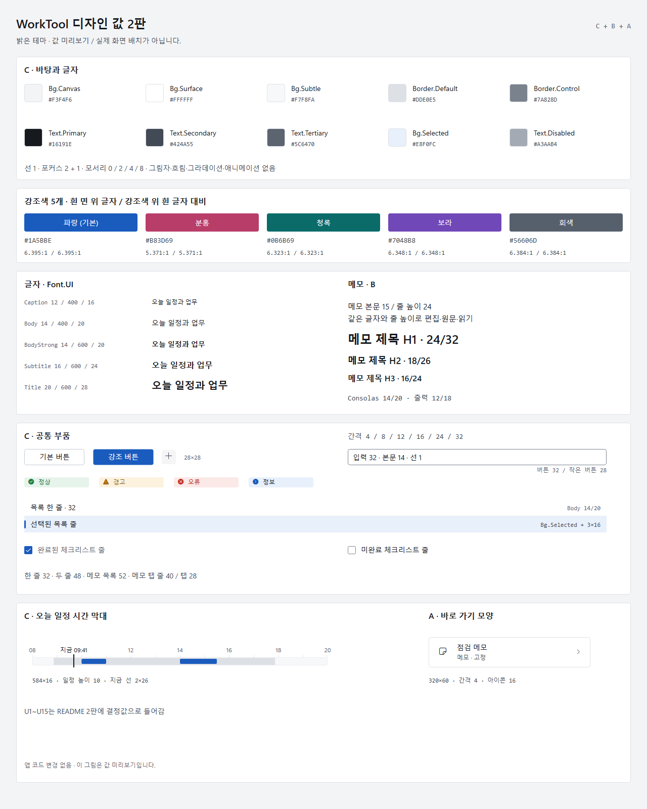

# WorkTool 디자인 값 2판

## 1. 2판 요약

- 밝은 테마의 색·간격·부품·왼쪽 메뉴는 C를 따릅니다.
- 타이틀바는 B, 일정 달력과 메모 목록·편집기·탭은 B, 홈 바로 가기 모양은 A입니다.
- UI 본문은 14, 메모 본문은 15/24입니다. 파스텔 바탕 대신 중성 바탕과 강조색 하나를 씁니다.
- 그림자·흐림·그라데이션·애니메이션과 둥근 안쪽 Clip은 쓰지 않습니다.
- 이 문서가 다음 구현의 값 기준입니다. U1~U15 결정값을 해당 절에 반영했습니다.

그림 경로: `apps/WorkTool/design/tokens-v2.png` · [SVG 원본](tokens-v2.svg).
그림은 값 미리보기이며 완성 화면이나 구현 완료 증거가 아닙니다.

**읽는 약속**

- 단위는 px = WPF DIP, 배율 100%입니다. 좌표는 바깥 테두리의 왼쪽 위 기준입니다. SVG의 `x+0.5`, `width-1`은 1px 선의 중심 좌표이므로 바깥 크기로 환산합니다.
- 색은 `B.*`, 크기·줄 높이는 `F.*`, 글꼴은 `Font.*` 이름으로 참조합니다. 이름은 2판 계약이며 현재 코드에 모두 있다는 뜻은 아닙니다.
- 읽어 확인한 현재 이름: `Font.UI`, `Font.Mono`, `Font.Icon`, `T.Body`, `Btn`, `Btn.Primary`, `Btn.Icon`, `Input`, `Row`, `Memo.Item`, `Memo.Tab`, `Check`, `Output`입니다. 현재 `B.Text` 등과 2판 이름을 연결하는 작업은 다음 구현 범위입니다.
- 출처 우선순위: U1~U15 결정값 → 이번 합성 규칙 → 시안 SVG의 실제 값입니다. 색은 C로 통일하고 B·A에서는 지정한 구조·치수만 가져옵니다.
- C = `c-console`, B = `b-productivity`, A = `a-native`의 README와 밝은 PNG·SVG입니다. 기준 그림 이름은 8절에 적습니다. 비공개 원본 자료를 저장소에 복사하지 않습니다.
- 1판 그림과 체험 파일은 과거 기록입니다. 파일을 보존하되 그 안의 값·배치를 2판의 빠진 값으로 사용하지 않습니다. 공통 원칙은 [apps/design.md](../../design.md)를 따릅니다.

## 2. 색

### 바탕·면·선

| 쓰임새 이름 | hex |
|---|---|
| `B.Bg.Canvas` 창·타이틀바·메뉴·상태 줄 | `#F3F4F6` |
| `B.Bg.Surface` 패널·목록·입력·편집 면 | `#FFFFFF` |
| `B.Bg.Subtle` 표 머리·코드·출력·편집 중인 줄 | `#F7F8FA` |
| `B.Bg.Raised` 툴팁·메뉴·대화상자 | `#FFFFFF` |
| `B.Border.Default` 패널·구분·찾기 칸 | `#DDE0E5` |
| `B.Border.Muted` 행 사이·패널 머리 아래·달력 격자 | `#ECEEF1` |
| `B.Border.Strong` 기본 버튼·분할 버튼 | `#C6CBD2` |
| `B.Border.Control` 입력·체크 상자 | `#7A828D` |

### 글자·강조·선택·조작 상태

| 쓰임새 이름 | hex |
|---|---|
| `B.Text.Primary` 본문·제목 | `#16191E` |
| `B.Text.Secondary` 라벨·보조 정보 | `#424A55` |
| `B.Text.Tertiary` 날짜·개수·덜 중요한 글자 | `#5C6470` |
| `B.Text.Disabled` 비활성 글자·아이콘 | `#A3AAB4` |
| `B.Accent` 기본 강조 채움·선 | `#1A5BBE` |
| `B.Accent.Text` 링크·태그 | `#1A5BBE` |
| `B.Accent.Hover` 기본 강조 버튼 올림 | `#174FA6` |
| `B.Accent.Pressed` 기본 강조 버튼 누름 | `#144690` |
| `B.OnAccent` 강조색 위 글자·아이콘 | `#FFFFFF` |
| `B.Bg.Selected` 선택 행·태그·오늘 칸 | `#E8F0FC` |
| `B.Overlay.Ink` 조작 덧칠 원색 | `#000000` |
| `B.Fill.Hover.Surface` 흰 면에 검정 4% | `#F5F5F5` |
| `B.Fill.Pressed.Surface` 흰 면에 검정 7% | `#EDEDED` |
| `B.Fill.Hover.Canvas` 창 바탕에 검정 4% | `#E9EAEC` |
| `B.Fill.Pressed.Canvas` 창 바탕에 검정 7% | `#E2E3E5` |
| `B.Fill.Selected.Nav` 창 바탕에 검정 6% | `#E4E5E7` |
| `B.Fill.Hover.Subtle` 옅은 면에 검정 4% | `#EDEEF0` |
| `B.Fill.Pressed.Subtle` 옅은 면에 검정 7% | `#E6E7E8` |

- 덧칠 환산은 채널마다 `round(바탕 × (1−비율))`입니다. 작은 조작 면에만 쓰고 완성된 단색 브러시로 둡니다.
- 비활성: 채움 `B.Bg.Canvas`, 선 `B.Border.Muted`, 글자·아이콘 `B.Text.Disabled`, 불투명도 1입니다. 이유는 툴팁으로 표시합니다.
- 선택은 `B.Bg.Selected`와 `B.Accent` 막대를 함께 씁니다. 왼쪽 메뉴만 `B.Fill.Selected.Nav`를 씁니다. 선택된 행에 올림 덧칠을 더하지 않습니다.
- 포커스: 바깥 2 `B.Text.Primary` + 안쪽 1 `B.Bg.Surface`, 요소에서 1 띄웁니다. 가장자리 행은 안쪽에 그립니다. 입력 중 외곽선은 C SVG처럼 2 `B.Accent`입니다.

### 상태 4색

아래 순서는 아이콘 / 글자 / 연한 바탕입니다.

- 정상: `B.Status.Success.Icon` `#1E7F47` / `B.Status.Success.Text` `#1A6E3E` / `B.Status.Success.Bg` `#E6F4EC`.
- 경고: `B.Status.Warning.Icon` `#A86500` / `B.Status.Warning.Text` `#8A5300` / `B.Status.Warning.Bg` `#FCF2DE`.
- 오류: `B.Status.Error.Icon` `#C42F29` / `B.Status.Error.Text` `#B42820` / `B.Status.Error.Bg` `#FBE9E7`.
- 정보: `B.Status.Info.Icon` = `B.Accent`, `B.Status.Info.Text` = `B.Text.Primary`, `B.Status.Info.Bg` = `B.Bg.Selected`.
- 예정·취소용 중립: `B.Status.Neutral.Icon` `#6B7380` / `B.Status.Neutral.Text` = `B.Text.Secondary` / `B.Status.Neutral.Bg` `#EEF0F3`. 상태 4색과 구별되는 보조 값입니다.
- 표·목록은 아이콘만 상태색이고 글자는 `B.Text.Primary`입니다. 배지에만 연한 상태 바탕을 쓰며 행 전체를 칠하지 않습니다. 근태 기호의 예외는 8절에 적습니다.

### 달력·시간 막대·코드

- `B.Cal.Work` = `B.Border.Default`: C SVG 시간 막대의 근무 구간.
- `B.Cal.Leave.Text` `#0B6B69`, `B.Cal.Leave.Bg` `#E2F1F0`: 휴가.
- `B.Cal.Overtime.Text` `#6A44B5`, `B.Cal.Overtime.Bg` `#F0ECFA`: 업무외.
- `B.Cal.Holiday` = `B.Status.Error.Text`: 공휴일·일요일.
- `B.Cal.Saturday` `#2457B0`: 토요일.
- `B.Cal.DayOff` `#F1F2F5`: 주말·휴무일 칸.
- `B.Code.Command` `#6639BA`, `B.Code.String` `#0A3069`, `B.Code.Keyword` `#C4243B`, `B.Code.Variable` `#953800`: C SVG에 있는 코드 색입니다.
- 코드 바탕은 `B.Bg.Subtle`, 주석은 `B.Text.Tertiary`, 나머지는 `B.Text.Primary`입니다. 이 목록에 없는 구문별 색은 추가하지 않습니다.
- 출장 등 C에 별도 색이 없는 종류는 글자로 구별합니다. 1판의 종류 색을 자동으로 가져오지 않습니다.

## 3. 강조색 5개

파스텔 7색 테마는 없앱니다. 바탕을 물들이지 않고 강조색만 고릅니다. 파랑·청록은 C, 분홍·보라·회색은 1판에 이미 있던 강조색에서 고릅니다.

| 이름·쓰임새 이름 | hex | 흰 면 위 글자 / 흰 글자 |
|---|---|---|
| 파랑·`B.Accent.Blue` (기본) | `#1A5BBE` | 6.395:1 / 6.395:1 |
| 분홍·`B.Accent.Pink` | `#B83D69` | 5.371:1 / 5.371:1 |
| 청록·`B.Accent.Teal` | `#0B6B69` | 6.323:1 / 6.323:1 |
| 보라·`B.Accent.Purple` | `#7048B8` | 6.348:1 / 6.348:1 |
| 회색·`B.Accent.Gray` | `#56606D` | 6.384:1 / 6.384:1 |

- 두 대비는 흰 면과 같은 색 두 개의 순서를 바꾼 값이므로 같습니다. 5개 모두 반올림 전 4.5:1 이상입니다.
- 계산: sRGB 채널 `s=채널/255`; `s≤0.04045`이면 `s/12.92`, 아니면 `((s+0.055)/1.055)^2.4`. 상대 휘도 `L=0.2126R+0.7152G+0.0722B`; 대비 `(큰 L+0.05)/(작은 L+0.05)`입니다.
- 선택한 색을 `B.Accent`, `B.Accent.Text`, 정보 아이콘에 연결합니다. 상태색·면·선·선택 바탕은 그대로입니다.
- C 파랑의 검정 혼합률은 올림 12.7172248485%, 누름 23.9851743347%로 추정합니다. 채널별 비율이 달라 RGB 최소제곱 `k=Σ(기본 채널×상태 채널)/Σ(기본 채널²)`, 검정 비율 `1−k`를 씁니다. 파랑은 C 원값을 유지하며 나머지는 `round(기본 채널×k)`입니다.
- 선택한 색의 아래 값을 `B.Accent.Hover`·`B.Accent.Pressed`에 연결합니다. 대비는 각 상태색의 흰 면 위 글자 / 그 색 위 흰 글자이며 모두 4.5:1 이상입니다.

| 색 | 올림 hex | 대비 | 누름 hex | 대비 |
|---|---|---|---|---|
| 파랑 | `#174FA6` | 7.762:1 / 7.762:1 | `#144690` | 9.097:1 / 9.097:1 |
| 분홍 | `#A1355C` | 6.605:1 / 6.605:1 | `#8C2E50` | 8.010:1 / 8.010:1 |
| 청록 | `#0A5D5C` | 7.683:1 / 7.683:1 | `#085150` | 9.118:1 / 9.118:1 |
| 보라 | `#623FA1` | 7.650:1 / 7.650:1 | `#55378C` | 9.085:1 / 9.085:1 |
| 회색 | `#4B545F` | 7.685:1 / 7.685:1 | `#414953` | 9.120:1 / 9.120:1 |

## 4. 글자 단계

- `Font.UI` = `Segoe UI Variable Text, Segoe UI, Malgun Gothic`.
- `Font.Mono` = `Consolas, Malgun Gothic`.
- `Font.Icon` = `Segoe Fluent Icons, Segoe MDL2 Assets`.
- 굵기는 Regular 400과 SemiBold 600입니다. 한글 600은 맑은 고딕에서 Bold로 보입니다. 12/600은 작은 달력의 오늘 날짜만 예외입니다. 시각·숫자 열은 고정폭 숫자입니다.

### UI 단계 — 크기 / 굵기 / 줄 높이

| 쓰임새 이름 | 값 |
|---|---|
| `F.Caption` 보조·개수·상태 줄 | 12 / 400 / 16 |
| `F.Body` 본문·입력·표·메뉴 | 14 / 400 / 20 |
| `F.BodyStrong` 패널 제목·선택 메뉴·날짜 | 14 / 600 / 20 |
| `F.Subtitle` 상세 제목·스크립트 이름 | 16 / 600 / 24 |
| `F.Title` 화면 제목 | 20 / 600 / 28 |
| `F.Code` 코드·값 (`Font.Mono`) | 14 / 400 / 20 |
| `F.Code.Dense` 출력·명령 (`Font.Mono`) | 12 / 400 / 18 |

C의 본문·본문 강조·코드 13은 모두 14로 올립니다. C의 `Text.Reading` 14/22는 별도 단계로 두지 않고 `F.Body` 14/20으로 합칩니다. 메모 본문은 다음 B 단계가 대신합니다. 따라서 UI 크기 단계는 **12 → 14 → 16 → 20**입니다. C의 메모 제목 22는 B의 24로 대체합니다.

### 메모 — B 단계

| 쓰임새 이름 | 값 |
|---|---|
| `F.Memo.Body` (`Font.UI`) | 15 / 400 / 24 |
| `F.Memo.H1` | 24 / 600 / 32 |
| `F.Memo.H2` | 18 / 600 / 26 |
| `F.Memo.H3` | 16 / 600 / 24 |
| `F.Memo.H4` | 15 / 600 / 24 |
| `F.Memo.H5` | 14 / 600 / 22 |
| `F.Memo.H6` (`B.Text.Secondary`) | 14 / 600 / 22 |
| `F.Memo.Code` (`Font.Mono`) | 14 / 400 / 20 |

- B의 메모 코드 13도 14로 올립니다. UI의 14와 메모의 15는 서로 다른 쓰임새입니다.
- 편집·원문·읽기의 본문 크기와 줄 높이는 같습니다. 코드 블록만 `Font.Mono`와 코드 단계를 씁니다.

## 5. 간격·모서리·선·높이

### 간격

- `F.Space.1` 4, `F.Space.2` 8, `F.Space.3` 12, `F.Space.4` 16, `F.Space.6` 24, `F.Space.8` 32.
- `F.Gap.InGroup` 4 또는 8은 부품별 지정값을 따릅니다. 버튼 사이 8, 개요 패널 사이 12입니다.
- `F.Padding.Panel` 12, `F.Padding.Screen` 16입니다. 편집 화면의 패널은 간격 0과 선 1로 맞붙입니다.
- SVG에 직접 있는 10(입력 글자 시작), 20·28(부품), 44(메모 본문 옆 여백), 52·60(행)은 일반 간격 단계가 아닌 해당 부품의 전용 값입니다.

### 모서리·선

- `F.Radius.Joined` 0: 맞붙은 패널·표의 선택 행·탭 아래.
- `F.Radius.Small` 2: 체크 상자·달력 칩·작은 막대.
- `F.Radius.Control` 4: 버튼·입력·패널·배지·B 메모 탭.
- `F.Radius.Overlay` 8: 메뉴·대화상자·펼침 패널.
- `F.Radius.SelectionBar` 1.5: C SVG의 폭 3인 선택 막대만의 예외입니다.
- `F.Line.Border` 1, `F.Line.Focus` 2, `F.Line.FocusInner` 1, `F.Line.Selection` 3, `F.Line.TabActive` 2.
- 선택 막대는 3×16, 현재 시각 선은 2×26입니다.
- 그림자·흐림·그라데이션·애니메이션은 모두 없음입니다. 상태는 즉시 바꿉니다. 둥근 안쪽 Clip·둥근 `ClipToBounds` 처리는 금지하며 테두리만 둥글립니다.

### 높이

- `F.Height.Control` 32: 기본·강조 버튼, 입력, 고르기 칸, 메뉴 항목, 표 행, 한 줄 목록.
- `F.Height.Compact` 28: 작은 찾기 칸·아이콘 버튼·달 이동·분할 버튼.
- `F.Height.Row2` 48: 두 줄 목록. 메모 목록은 B SVG의 `F.Height.MemoRow` 52가 예외입니다.
- `F.Height.PanelHeader` 40, `F.Height.StatusBar` 24, `F.Height.Tab` 36(C 공통)입니다.
- 메모는 B의 `F.Height.MemoTabBar` 40, `F.Height.MemoTab` 28을 씁니다. C의 탭 36과 혼용하지 않습니다.
- 높이는 배율·글자 확대 전 기준입니다. 텍스트 확대 시 글자가 잘리면 같은 비율로 늘립니다.

## 6. 창 짜임

### 타이틀바 — B

- `F.Chrome.Height` 32. 바탕 `B.Bg.Canvas`, 찾기 칸·출근 표시·시계는 두지 않습니다.
- 앱 표식은 `(12,8)`의 16×16, 모서리 4, `B.Accent` 바탕·`B.OnAccent` W입니다. W는 B SVG의 10/700인 표식 예외이며 UI 글자 단계가 아닙니다.
- 앱 이름 `WorkTool`: x=36, 기준선 y=20.3, `F.Caption`, `B.Text.Secondary`입니다.
- 오른쪽 창 버튼은 각각 46×32입니다. 최소화 x=`W−138`, 최대화/복원 x=`W−92`, 닫기 x=`W−46`, y=0입니다. 글리프 10, 중앙 x는 `W−115`, `W−69`, `W−23`, 기준선 y=21입니다.
- 창 버튼의 보통·올림·누름·비활성은 7절 아이콘 버튼의 Canvas 상태를 씁니다. 창 단추에 글자 라벨은 없습니다.

### 왼쪽 메뉴 — C

- `F.Nav.Width` 200, `F.Nav.CollapsedWidth` 48, 항목 높이 32, 묶음 이름 높이 24, 아이콘 16입니다.
- 펼쳤을 때 행 x=8, 폭 184, 글자 x=48, 아이콘 x=20입니다. 개수 오른쪽 끝 x=184, `F.Caption`·`B.Text.Tertiary`입니다.
- 묶음은 `일과`(홈·일정·근태), `작업`(메모·문서·업무·활성 작업)입니다. 묶음 이름은 `F.Caption`·`B.Text.Tertiary`, 선택 항목만 `F.BodyStrong`입니다.
- 메뉴 맨 위 첫 줄 높이는 40이며 접기 단추를 왼쪽에 둡니다. 단추 28×28, `GlobalNavButton E700` 16입니다. 앱 표식은 타이틀바에만 둡니다.
- 선택: 모서리 4의 `B.Fill.Selected.Nav`, 행 왼쪽에 3×16 `B.Accent`. 막대는 세로 중앙입니다. 올림·누름은 Canvas 상태입니다.
- 일정·활성 작업 개수는 C 위치에 둡니다. 근태 옆에는 시각 대신 `오늘 안 찍음`을 뜻하는 점 하나만 둡니다. 뜻은 툴팁에 둡니다.
- 맨 아래 도움말·설정은 펼침에서 가로 나란히 각 32×32(누르는 영역도 32), 사이 8, 왼쪽·아래 여백 12입니다. 접힘 폭 48에서는 세로로 쌓고 사이 4입니다. 글자·단축키 표시는 없으며 툴팁은 `도움말 (F1)`, `설정`입니다.
- 근태 점은 지름 6, `B.Status.Warning.Icon`입니다. 펼침에서는 개수 자리의 오른쪽 여백 12·세로 가운데, 접힘에서는 아이콘 오른쪽 위(+4, −4)입니다.

### 오른쪽·목록 사이드바

- `F.Sidebar.Schedule.Width` 308: C `schedule-light.svg`의 x=956부터 오른쪽 여백 16까지인 바깥 폭입니다.
- `F.Sidebar.Toc.Width` 220: C 메모 목차, 창 오른쪽에 붙입니다.
- `F.Sidebar.Workflows.Width` 280: C 업무 설명, 창 오른쪽에 붙입니다.
- `F.Sidebar.MemoList.Width` 280: B 메모 목록입니다. C의 목록 256을 쓰지 않습니다.
- 접기 단추는 28×28·글리프 16입니다. 오른쪽 사이드바는 제목 줄 왼쪽 끝의 `ChevronRight E76C`, 메모 목록은 제목 줄 오른쪽 끝의 `ChevronLeft E76B`입니다.
- 오른쪽 사이드바·메모 목록은 접히면 폭 28 레일(`B.Bg.Canvas`, 내용 쪽 선 1 `B.Border.Default`)입니다. 다시 열기 단추는 레일 맨 위·제목 줄 높이의 가운데, 28×28·글리프 16입니다. 일정 +는 제목 줄 오른쪽 끝이며 접기 단추와 간격 8 이상입니다.
- 홈에는 오른쪽 사이드바가 없습니다. 근태는 폭 308이며 이번 달 출근 일수·휴가·출장·초과근무(작업장·원격·이동)를 요약합니다. 행을 누르면 그 자리가 편집 폼으로 바뀝니다.

### 가장자리·단축키

- 개요 화면 가장자리 16, 패널 간격 12입니다. 목록·편집 화면은 붙이고 안쪽만 12를 둡니다. 메모 본문 옆 여백은 B의 44입니다.
- 상태 줄은 창 아래 24, `B.Bg.Canvas`, 위 선 1 `B.Border.Default`, 글자 `F.Caption`·`B.Text.Secondary`입니다.
- `Ctrl+Shift+B`: 일반 화면은 오른쪽 → 왼쪽 메뉴를 접고, 다음 누름부터 왼쪽 메뉴 → 오른쪽 순으로 엽니다. 대상이 없는 단계는 건너뜁니다.
- 메모는 목록 → 왼쪽 메뉴 → 왼쪽 메뉴 열기 → 목록 열기의 순환입니다. 오른쪽 목차는 자체 접기 버튼으로 따로 조절합니다. 이는 사용자 사양의 ‘메모는 목록’ 예외입니다.
- `Ctrl+K`는 찾기·명령입니다. 타이틀바에 찾기 칸을 되살리지 않습니다.
- 창 최소 크기는 1024×640입니다. 창 폭 1200 미만이면 오른쪽 사이드바가 레일로 접혀 시작하며, 열면 내용 위에 겹칩니다. 선 1 `B.Border.Default`, 그림자 없음입니다.

## 7. 공통 부품

### 버튼

- `Btn`: 높이 32, 좌우 여백 12, 아이콘 16, 아이콘↔글자 8, 모서리 4, 선 1 `B.Border.Strong`, 바탕 `B.Bg.Surface`, 글자 `F.Body`·`B.Text.Primary`입니다. 폭은 글자와 이 여백의 합입니다.
- `Btn.Primary`: 같은 크기, 선 없음, `B.Accent`와 `B.OnAccent`. 기본 파랑 올림·누름은 `B.Accent.Hover`·`B.Accent.Pressed`입니다. 화면당 하나입니다.
- `Btn.Icon`: 28×28, 아이콘 16, 중앙 정렬, 모서리 4, 글자 없음입니다. 입력 옆 파일 선택은 C SVG의 32×32 예외입니다. 창 버튼만 46×32·아이콘 10입니다.
- 기본·아이콘 버튼의 올림·누름은 2절에 등록한 Surface(흰 면)·Canvas(창 바탕)·Subtle(옅은 면) 상태색 중 해당 바탕의 짝을 씁니다. 아이콘은 보통 `B.Text.Secondary`, 눌러도 같은 색입니다. 포커스·비활성은 2절입니다.
- 아이콘만 있으면 이름을 툴팁에 씁니다. 단축키가 정해진 기능에만 괄호로 붙입니다.

### 입력칸·고르기 칸

- `Input`: 높이 32, 작은 목록 찾기만 28, 모서리 4, 선 1 `B.Border.Control`, 바탕 `B.Bg.Surface`, 본문 `F.Body`·`B.Text.Primary`입니다. 글자 시작은 왼쪽에서 10, 세로 중앙입니다.
- 찾기 아이콘은 14, 왼쪽 10; 찾기 글자는 왼쪽 32입니다. 예시 글자는 `B.Text.Tertiary`입니다.
- 올림은 기존 선을 유지하고, 입력 포커스는 2 `B.Accent`입니다. 오류는 선과 옆 오류 아이콘에 `B.Status.Error.Icon`, 이유는 툴팁입니다. 비활성은 2절입니다.
- 고르기 칸은 입력과 같은 높이·색입니다. 펼친 면은 `B.Bg.Raised`·1 `B.Border.Default`·모서리 8, 행 높이 32입니다.

### 칩 — 삭제 ✕ 포함

- C 메모 태그 칩은 높이 20, 좌우 여백 8, 모서리 4, `F.Caption`, `B.Bg.Selected`·`B.Accent.Text`입니다. 달력 칩은 8절의 높이 20·모서리 2를 씁니다.
- 조건 칩은 높이 24·모서리 4, `B.Bg.Subtle`·선 1 `B.Border.Default`, 글자 12/16입니다. 왼쪽 여백 8, 글자와 ✕ 사이 4, ✕는 `Cancel E711` 10·`B.Text.Secondary`, 오른쪽 끝 누르는 영역 20×24입니다. 폭은 왼쪽 8+글자 폭+간격 4+삭제 영역 20, 칩 사이·줄 사이 4입니다. 삭제를 누르면 그 조건만 해제합니다.
- 올림·누름은 Surface 조작색, 선택은 기존 선택색, 포커스·비활성은 2절입니다.
- 메모 목록 사이드바는 위에서 검색 줄(입력 높이 32, 오른쪽 필터·정렬 아이콘 단추 각 28) → 조건 칩 줄(넘치면 다음 줄) → 보기 고르기 단추 하나(현재 보기 이름+▾) → 메모 목록입니다. 보기 메뉴는 일반·고정·최근·보관·모두·저장한 보기·폴더입니다. 최근 메모 별도 칸은 없습니다.

### 목록 줄·탭

- `Row`: 한 줄 높이 32, 두 줄 48, 좌우 12, 바탕 `B.Bg.Surface`, 첫 줄 `F.Body`, 둘째 줄 `F.Caption`·`B.Text.Tertiary`입니다. 행 구분선은 1 `B.Border.Muted`입니다.
- 선택은 2절의 선택 바탕과 3×16 막대, 올림·누름은 Surface 조작색, 포커스·비활성은 2절입니다. 상태색으로 행을 채우지 않습니다.
- C 공통 탭은 높이 36, 바탕 `B.Bg.Canvas`; 선택은 `B.Bg.Surface`와 위 선 2 `B.Accent`입니다. 메모 탭에는 적용하지 않습니다.
- B 메모 탭 줄은 높이 40·아래 선 1 `B.Border.Muted`, 탭은 높이 28·모서리 4입니다. 선택 탭의 옅은 면은 `B.Fill.Hover.Surface`, 아래 활성 선은 2 `B.Accent`입니다. 선택되지 않은 탭은 투명, 글자 `B.Text.Secondary`입니다.
- 메모 탭 폭은 `min(240, max(120, 글자 폭+12+24))`이며 넘친 제목은 말줄임입니다. 글자 시작 왼쪽 12, 닫기 영역 폭 24·글리프 10·중심은 오른쪽에서 12, 활성 선은 좌우 8을 뺀 폭입니다. 첫 탭은 줄 왼쪽에서 9, 위 6입니다.
- 탭 올림·누름은 Surface 조작색, 포커스·비활성은 2절입니다. 닫기 아이콘은 `Cancel E711`입니다.

### 툴팁

- `ToolTip`: `B.Bg.Surface`, 선 1 `B.Border.Default`, 글자 `F.Caption`·`B.Text.Primary`, 그림자·애니메이션 없음입니다. 비활성 이유와 잘린 글자 전체도 이 부품을 씁니다.
- 툴팁 글자 12/16, 여백 가로 8·세로 6, 모서리 4, 최대 폭 320, 나타나기 400ms, 툴팁 사이 이동 100ms입니다.

### 체크리스트 줄

- `Checklist.Row`: C 체크리스트의 높이 28, 체크 상자 16×16, 모서리 2, 상자↔글자 10입니다. 한 줄 텍스트는 `F.Body`; 메모 안에서는 `F.Memo.Body`입니다.
- 미완료: `B.Bg.Surface`·선 1 `B.Border.Control`, 글자 `B.Text.Primary`. 완료: `B.Accent` 채움·12 `CheckMark E73E`·`B.OnAccent`, 글자는 `B.Text.Tertiary`로 흐리게만 표시하며 취소선은 없습니다. 별도 투명도는 쓰지 않습니다.
- 올림·누름은 Surface 조작색, 키보드 포커스는 2절, 비활성은 2절입니다. 편집 중인 줄은 `B.Bg.Subtle`입니다.
- 일정 루틴·업무 체크리스트·일일 업무가 같은 부품을 씁니다. 체크한 기록은 보존하고, 완료 또는 날짜 변경 뒤 목록에서 보관합니다. 연속 달성 표시는 없습니다.

### 작은 달력

- 날짜는 12/400, 오늘은 12/600 흰 글자·강조색 원 지름 22, 요일은 12·`B.Text.Tertiary`입니다. 보통 면 `B.Bg.Surface`, 쉬는 날 `B.Cal.DayOff`, 선택 선 1 `B.Accent`를 씁니다. 올림·누름은 Surface 조작색, 포커스·비활성은 2절입니다.
- ✔/X의 뜻·색은 8절 일정과 같습니다. 별도 근태 표를 만들지 않습니다.
- 7열×6주 고정, 칸 36×32, 머리 줄 32(월 이름 16/600, ‹ › 단추 28×28), 요일 줄 20, 안쪽 여백 12로 전체 276×268입니다. 근태 기호 10을 날짜 아래 가운데에 둡니다. 홈 오른쪽 칸 맨 위에 놓습니다.

### 시간 막대 — C 홈 SVG

- `Timeline`: 바깥 584×16, 모서리 2, `B.Bg.Subtle`·선 1 `B.Border.Muted`입니다. 업무시간 시작 1시간 전~끝 2시간 뒤(기본 08~20)를 같은 비율로 놓습니다.
- 근무 구간은 높이 14, 막대 안 위 1, `B.Cal.Work`; 일정 막대는 높이 10, 위 3, 모서리 2, `B.Accent`입니다. 알람은 12 글리프·`B.Accent`입니다.
- 지금 선은 2×26, 막대 위 6부터 아래 4까지, `B.Text.Primary`입니다. 위에는 `지금 HH:mm`, `F.Caption`·`B.Text.Primary`를 중앙 정렬합니다.
- 눈금은 폭 1·높이 4, 막대 위 4부터, `B.Border.Default`입니다. 숫자는 막대 위 기준선 −10.18, `F.Caption`·`B.Text.Tertiary`입니다. SVG처럼 08·12·14·16·18·20을 표시합니다.
- 범위 시작·끝을 분 단위 `S`, `E`로 두고 위치 `x=막대 왼쪽+584×(분−S)/(E−S)`; 구간 폭도 같은 비율입니다. 업무시간은 설정에서 읽고 C 예시 시각을 고정값으로 저장하지 않습니다. 지금 선만 1분마다 갱신합니다.
- 일정 막대는 올리면 상세 툴팁, 누르면 편집입니다. 올림·누름은 해당 작은 막대에 C의 검정 4%·7%를 합성합니다. 포커스는 2절입니다. 범위 밖 일정은 끝에 붙이고 해당 끝에 작은 ‹ ›를 표시합니다. 겹치면 막대 높이 10·사이 2로 최대 2줄, 그 이상은 오른쪽 끝에 `+n`입니다.

## 8. 화면별 값

### 공통

- 기준 그림은 1280×800입니다. 창 폭·높이는 `W`, `H`, 펼친 메뉴 오른쪽은 `N=200`입니다. 접힌 메뉴는 `N=48`입니다.
- 본문 시작 y=32, 끝 y=`H−24`입니다. C의 위 기준 좌표는 타이틀바 40→32만큼 8을 빼고, 아래에 붙는 패널은 끝 y=`H−24`를 유지해 높이를 늘립니다.
- 개요 화면 안쪽 왼쪽은 `N+16`, 오른쪽은 `W−16`입니다. 홈·일정의 화면 제목은 `F.Title`입니다. 편집 화면은 패널 머리가 제목을 대신합니다.
- 모든 화면은 불러오는 중·비어 있음·오류·정상을 구분합니다. 새 설명 줄은 추가하지 않고 10절 문구와 툴팁을 씁니다.

### 홈

기준 그림: C `home-light.png`, 바로 가기 부분만 A `home-light.png`.

- 오늘 일정 면은 제목 줄 40+막대 영역 56+안쪽 여백 12입니다. C 시간 막대·지금 시각을 표시하며 아래 표는 없습니다. 제목 x=12, 개수는 제목 오른쪽, `일정 열기`는 오른쪽 12입니다.
- 작은 달력은 근태·다가오는 휴무일 칸을 대신하며 7절 치수와 근태 기호를 씁니다.
- 바로 가기는 A의 한 줄 카드입니다. 바깥 폭 320·높이 60, 카드 사이 4, 모서리 4, `B.Bg.Surface`·1 `B.Border.Default`입니다.
- 카드 왼쪽 아이콘은 16·중심 `(28,30)`, 제목은 `(56,21)` 중심선·`F.Body`, 종류 정보는 `(56,40)` 중심선·`F.Caption`·`B.Text.Secondary`, 오른쪽 화살표는 12·중심 `(296,30)`입니다. 제목은 주 콘텐츠이고 종류 정보만 남깁니다. 사용법 설명은 넣지 않습니다.
- 카드 상태는 목록 줄과 같습니다. 최근 30일 연 횟수 내림차순, `홈에 고정`한 항목이 먼저입니다. 같은 순위면 최근 연 시각 → 제목 순입니다. 메모·문서·업무의 등록 목록을 통해 받습니다.
- 최근 메모·상태 타일·최근 업무 실행·퇴근 기록 버튼·근태 요약·다가오는 휴무일 목록은 제거합니다.
- 홈은 두 칸입니다. 왼쪽은 나머지 폭으로 오늘 일정 면 → 바로 가기(320×60 타일, 2열, 최대 8개), 오른쪽은 폭 300으로 작은 달력 → 오늘 루틴 체크리스트입니다. 오른쪽 사이드바는 없습니다.

### 일정

기준 그림: B `schedule-light.png`. 색과 오른쪽 폭은 C, 일정 최대 개수·근태 기호·루틴은 사용자 결정입니다.

- 달력은 B의 7열×6행, 기준 칸 104×100, 전체 728×600입니다. 펼친 메뉴에서 달력 왼쪽은 `N+16=216`, 위는 144, 오른쪽은 944입니다. 칸 폭은 `달력 폭/7`, 높이는 기준 100입니다.
- 달력 위 요일 글자는 `F.Caption`, 일요일 `B.Cal.Holiday`, 토요일 `B.Cal.Saturday`, 나머지 `B.Text.Tertiary`입니다. 날짜는 B의 13 대신 `F.Body` 14, 오늘 날짜는 600입니다.
- 날짜 중심 x는 칸 왼쪽+18, 원본 기준선 y는 칸 위+20.7입니다. 오늘은 지름 24 `B.Accent` 원과 `B.OnAccent` 날짜입니다. 월 밖 날짜는 `B.Text.Tertiary`, 쉬는 날 칸은 `B.Cal.DayOff`입니다.
- 오늘 칸은 `B.Bg.Selected`, 선택 외곽선은 1 `B.Accent`, 격자는 1 `B.Border.Muted`, 칸 모서리는 0입니다. 올림·누름은 Surface 조작색, 포커스는 2절입니다.
- 칸 안 일정은 최대 2개입니다. 칩은 공휴일 이름 줄 아래, 왼쪽 4, 높이 20, 다음 줄 간격 2, 폭 `칸 폭−12`, 모서리 2, 글자 `F.Caption`입니다. B의 항목 자리와 C 모서리를 합칩니다. 세 번째 자리는 `+n` 한 줄이며 루틴은 칸에 넣지 않습니다.
- 보통 일정은 `B.Bg.Subtle`·`B.Text.Primary`, 휴가는 `B.Cal.Leave.Bg`·`B.Cal.Leave.Text`, 업무외는 `B.Cal.Overtime.Bg`·`B.Cal.Overtime.Text`입니다. 공휴일 이름은 날짜 줄 아래 한 줄, 12·`B.Status.Error.Text`이며 넘치면 말줄임입니다.
- 근태는 업무시간 안 근무 ✔=`B.Status.Success.Icon`, 업무시간 밖 근무 ✔=`B.Text.Tertiary`, 쉬는 날 X=`B.Status.Error.Icon`입니다. 쉬는 날에 기록이 있거나 `근무일로` 바꾸면 ✔가 우선입니다. 쉬는 이유는 툴팁입니다.
- 날짜는 왼쪽 위, 근태 기호는 12·칸 오른쪽 위(오른쪽 6·위 6)입니다. B의 출근 시각 글자는 없애고 기호로 대신합니다.
- 오른쪽은 폭 308, 달력과 사이 12, x=`W−324=956`, 위 88, 아래 `H−40`입니다. 바탕 `B.Bg.Surface`·선 1 `B.Border.Default`·모서리 4입니다.
- 날짜 제목은 `F.Subtitle`입니다. 제목 줄 왼쪽 끝은 접기 단추, 오른쪽 끝은 `Add E710` 단추 하나(28×28, 글자 없음)이며 둘 사이 8 이상입니다. 입력칸은 없습니다.
- 날짜 아래에는 고른 날 일정과 해당 날짜 루틴 체크리스트만 둡니다. 출퇴근 요약·월 요약·휴무일 목록·지난주 업무외 구역은 옮기지 않습니다. 루틴은 7절 부품, ‘1시간마다’는 다음 차례만 표시합니다.

### 근태

기준 그림: 없음. C 공통 부품만 적용합니다.

- 표: 머리·행 높이 32, 머리 `F.BodyStrong`·`B.Bg.Subtle`, 본문 `F.Body`·`B.Bg.Surface`, 좌우 셀 여백 12, 아래 선 1 `B.Border.Muted`, 선택은 2절입니다.
- 입력 폼: 7절 `Input`, 라벨 `F.Body`·`B.Text.Secondary`, 폼 안쪽 12, 필드 사이 12입니다. 버튼은 `Btn`·`Btn.Primary`·`Btn.Icon`만 씁니다.
- 출근·퇴근·휴가·출장·업무외시간 용어를 씁니다. 초과근무는 작업장·원격·이동을 나눠 봅니다. 새 종류 색·요약 타일은 추가하지 않습니다. 월 보고 복사 아이콘은 보류 중이면 숨깁니다.
- 위 줄 왼쪽은 월 이동(`‹ 2026년 10월 ›`), 오른쪽은 `출근`·`퇴근`·`업무외 시작`(누르면 `업무외 끝`)·직접 입력 `Add E710`·월 보고 `Copy E8C8`입니다. 복사는 보류 중이면 숨깁니다.
- 표 열·폭: 날짜 90 · 종류 80 · 시작 64 · 끝 64 · 장소 72(작업장·원격·—) · 이동 56 · 시간 64(계산) · 메모(나머지)입니다. 줄 높이는 32입니다.
- 사이드바 편집 폼은 날짜 → 종류 → 시작 → 끝(+다음 날) → 장소 → 이동(가는 길 분·오는 길 분) → 메모 순이며 아래에 `저장`·`취소`를 둡니다. 오른쪽 요약·폭 308은 6절입니다.

### 메모

기준 그림: B `memo-light.png`; 오른쪽 목차만 C `memo-light.png`.

- 목록은 x=`N`, y=32, 폭 280, 아래 `H−24`입니다. 편집기는 x=`N+280=480`부터 오른쪽 목차 왼쪽 `W−220=1060`까지 남는 폭 580입니다. 사이 선은 1 `B.Border.Default`, 패널 간격 0입니다.
- 목록 제목은 x=`N+16`, B 기준선 y=61.8, `F.Subtitle`; 개수는 `F.Body`·`B.Text.Tertiary`입니다. 목록 검색 줄은 x=`N+12`, y=80, 입력 높이 32·오른쪽 필터·정렬 단추 각 28입니다. 제거하는 찾기 줄은 전역 위쪽 줄이며 목록 검색은 남깁니다.
- 목록은 검색 줄·조건 칩·보기 고르기 단추 아래에서 시작합니다. 행 높이 52, 선택 면은 x=`N+8`, 폭 264, 모서리 4입니다. 제목 x=`N+24`, 기준선 `행 위+23`, `F.Body`; 보조 기준선 `행 위+40.3`, `F.Caption`입니다. 선택 막대 3×16은 x=`N+8`, 세로 중앙입니다.
- 검색창 하나·조건 칩·정렬·저장한 보기를 씁니다. 칩과 검색식은 같은 조건입니다. 기본 정렬은 고정→수정일 최신→제목, 검색 시 제목 완전 일치→제목 포함→본문 포함입니다. 검색 줄 → 조건 칩 → 보기 고르기 → 목록의 배치·치수는 7절입니다.
- 탭 줄은 편집기 위 y=32부터 40입니다. 첫 탭 x=489·y=38, 가변 폭 120~240·높이 28, 활성 선 y=70·높이 2입니다. 나머지는 7절 B 탭을 따릅니다.
- 본문 최대 폭 680, 편집 영역 좌우 여백 44입니다. 실제 본문 폭=`min(680, 편집기 폭−88)`이므로 기준 창에서는 492입니다. 가운데 정렬합니다. 오른쪽 목차를 닫아도 최대 폭 680을 넘기지 않습니다.
- B 제목 기준선 y=132.6, 태그·수정일 기준선 y=160.3, 첫 본문 기준선 y=197.4입니다. 제목·본문 단계는 4절입니다. 코드 면은 폭을 본문에 맞추고 안쪽 좌우 16·모서리 4·`B.Bg.Subtle`·선 1 `B.Border.Muted`입니다.
- 보기 버튼은 32×32 아이콘 하나로 현재 상태를 나타냅니다. 편집 `Edit E70F` → 원문 `Code E943` → 읽기 `ReadingMode E736` → 편집이며 클릭·`Ctrl+E`가 같은 순환입니다. 툴팁은 `편집 보기 (Ctrl+E)`·`원문 보기 (Ctrl+E)`·`읽기 보기 (Ctrl+E)`입니다. 열린 탭마다 기억합니다. 세 글자 버튼 묶음은 없습니다.
- 보기 단추는 편집기 탭 줄 오른쪽 끝, 목차 접기 단추 왼쪽에 둡니다.
- 목차는 x=`W−220`, y=32, 폭 220, 아래 `H−24`입니다. 머리 높이 36·`B.Bg.Canvas`, 제목 `F.BodyStrong`, 왼쪽 12, 아래 선 1 `B.Border.Default`입니다.
- C 목차 항목은 높이 28, 좌우 8, 들여쓰기 26(선택 면 왼쪽 기준), 선택 `B.Bg.Selected`·모서리 4·왼쪽 3×16 막대입니다. 제목은 `F.Body`, 오른쪽에서 12 띄웁니다. 목차 밖의 긴 연결 설명·속성은 툴팁·새 창으로 보냅니다.
- 목록과 목차를 각각 접을 수 있습니다. 위쪽 출근 표시·전역 찾기 줄은 없습니다. 메모 안 찾기·바꾸기 기능을 새로 없애는 지시는 아닙니다.

### 업무

기준 그림: C `workflows-light.png`.

- 목록 x=`N`, 폭 240, y=32부터 `H−24`; 가운데 x=`N+240=440`, 오른쪽 사이드바 왼쪽 `W−280=1000`까지입니다. 가운데 최소 폭 360, 패널 간격 0·선 1입니다.
- 목록 머리 높이 40, 안쪽 12, 찾기 x=`N+12`, y=72, 폭 216·높이 28입니다. 저장한 업무·폴더·스크립트 행은 C SVG의 높이 28, 들여쓰기 16 단위입니다. 일반 목록 32와 다른 트리 전용 값입니다.
- 가운데 좌우 여백 16, 스크립트 이름 `Font.Mono`·`F.Subtitle` 600입니다. 이름 밑 사용법 설명 줄은 제거하고 경로·상세 설명은 툴팁으로 보냅니다.
- C의 폼 기준: 입력 시작 x=`가운데 왼쪽+169`, 오른쪽 여백 16, 입력 높이 32, 행 시작 y=130·174·218·262·306입니다. 행 간격 44, 라벨 시작 x=`가운데 왼쪽+17`, 값 `F.Code`입니다. 32×32 파일 선택 버튼은 입력 오른쪽에 붙고 간격 8입니다.
- 실행 줄 위 y=356, 실행 버튼 높이 32, 버튼 간격 8입니다. 실행 위치 분할 버튼은 높이 28, 선택 면은 `B.Bg.Surface`·선 1 `B.Border.Strong`입니다. 실행 명령은 `F.Code.Dense`입니다.
- 결과 머리 기준 y=428, 출력 면 위 y=468, 왼쪽 `가운데 왼쪽+17`, 오른쪽 여백 16, 아래 `H−40`입니다. 출력 `Font.Mono`·`F.Code.Dense`, 줄 높이 18, 안쪽 12·모서리 4·`B.Bg.Subtle`·선 1 `B.Border.Default`입니다. 표로 볼 결과는 32 높이 표 부품입니다.
- 오른쪽 폭 280, 머리 높이 40, 안쪽 16입니다. 간략 결과·최근 실행만 남기고 긴 가이드는 새 창으로 엽니다. 체크리스트는 7절 공통 부품을 씁니다. 오른쪽을 접을 수 있습니다.

## 9. 아이콘 표

`Font.Icon`만 씁니다. 아래 이름은 쓰임새 이름과 글리프 이름입니다. 메뉴·버튼 16, 목록 안 14, 작은 표시 12, 창 버튼 10이 기본이며 부품별 예외가 우선입니다. 글리프가 없는 글꼴을 내려받지 않습니다.

| 쓰임새·이름 | 코드 포인트 |
|---|---|
| 메뉴 접기·GlobalNavButton | `E700` |
| 홈·Home | `E80F` |
| 일정·Calendar | `E787` |
| 근태·Recent | `E823` |
| 메모·EditNote | `E70B` |
| 문서·Folder | `E8B7` |
| 업무·CommandPrompt | `E756` |
| 활성 작업·TaskView | `E7C4` |
| 도움말·Help | `E897` |
| 설정·Settings | `E713` |
| 새로 만들기·Add | `E710` |
| 닫기·칩 삭제·근태 X·Cancel | `E711` |
| 편집 보기·Edit | `E70F` |
| 원문 보기·Code | `E943` |
| 읽기 보기·ReadingMode | `E736` |
| 찾기·Search | `E721` |
| 필터·Filter | `E71C` |
| 고정·Pin | `E718` |
| 저장·Save | `E74E` |
| 삭제·Delete | `E74D` |
| 실행·Play | `E768` |
| 복사·근태 월 보고·Copy | `E8C8` |
| 파일 선택·OpenLocal | `E8DA` |
| 새로 고침·Refresh | `E72C` |
| 파일·Page | `E8A5` |
| 연결·Link | `E71B` |
| 즐겨찾기·FavoriteStar | `E734` |
| 이전 달·메모 목록 접기·오른쪽 사이드바 열기·ChevronLeft | `E76B` |
| 다음 달·오른쪽 사이드바 접기·메모 목록 열기·ChevronRight | `E76C` |
| 트리 펼침·ChevronDown | `E70D` |
| 더 보기·More | `E712` |
| 알람·Ringer | `EA8F` |
| 반복·RepeatAll | `E8EE` |
| 체크·근태 ✔·CheckMark | `E73E` |
| 정상·CompletedSolid | `EC61` |
| 경고·Warning | `E814` |
| 오류·StatusErrorFull | `EB90` |
| 정보·InfoSolid | `F167` |
| 예정·StatusCircleRing | `EA3A` |
| 취소·Stop | `E71A` |
| 최소화·ChromeMinimize | `E921` |
| 최대화·ChromeMaximize | `E922` |
| 복원·ChromeRestore | `E923` |
| 창 닫기·ChromeClose | `E8BB` |

새 아이콘이 필요하면 이 표를 먼저 결정합니다. ✔/X는 문서에서 뜻을 나타내는 문자이고 구현에서는 표의 시스템 글리프를 씁니다. 앱 표식 W는 글리프 아이콘이 아닙니다.

## 10. 문구 원칙·바꿀 말

- 제목·버튼 밑에 사용법 설명 줄을 두지 않습니다. 긴 가이드는 새 창, 짧은 상세·비활성 이유·잘린 값은 툴팁입니다.
- 빈 화면 안내는 한 줄입니다: 홈·일정 `일정이 없습니다.`, 메모 `메모가 없습니다.`, 업무 `업무가 없습니다.`, 근태 `기록이 없습니다.`. 기존 새로 만들기 명령은 같은 이름을 씁니다.
- 표준 용어는 생성일·수정일·저장·삭제·편집·새로 만들기입니다. 버튼·라벨에는 마침표를 쓰지 않습니다. 문장인 툴팁은 한 문장으로 씁니다.
- 바로 가기 카드의 둘째 줄은 대상 종류·위치 정보이며 사용법 설명을 넣는 자리가 아닙니다.

| 찾은 말 | 바꿀 말 |
|---|---|
| 만듦 | 생성일 |
| 고침 | 수정일 |
| 만든 날 | 생성일 |
| 고친 날 | 수정일 |
| 고친 날짜 | 수정일 |
| 최근 고친 순 | 수정일 최신순 |
| 최근 고친 순서 | 수정일 최신순 |
| 메모 고치기 | 메모 편집 |
| 기록 고치기 | 기록 편집 |
| 이름으로 거르기 | 이름으로 필터링 |
| 새 메모 | 새로 만들기 |

11개 표현입니다. `만듦·고침·최근 고친 순·기록 고치기`는 C·B·A SVG에서, `만든 날·고친 날`은 현재 `addons/memo/Memo.psm1:277`, `고친 날짜`는 `addons/docs/Docs.psm1:593`, `메모 고치기·이름으로 거르기`는 WPF README에서 확인했습니다. 경로는 `apps/WorkTool/wpf/` 기준입니다. `새 메모`는 현재 코드·1판 문서·시안에 있습니다. 문장 속 일반 동사까지 일괄 치환하는 목록은 아닙니다.

## 11. 어두운 테마

나중에(2단계)

## 12. 1판에서 바뀐 것

- 파스텔 7색과 바탕 틴트·창 투명도 예시를 없애고 중성 밝은 면·강조색 5개로 바꿉니다. 1판의 어두운 테마 예시 값은 제거합니다.
- 기본 강조는 C 파랑, 상태는 C 정상·경고·오류·정보와 중립 보조값입니다. 1판 근태 종류 색·콜아웃·구문별 색·다이어그램 색 중 2절에 없는 값은 2판 확정값이 아닙니다.
- 제목 26 Bold·보조 12.5를 없앱니다. UI 12/14/16/20, 메모 15/24 본문과 B 제목 단계로 바꿉니다. C의 13은 14, C의 별도 Reading은 Body로 합칩니다.
- 타이틀바 32, 메뉴 200/48, 기본 컨트롤 32·작은 컨트롤 28, 한 줄 32·두 줄 48·메모 52, 패널 모서리 4·작은 것 2·떠 있는 면 8로 바꿉니다. 1판 카드 12·입력 8·끝까지 둥근 태그는 없앱니다.
- 메뉴 아이콘 20을 16으로 바꾸고 묶음·개수를 씁니다. 하단 도움말·설정은 각 32×32, 펼침에서는 가로·접힘에서는 세로로 둡니다. 메뉴 접기는 맨 위 40 줄, 근태 점은 지름 6입니다.
- 홈의 일정 표·근태 요약·다가오는 휴무일 목록·최근 메모·최근 업무 실행·상태 타일·퇴근 기록 버튼을 제거합니다. 왼쪽 오늘 일정·바로 가기 2열, 오른쪽 폭 300의 작은 달력·루틴으로 나눕니다.
- 일정은 B 달력·최대 일정 2개·근태 기호 12입니다. 출근 시각 글자는 없애고 공휴일 이름을 날짜 줄 아래로 옮깁니다. 오른쪽은 선택 날짜 일정·루틴과 + 아이콘 하나입니다.
- 메모는 B 목록·편집기·탭과 C 목차입니다. 전역 찾기 줄·출근 표시·세 보기 글자 버튼을 제거합니다. 목록·목차를 각각 접습니다.
- 업무는 C의 맞붙은 세 칸, 간략 오른쪽 패널·별도 가이드 창입니다. 근태는 월 이동·기록 버튼, 8열 표, 폭 308 요약·편집 폼을 씁니다. 월 보고 복사는 보류 중이면 숨깁니다.
- 모든 그림자·흐림·그라데이션·애니메이션·둥근 안쪽 Clip을 제거합니다. 1판의 그림·체험 파일은 지우거나 다시 만들지 않았습니다.
- 추가 강조색 4개의 올림·누름과 메모 H4~H6를 정했습니다. 사이드바는 폭 28 레일, 최소 창 1024×640·접힘 기준 1200입니다.
- 조건 칩 24·삭제 영역 20×24, 메모 탭 폭 120~240, 툴팁 400/100ms, 보기 단추 32×32·읽기 `ReadingMode E736`을 씁니다.
- 작은 달력은 276×268·날짜 12(오늘 600), 시간 막대는 업무시간 기준 범위·겹침 2줄입니다. 체크리스트 완료 줄은 `B.Text.Tertiary`만 쓰며 취소선을 없앱니다.
- 현재 코드·검사·묶음 파일은 이번에 바꾸지 않았습니다. 이 문서는 목표 값이며 앱 반영·성능·화면 배율 시험을 완료했다는 뜻이 아닙니다.

결정됨(2026-10-26)
