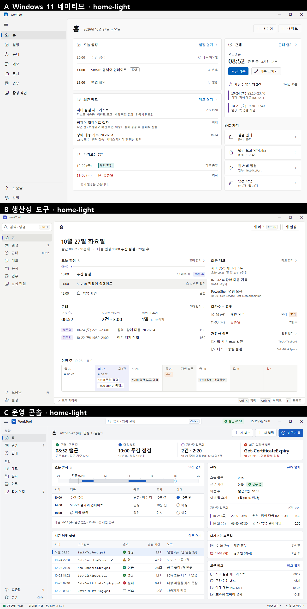
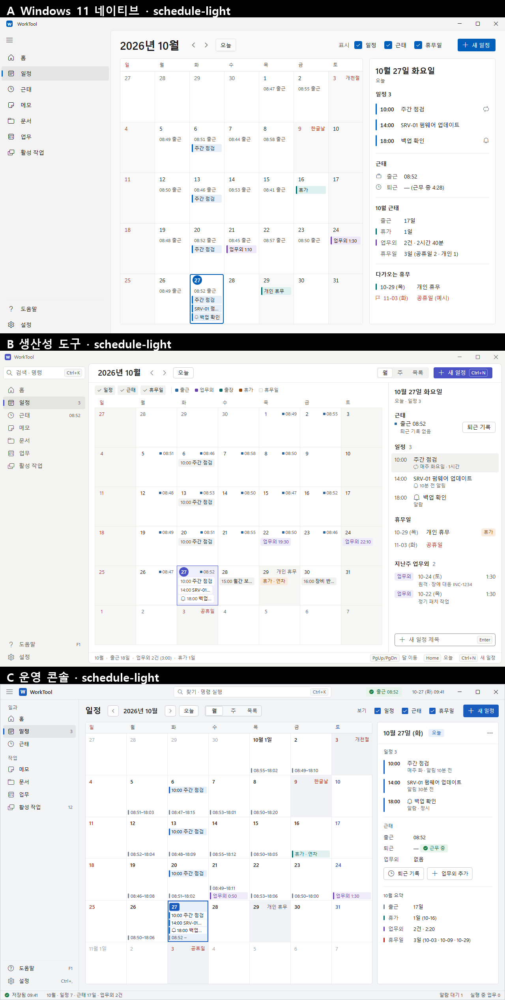
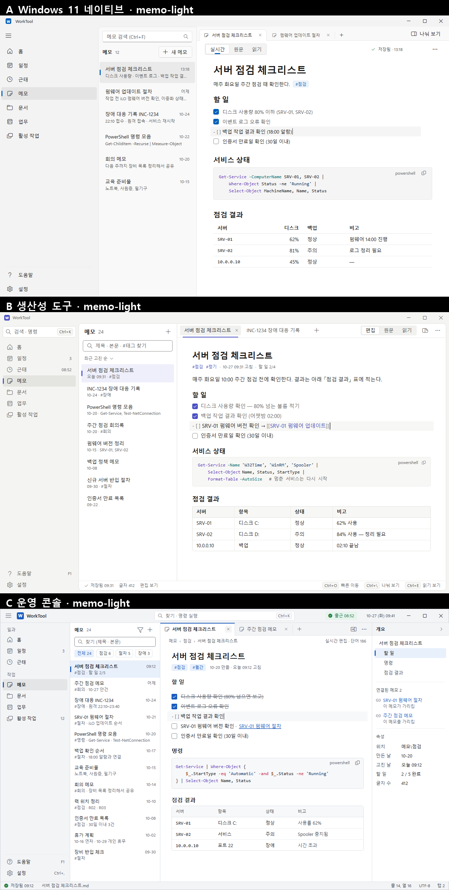
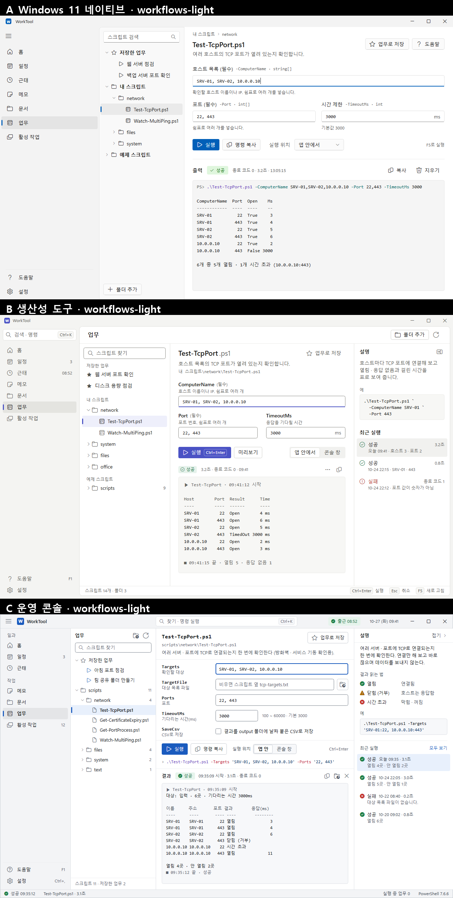
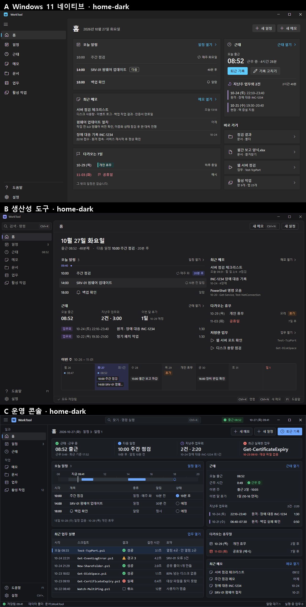

# WorkTool 디자인 시안 A · B · C

디자인 전면 개편 시안 셋입니다. 고르면 고른 것만 `main`에 남기고 이 브랜치(`design-candidates`)는 정리합니다.

- 모든 화면은 1280 × 800, 가짜 내용입니다(세 시안이 같은 내용).
- 글꼴은 지금과 같습니다: UI `Segoe UI Variable Text · Segoe UI · 맑은 고딕`, 코드 `Consolas · 맑은 고딕`.
- 그림자 · 흐림 · 애니메이션은 쓰지 않습니다(소프트웨어 렌더링에서 느려짐).
- 비교 그림은 위에서부터 **A · B · C** 순서입니다.

## 세 방향 한 줄씩

- **A. Windows 11 네이티브** — Windows 설정 앱처럼 익숙하고 믿음직합니다. 개성은 약합니다. → [자세히](a-native/README.md)
- **B. 생산성 도구** — 조용한 바탕, 글이 주인공. 메모가 가장 편합니다. 아래 상태 줄에 단축키, Ctrl+K 명령 팔레트. → [자세히](b-productivity/README.md)
- **C. 운영 콘솔** — 홈 한 화면에 근태 · 일정 · 업무 결과 · 휴무일 · 메모. 상태 표시(성공 · 경고 · 실패)가 앱 전체에서 같습니다. 본문 글자 13. → [자세히](c-console/README.md)

## 홈

## 일정 (달력에 근태 · 휴무일 표시)

## 메모

## 업무

## 홈 · 어두운 테마

B의 명령 팔레트(Ctrl+K) 화면: [b-productivity/palette-dark.png](b-productivity/palette-dark.png)

## 답하는 법

채팅에 번호와 글자만 보내면 됩니다. 예: `1C 2B 3C 4C 5-14 6예 7아니요 8 홈 위쪽 타일이 너무 많음`

1. 홈: A / B / C
2. 메모: A / B / C
3. 일정: A / B / C
4. 업무: A / B / C
5. 본문 글자 크기: 13 / 14 (지금은 14)
6. 어두운 테마가 필요한지: 예 / 아니요
7. 지금의 파스텔 7색 테마를 남길지: 예 / 아니요 (아니요면 강조색 몇 개 고르기로 줄입니다)
8. 그 밖에 걸리는 것 (자유롭게, 화면 이름과 같이)

제안: **1C 2B 3C 4C 5-14** — 상태가 한눈에 보이는 C를 바탕으로, 메모만 B처럼 조용하게, 글자는 지금 크기 유지.
