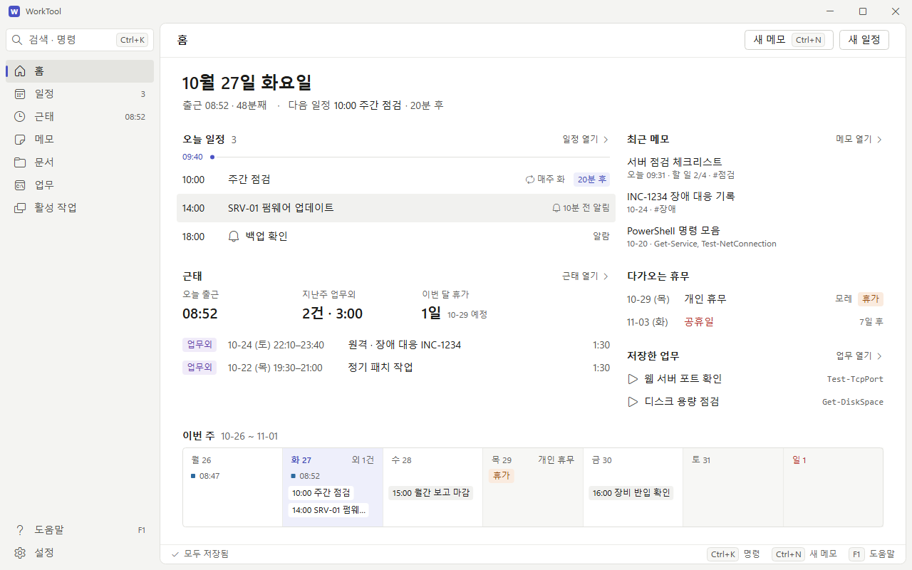
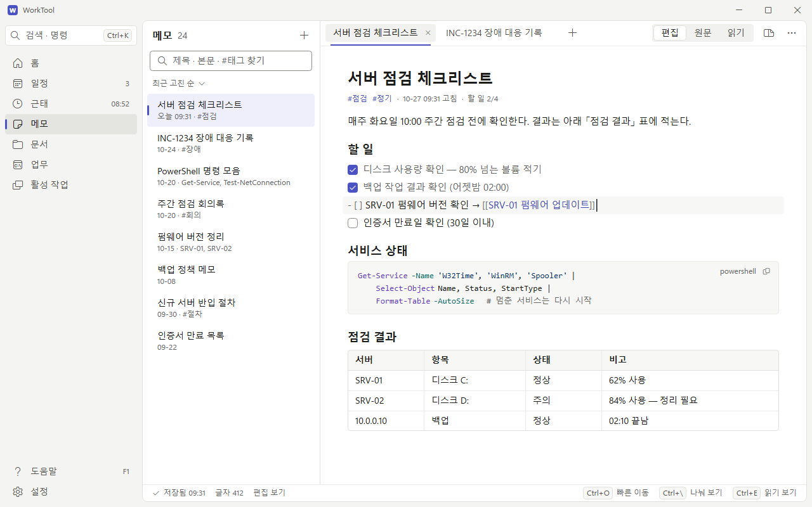
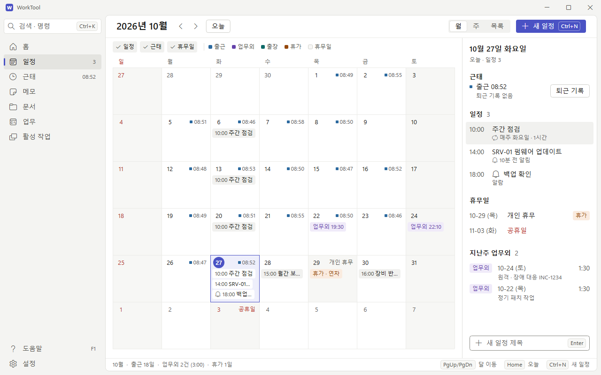
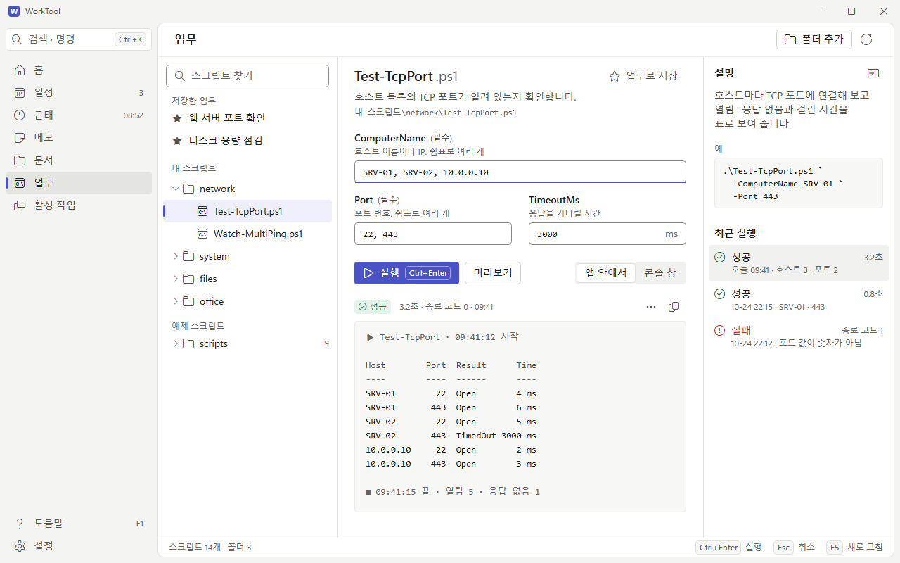
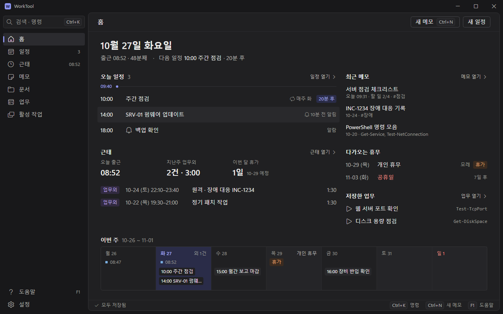
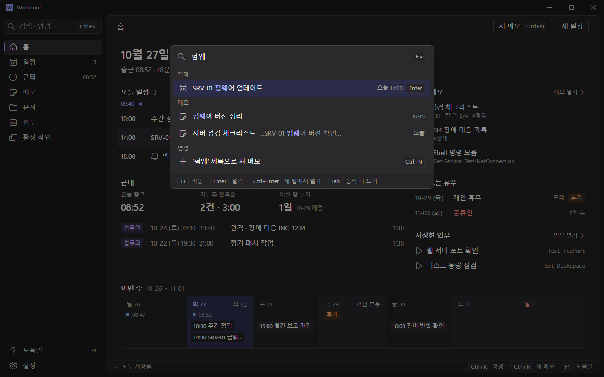

# 시안 B · 생산성 도구

회색 바탕 위에서 글이 주인공이다. 색은 강조 하나만 쓰고, 층은 면 두 단과 1px 선으로 나눈다. 단축키는 늘 화면에 보인다.

## 지금 디자인이 구린 이유 (내 판단)

- 하늘색 틴트가 창 바탕 · 메뉴 · 선택 · 버튼을 다 덮는다. 층이 안 나뉘어 흐릿하고, 강조색이 뜻 없이 깔려 장식이 됐다.
- 모든 걸 카드(모서리 12 + 테두리)에 담고, 카드 안에 또 카드(근태 4칸)를 넣었다. 정보보다 상자가 먼저 보인다.
- 크기가 웹 대시보드식이다. 제목 26 Bold, 높이 40, 넓은 여백 때문에 1280 창에서 홈 정보가 일정 3줄 · 메모 3개뿐이다.
- 단축키(Ctrl+O · Ctrl+B · Ctrl+\ · F5)가 많은데 화면엔 안 보인다. 키보드로 쓰는 앱이라는 단서가 없다.
- 글자 단계가 26 · 22 · 16 · 14 · 12.5로 많고, 화면마다 머리줄 · 버튼 자리가 다르다.

## 레퍼런스

- Linear 「Behind the latest design refresh」 — https://linear.app/now/behind-the-latest-design-refresh
  - 메뉴는 한 단 어둡고 조용하게 둔다. 구분선은 줄이고 연하게, 차가운 파랑 회색 대신 채도 낮은 중성 회색을 쓴다.
- Linear 「How we redesigned the Linear UI」 — https://linear.app/now/how-we-redesigned-the-linear-ui
  - 테마를 바탕 · 강조 · 대비 세 값으로 만든다(변수 98개 → 3개). 화면 틀에서 파란 기운을 뺀다.
- Raycast 디자인 분석(제3자 글) — https://blakecrosley.com/guides/design/raycast
  - 단축키를 툴팁이 아니라 줄 오른쪽 키캡으로 보인다. 명령 목록은 무리 머리 + 한 줄 항목 + 아래 안내 줄이다.
- Arc 디자인 분석(제3자 글) — https://blakecrosley.com/guides/design/arc
  - 세로 메뉴는 이름이 숨 쉬게 둔다. "정리보다 찾기가 빨라야 한다"를 명령 막대로 푼다.
- Obsidian 포럼 「Readable line length」 — https://forum.obsidian.md/t/adjustable-readable-line-length/7564
  - 본문 폭을 약 700px · 한 줄 50~75자로 묶는다. 메모 가운데 단 680의 근거.
- Things 3 리뷰(The Sweet Setup) — https://thesweetsetup.com/cultured-code-releases-things-3/
  - 여백이 넉넉한 깨끗한 화면, 오늘 화면 하나에 낮 · 저녁 항목을 같이 둔다. 홈 「오늘 일정」의 근거.
- Radix Colors 「Understanding the scale」 — https://www.radix-ui.com/colors/docs/palette-composition/understanding-the-scale
  - 회색 단계를 바탕 · 부품 · 테두리 · 글자 쓰임새로 나눠 이름 붙인다. 아래 색 이름의 근거.

## 시안 그림 (1280 × 800)

- `home-light` — 홈: 오늘 일정 · 근태 · 최근 메모 · 휴무 · 저장한 업무 · 이번 주
- `memo-light` — 메모: 목록 280 + 탭 2개 + 가운데 단 680. 고치는 블록(할 일 셋째 줄)만 원문
- `schedule-light` — 일정: 월 달력에 출근 시각 · 업무외 · 휴가 · 휴무일을 같이, 오른쪽에 고른 날
- `workflows-light` — 업무: `Test-TcpPort.ps1` 폼 + 실행 결과 + 설명 · 최근 실행
- `home-dark` — 홈 어두운 테마
- `palette-dark` — (덤) Ctrl+K 명령 팔레트를 연 모습

## 디자인 값

모든 값은 쓰임새 이름으로 둔다. WPF 리소스 키는 앞에 `B.`(색) · `F.`(크기) · `Font.`(글꼴)를 붙인다.

### 색 — 밝은

- 바탕: `Bg.Base` #F4F4F2(제목 줄 · 메뉴) · `Bg.Content` #FFFFFF(작업 면) · `Bg.Subtle` #F7F7F5(코드 · 출력 · 표 머리 · 휴무일 칸) · `Bg.Raised` #FFFFFF(팔레트 · 메뉴, + `Line.Strong`)
- 마우스 올림 · 선택: `Bg.Hover` #F1F1EF · `Bg.HoverOnBase` #EAEAE7 · `Bg.SelectedOnBase` #E4E4E0(메뉴, + 강조 막대 3 × 16) · `Bg.Selected` #EEEFFB(목록 · 오늘 칸)
- 선: `Line.Subtle` #EBEBE8(안쪽 구분) · `Line.Default` #E0E0DC(면 테두리) · `Line.Strong` #CFCFCA(보조 버튼 · 떠 있는 면) · `Line.Control` #8A8A84(입력칸, 3.1:1 이상)
- 글자 3단: `Text.Primary` #1C1C1A(13:1 이상) · `Text.Secondary` #53534E(6.0 이상) · `Text.Tertiary` #65655F(4.8 이상) · `Text.Disabled` #A3A39D(예외)
- 강조(남보라): `Accent` #4A52C4 · `Accent.Hover` #4048B4 · `Accent.Pressed` #3A41A3 · `Accent.Soft` #EEEFFB · `Accent.Text` #4048B8(링크 · 태그) · `OnAccent` #FFFFFF(6.3:1 이상)
- 상태(글자 / 연한 바탕): 정상 #1D7346 / #E6F2EB · 주의 #875500 / #FAEFD9 · 장애 #B3322A / #FAE8E6 · 정보 = 강조색 아이콘 + `Text.Primary` 글자
- 근태(글자 / 바탕): 출근 #2D6A9F / #E5EFF7 · 업무외 #6542AA / #F0EBF9 · 출장 #0D6967 / #E0F1F0 · 휴가 #94480C / #FAEBDF
- 달력: `Cal.Holiday` #B3322A(일요일 · 공휴일 숫자) · `Cal.DayOff` #F7F7F5(주말 · 휴무일 칸)
- 포커스: 바깥 2 `Text.Primary` + 안쪽 1 흰색(`apps/design.md` 그대로)

### 색 — 어두운

- 바탕: `Bg.Base` #18181A · `Bg.Content` #202022 · `Bg.Subtle` #252528 · `Bg.Raised` #2A2A2D
- 마우스 올림 · 선택: `Bg.Hover` #29292C · `Bg.HoverOnBase` #222225 · `Bg.SelectedOnBase` #2B2B2F · `Bg.Selected` #2A2C48
- 선: `Line.Subtle` #2B2B2E · `Line.Default` #333336 · `Line.Strong` #46464B · `Line.Control` #7C7C82(3.4:1 이상)
- 글자 3단: `Text.Primary` #ECECEA(11:1 이상) · `Text.Secondary` #B5B5B0(6.5 이상) · `Text.Tertiary` #9A9A94(4.7 이상) · `Text.Disabled` #5C5C60
- 강조: `Accent` #8E96F2 · `Accent.Hover` #9DA4F4 · `Accent.Pressed` #7F87E0 · `Accent.Soft` #2A2C48 · `Accent.Text` #A5ABF6 · `OnAccent` #14163A(5.3:1 이상)
- 상태(글자 / 바탕): 정상 #5DC08B / #24332B · 주의 #E3B04E / #37311F · 장애 #F2877E / #3C2726
- 근태(글자 / 바탕): 출근 #79AEE0 / #22303D · 업무외 #B9A0F0 / #312A40 · 출장 #5CC4C0 / #1F3533 · 휴가 #EFA068 / #3A2B20
- 코드(어두운): 주석 #9A9A94 · 문자열 #9CC3F2 · 예약어 #F2877E · 숫자 #86B8F5 · 명령 #C3A6F5 · 변수 #EFA068 · 형식 #7FD1A0 · 옵션 #5CC4C0 (밝은 쪽은 지금 값 그대로, 새 코드 바탕에서도 4.5:1 이상)
- 대비는 `_build/check_contrast.py`로 계산했다. 글자 4.5:1 · 입력 테두리 3:1을 모든 바탕에서 넘는다.

### 글자

글꼴은 지금 그대로다. 쓰임새 이름만 넷으로 나눈다.
- `Font.UI` = `Segoe UI Variable Text, Segoe UI, Malgun Gothic`
- `Font.Doc` = `Font.UI`와 같은 값(메모 본문. 나중에 글꼴 고르기를 여기에 붙인다)
- `Font.Mono` = `Consolas, Malgun Gothic`(코드 · 출력 · IP · 스크립트 값)
- `Font.Icon` = `Segoe Fluent Icons, Segoe MDL2 Assets`

크기 단계(크기 / 줄 높이 · 굵기)
- 화면: `Caption` 12/16 · `Body` 14/20 · `BodyStrong` 14/20 600 · `Heading` 16/24 600 · `Title` 20/28 600 · `Display` 24/32 600(홈 날짜 하나)
- 메모 본문: `Doc.Body` 15/24 · `Doc.H1` 24/32 · `Doc.H2` 18/26 · `Doc.H3` 16/24 · `Doc.Code` 13/20
- 12.5는 없앤다. 강조(600)는 머리글 · 제목에만 쓴다(맑은 고딕은 Bold로 보임).

### 간격 · 모서리 · 크기

- 간격: 4 · 8 · 12 · 16 · 24 · 32. 묶음 안 4 · 8, 묶음 사이 24
- 내용 면 안쪽 여백: 개요(홈) 32 · 목록/편집 패널 12~16
- 모서리: `Radius.Control` 4(버튼 · 입력 · 칩 · 키캡 · 목록 항목) · `Radius.Panel` 8(내용 면 · 팔레트 · 메뉴). 둘만 쓴다
- 컨트롤 높이: 버튼 · 입력 · 표 행 · 메뉴 항목 32 · 머리줄 안 버튼 28 · 칩 20 · 키캡 20 · 두 줄 목록 48~52
- 틀: 제목 줄 32 · 화면 머리줄 48 · 상태 줄 28(저장 상태 · 단축키)
- 왼쪽 메뉴: 펼침 224 · 접힘 48. 아이콘 16, 항목 32, 맨 위에 명령 팔레트 입구
- 패널 폭: 메모 목록 280 · 업무 목록 256 · 오른쪽 상세 272~288 · 메모 가운데 단 최대 680
- 내용 면은 메뉴 오른쪽에 떠 있는 흰 면이다(오른쪽 · 아래 8 띄움, 모서리 8, 테두리 1, 그림자 없음)

## WPF 구현 메모

**만들 스타일 · 템플릿** (모두 `Ui.psm1` 한 곳, 화면 모듈은 이름만 쓴다)
- `Nav.Item`: Border(모서리 4) + 막대 3 × 16 + 아이콘 + 글자 + 오른쪽 숫자. 선택 · 마우스 올림은 트리거
- `Button.Primary` · `Button.Secondary` · `Button.Ghost` · `Button.Icon`: Border 하나 + ContentPresenter. 올림 · 눌림 · 비활성 · 포커스 트리거
- `Keycap`: Border(모서리 4, 테두리 1) + TextBlock 12. 버튼 안 · 상태 줄 · 팔레트에서 같이 씀
- `Chip.*`: 상태 · 근태 · 일정 칩. 바탕 · 글자 브러시만 다르게
- `Input` · `Combo`: 테두리 `Line.Control`, 입력 중엔 아래 2 강조(Windows 입력칸 방식)
- `Segmented`: 가로 ListBox 또는 RadioButton 묶음(편집 · 원문 · 읽기, 월 · 주 · 목록, 실행 방식)
- `CheckBox` 16, `Memo.Tab`(알약 + 포커스 칸만 아래 2 강조), `ScrollBar` 얇게
- `List.Row2`: 두 줄 항목(제목 14 + 캡션 12). `VirtualizingStackPanel` 재사용 모드
- `Cal.DayCell`: 달력 칸 DataTemplate 하나(숫자 · 오른쪽 위 근태/휴무 · 항목 최대 3)
- `StatusBar`: 왼쪽 상태 글자 + 오른쪽 단축키 안내 목록. 각 탭이 목록만 넘김
- `Palette`: 창 안 겹침 Grid(뒤 어둡게 40% + `Bg.Raised` 면 + `Line.Strong` 테두리 + 무리별 결과 목록)
- `FocusVisual`: 바깥 2 + 안쪽 1

**코어에 더할 것**
- 명령 팔레트 · 상태 줄 안내는 코어가 그리고, 탭은 등록 목록으로 "명령 · 찾기 결과 · 단축키 안내"만 넘긴다. 코어에 탭 이름을 쓰지 않는 규칙 그대로다.
- 테마 = 바탕(밝은/어두운) + 강조색 하나. 파스텔 7색은 강조색 목록으로만 남길 수 있다(바탕 틴트는 없앰).

**비용이 큰 것 · 조심할 것**
- 내용 면 모서리 8: `ClipToBounds`나 둥근 Clip을 쓰지 않는다. 소프트웨어 렌더링에서 다시 그릴 때마다 비싸다. 테두리만 둥글게 그리고 안쪽은 여백으로 모서리를 피한다.
- 달력: 42칸 × 6~8개 ≈ 300개 요소. 달을 넘길 때 새로 만들지 말고 칸을 그대로 두고 값만 바꾼다.
- 팔레트 뒤 어둡게: 창 전체 반투명 사각형 한 장이다(움직임 없음). 버벅이면 빼고 테두리만 둔다.
- 팔레트 무리 나누기: WPF 그룹은 가상화를 끈다. 결과를 50개 안팎으로 자르거나 `IsVirtualizingWhenGrouping`을 켠다.
- 그림자 · 흐림 · 그라데이션 · 애니메이션은 쓰지 않는다. 상태 바뀜은 트리거로 바로 바꾼다.

## 지금 값과 달라지는 것

- 바탕: 파스텔 틴트 → 중성 회색 고정. 강조: 하늘 #2370C2 → 남보라 #4A52C4
- 높이 40 → 32, 메뉴 232 → 224, 메뉴 아이콘 20 → 16
- 모서리: 카드 12 · 버튼 8 → 면 8 · 부품 4. 카드 상자는 없애고 구역 제목 + 여백으로 나눈다
- 화면 제목 26 Bold → 머리줄 16 SemiBold(홈 날짜만 24). 12.5 → 12
- 메모 본문 14/21 → 15/24, 가운데 단 680
- 새로 생김: 상태 줄 28, 명령 팔레트, 버튼 안 키캡
- `apps/design.md`와 다른 점: 메뉴 아이콘 20 → 16, 탐색 폭 240(최소) → 224, 화면 제목 28 → 머리줄 16 · 홈 24. 고르면 design.md도 같이 고친다.

## 단축키 (새로 정하는 것)

- Ctrl+K 명령 팔레트 · Ctrl+1~7 탭 이동(메뉴에 마우스를 올리면 보임)
- 일정: PgUp / PgDn 달 이동 · Home 오늘
- 업무: Ctrl+Enter 실행 · Esc 취소
- 지금 있는 것(Ctrl+O · Ctrl+\ · Ctrl+E · Ctrl+B · F5 · F1)은 그대로, 상태 줄에 보여 준다

## 장점

- 회색 바탕 + 흰 면 + 강조 하나라 하루 종일 켜 둬도 눈이 덜 피곤하다. 메모는 폭 680 · 15/24라 읽고 쓰기 편하다.
- 키캡 · 상태 줄 · 명령 팔레트로 단축키가 늘 보인다. 숙련자는 빨라지고 입문자는 보면서 배운다.
- 카드 · 틴트 · 그림자를 빼서 Border 하나 + 글자로 찍어 낸다. 템플릿 수가 적고 소프트웨어 렌더링에 가볍다.

## 단점

- 차분한 만큼 밋밋하다. 파스텔 테마의 "내 앱" 느낌과 색 고르는 재미가 줄어든다(강조색만 바꿈).
- 밀도가 높아 처음엔 빽빽해 보일 수 있다. 높이 32는 글자 크기 1.12배 · 고배율에서 달력 칸이 넘칠 수 있다.
- 명령 팔레트 · 상태 줄 안내 · 단축키 체계는 새 기능이다. 코어 등록 목록과 검색 색인을 새로 만들어야 한다.

## 다시 만들기

- 원본은 `_build/`(Python 3 + Pillow, 개인 PC 전용. 업무 PC에서는 쓰지 않는다)
- `python make.py` → SVG 6장, `sh render.sh home-light ...` → Edge로 PNG
- `python check_contrast.py` → 색 대비 검사
