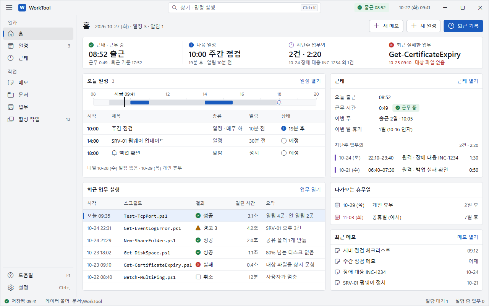
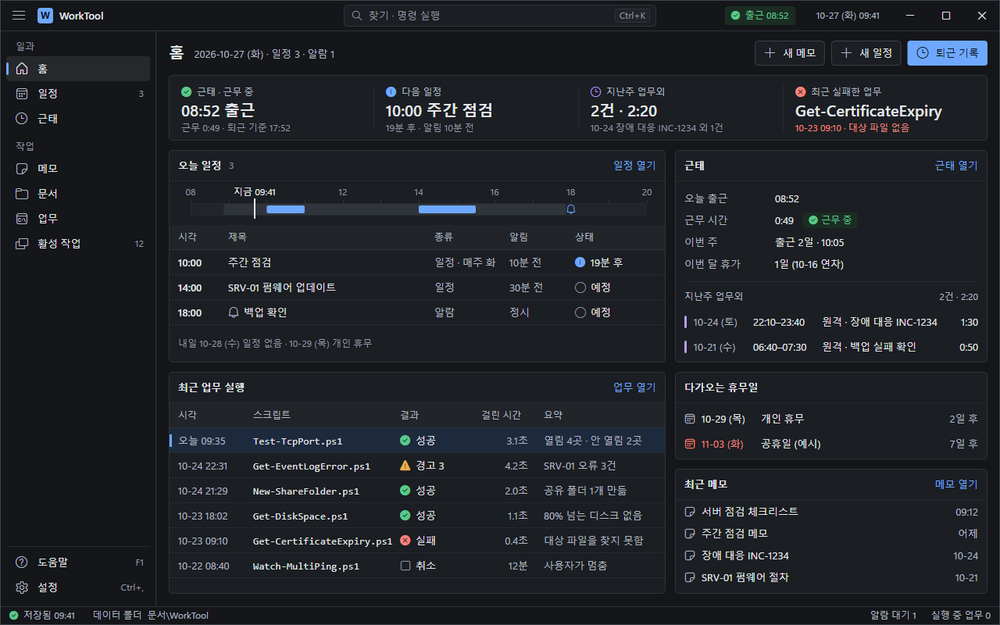
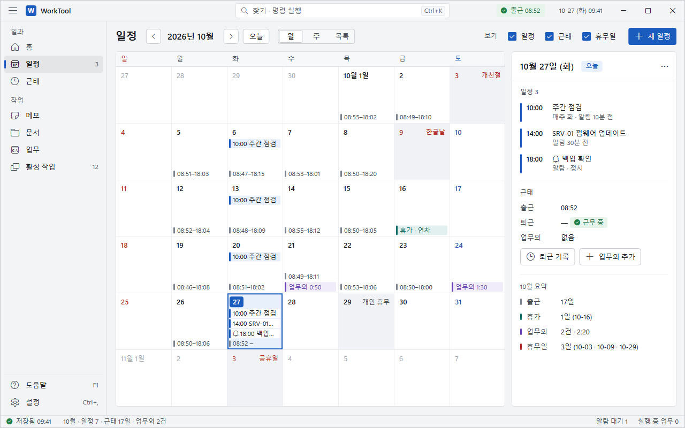
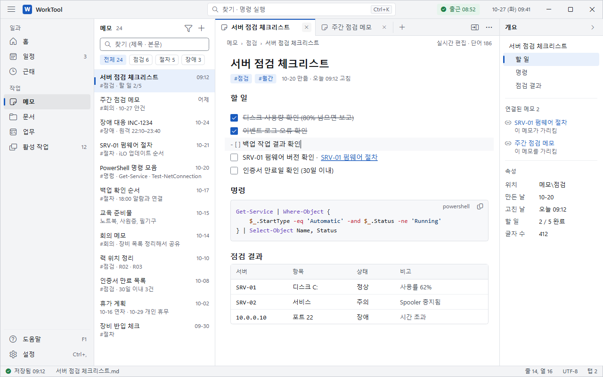
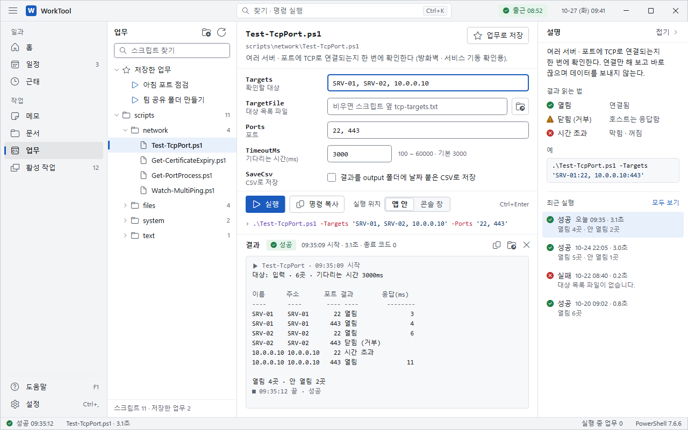

# C. 운영 콘솔 시안

**방향:** 상태가 먼저 보이는 작업대다. 회색 면 2단, 1px 선, 상태색 4개로 촘촘하지만 조용하게 만든다.

그림(1280 × 800, 같은 이름 PNG도 있음):

- 홈 · 밝은: `home-light.svg` 
- 홈 · 어두운: `home-dark.svg` 
- 일정 · 달력에 근태 · 휴무일 겹쳐 보기: `schedule-light.svg` 
- 메모: `memo-light.svg` 
- 업무: `workflows-light.svg` 

## 지금 디자인 진단

- 모든 것이 둥근 카드(12)에 큰 여백이라, 넓은 창에도 보이는 정보가 10줄 남짓이다. 모바일 앱처럼 보인다.
- 강조 파랑을 링크 · 선택 · 점 · 단추에 다 써서 파랑이 뜻을 잃었다. 창 · 메뉴 바탕까지 파랗게 물들어 있다.
- 위계가 평평하다. 굵은 글자가 곳곳에 있고, 상태는 연한 알약 몇 개뿐이라 훑어봐도 "지금 괜찮은지"가 안 보인다.
- 달력 칸에는 숫자와 점만 있어 그날 무엇이 있는지 알려면 눌러야 한다.
- 어두운 모드는 남색 바탕에 색만 바꾼 것이라 따로 설계한 느낌이 없다.

## 레퍼런스

- Fluent 2 색 — https://fluent2.microsoft.design/color — 바탕은 중립 회색, 브랜드색은 단추 · 선택에만 조금. 상태색은 장식에 쓰지 않는다.
- Azure 포털 — https://learn.microsoft.com/en-us/azure/azure-portal/azure-portal-overview — 위 전역 머리줄(찾기 · 알림) + 화면별 명령 + 작업 칸 구조.
- Intune 관리 센터 — https://learn.microsoft.com/en-us/intune/fundamentals/tutorial-admin-center-walkthrough — 홈은 "전체 상태 한눈에", 개요 맨 위에 실패 · 미준수 수를 타일로.
- GitHub Primer 색 — https://primer.style/foundations/color/overview — 역할마다 글자 · 바탕 · 테두리 짝. 연한 바탕엔 같은 역할 글자색.
- Carbon 상태 표시 — https://carbondesignsystem.com/patterns/status-indicator-pattern/ — 색 + 모양 + 글자. 같은 모양에 색만 다르게 쓰지 않는다.
- Grafana 테마(Saga) — https://github.com/grafana/grafana/blob/main/contribute/style-guides/themes.md — 바탕 3단 · 테두리 3단, 상태색마다 main · text 분리.
- Vercel Geist 색 — https://vercel.com/geist/colors — 회색 단계를 바탕 · 테두리 · 글자 구간으로 나눔. 둘째 바탕은 아껴 씀.
- Datadog 모니터 상태 — https://docs.datadoghq.com/monitors/manage/status — 정상 · 경고 · 경보에 "데이터 없음" 같은 중립 상태를 하나 더 둔다.

## 디자인 값

이름은 쓰임새 이름이다. 화면 모듈은 이 이름만 쓴다. 대비는 그 색이 놓이는 모든 바탕(마우스 올림 포함)에서의 최솟값이다.

### 색 · 밝은

- `Bg.Canvas` `#F3F4F6` — 창 바탕 · 머리줄 · 메뉴 · 상태 표시줄 (아래층)
- `Bg.Surface` `#FFFFFF` — 패널 · 표 · 목록 · 입력칸 (위층)
- `Bg.Subtle` `#F7F8FA` — 표 머리글 · 코드 · 출력 칸 · 고치는 줄
- `Bg.Raised` `#FFFFFF` + `Border.Default` — 메뉴 · 대화상자 · 펼침 패널
- `Bg.Selected` `#E8F0FC` — 고른 행 · 일정 칩 · 태그 (+ 왼쪽 강조 막대 3 × 16)
- `Overlay.Hover` 검정 4% · `Overlay.Pressed` 검정 7% · 메뉴 고름 검정 6%
- `Border.Default` `#DDE0E5` — 패널 · 구분선 · 찾기 상자
- `Border.Muted` `#ECEEF1` — 표 행 사이 · 패널 머리 아래 · 달력 칸
- `Border.Strong` `#C6CBD2` — 보조 단추 · 분할 단추 테두리
- `Border.Control` `#7A828D` — 입력칸 · 체크 상자 (3.1)
- `Text.Primary` `#16191E` (14.0) · `Text.Secondary` `#424A55` (7.1) · `Text.Tertiary` `#5C6470` (4.7) · `Text.Disabled` `#A3AAB4`
- `Accent` `#1A5BBE` · `Accent.Hover` `#174FA6` · `Accent.Pressed` `#144690` · `OnAccent` `#FFFFFF` (6.4)
- `Accent.Text` `#1A5BBE` (5.1) — 링크 · 태그 글자
- 상태 (아이콘 / 글자 / 연한 바탕):
  - 정상 `#1E7F47` / `#1A6E3E` (5.0) / `#E6F4EC`
  - 경고 `#A86500` / `#8A5300` (5.0) / `#FCF2DE`
  - 오류 `#C42F29` / `#B42820` (5.1) / `#FBE9E7`
  - 정보 `#1A5BBE` / `Text.Primary` / `#E8F0FC`
  - 중립(예정 · 취소) `#6B7380` / `Text.Secondary` / `#EEF0F3`
- 근태 · 달력: 출근 막대 `#7A828D` · 휴가 `#0B6B69` / `#E2F1F0` · 업무외 `#6A44B5` / `#F0ECFA` · 공휴일 · 일요일 `#B42820` · 토요일 `#2457B0` · 휴무 칸 `#F1F2F5`

### 색 · 어두운

- `Bg.Canvas` `#141619` · `Bg.Surface` `#1B1E22` · `Bg.Subtle` `#212429` · `Bg.Raised` `#262A30` · `Bg.Selected` `#1D2A3D`
- `Overlay.Hover` 흰색 6% · `Overlay.Pressed` 흰색 4% · 메뉴 고름 흰색 8%
- `Border.Default` `#30343B` · `Border.Muted` `#272B31` · `Border.Strong` `#3E434B` · `Border.Control` `#727A85` (3.2)
- `Text.Primary` `#E4E7EB` (11.3) · `Text.Secondary` `#B1B8C2` (7.0) · `Text.Tertiary` `#9199A4` (4.9) · `Text.Disabled` `#5F6670`
- `Accent` · `Accent.Text` `#6EA8FE` (5.8) · `Accent.Hover` `#88B8FE` · `Accent.Pressed` `#5A95EC` · `OnAccent` `#0B1220` (7.8)
- 상태 (아이콘 = 글자 / 연한 바탕): 정상 `#5BC88A` (6.7) / `#1B2D23` · 경고 `#E6B04E` (7.1) / `#31281A` · 오류 `#F2847C` (5.6) / `#3A2325` · 정보 `#6EA8FE` / `#1D2A3D` · 중립 `#9199A4` / `#262A30`
- 근태 · 달력: 휴가 `#4FC3BE` / `#17302F` · 업무외 `#B69EF7` / `#2A2440` · 공휴일 `#F2847C` · 토요일 `#8DB5F5` · 휴무 칸 `#24272C`
- 순수한 흰 글자 · 남색 바탕은 쓰지 않는다. 바탕은 푸른 기 없는 숯색이다.

### 상태 표시 규칙

- 상태는 항상 아이콘 + 글자다. 모양이 다르다: 정상 원 체크 `EC61` · 경고 삼각형 `E814` · 오류 원 X `EB90` · 정보 원 i `F167` · 예정 빈 원 `EA3A` · 취소 네모 `E71A`.
- 표 · 목록에서는 아이콘만 상태색, 글자는 `Text.Primary`. 눈이 덜 피곤하다.
- 연한 바탕은 배지(머리줄 출근 · 결과 성공 등)에만. 행 전체를 칠하지 않는다.
- 업무 결과: 종료 코드 · 오류로 성공 / 실패, 경고 스트림이 있으면 「경고 n」, 멈추면 「취소」.

### 글꼴 · 글자 크기

- 글꼴은 쓰임새 이름 두 개: `Font.UI` = Segoe UI Variable Text, Segoe UI, Malgun Gothic · `Font.Code` = Consolas, Malgun Gothic.
- 시각 · 숫자 열은 고정폭 숫자(`Typography.NumeralAlignment="Tabular"`).
- 단계 (크기 / 줄 높이):
  - `Text.Caption` 12 / 16 보통 — 보조 정보 · 상태 표시줄 · 표 머리글 · 달력 칸 안
  - `Text.Body` 13 / 20 보통 — 기본. 컨트롤 · 표 · 목록 · 메뉴
  - `Text.BodyStrong` 13 / 20 강조 — 패널 제목 · 고른 메뉴 · 시각 · 날짜 숫자
  - `Text.Reading` 14 / 22 보통 — 메모 본문 · 할 일
  - `Text.Subtitle` 16 / 24 강조 — 상세 패널 제목 · 스크립트 이름 · 메모 제목 2
  - `Text.Title` 20 / 28 강조 — 화면 제목(화면당 하나) · 상태 타일 값
  - `Md.H1` 22 / 30 강조 — 메모 제목 1
  - `Code` 13 / 20 — 코드 블록 · 입력값 · 스크립트 이름 · 호스트
  - `Code.Dense` 12 / 18 — 출력 칸 · 명령 미리보기
- 강조 = SemiBold(600). 맑은 고딕은 600이 없어 한글은 Bold로 보인다. 12에는 강조를 쓰지 않는다.

### 간격

- 4 · 8 · 12 · 16 · 24 · 32만 쓴다.
- 묶음 안 4 · 8, 패널 안쪽 12, 화면 가장자리 16, 개요 화면의 패널 사이 12.
- 편집 화면(메모 · 업무 · 문서)은 패널을 맞붙이고 1px 선으로 나눈다.

### 모서리

- 0 — 맞붙은 패널 · 표의 고른 행 · 탭 아래
- 2 — 체크 상자 · 칩 · 막대처럼 16 이하의 작은 것
- 4 — 단추 · 입력칸 · 패널 · 배지
- 8 — 메뉴 · 대화상자 · 펼침 패널 (떠 있는 것만)

### 높이 · 폭

- 28 — 작은 컨트롤: 머리줄 찾기 · 목록 찾기 · 분할 단추 · 아이콘 단추 · 달 이동
- 32 — 기본: 단추 · 입력칸 · 고르기 칸 · 메뉴 항목 · 표 행 · 한 줄 목록
- 48 — 두 줄 목록: 메모 목록 · 최근 실행
- 머리줄 40 · 패널 머리 40 · 탭 36 · 상태 표시줄 24 · 상태 타일 줄 84
- 왼쪽 메뉴 펼침 200 · 접힘 48. 묶음 이름(일과 · 작업) 24, 아이콘 16
- 패널 폭: 목록 240 ~ 256 · 설명 · 개요 220 ~ 280 · 가운데 최소 360

### 화면 틀

- 맨 위 머리줄 40 = 창 제목 줄. 메뉴 접기 · 앱 이름 · 찾기(Ctrl+K) · 출근 상태 · 시계 · 창 단추.
- 왼쪽 메뉴 200, 맨 아래 도움말 · 설정(단축키 같이 표시).
- 맨 아래 상태 표시줄 24: 저장 상태 · 지금 화면 요약 · 알람 대기 · 실행 중 업무.
- 개요 화면(홈 · 일정): 화면 제목 + 오른쪽 명령, 강조 단추는 하나.
- 편집 화면(메모 · 업무): 제목 줄 없이 패널 머리가 제목을 대신한다.

### apps/design.md와 다른 값

- 본문 14 → 13 (긴 글은 `Text.Reading` 14). 강조 최소 14 → 13
- 두 줄 목록 64 → 48, 탐색 아이콘 20 → 16, 탐색 폭 280 → 200
- 제목 표시줄 32 / 48 → 40 (찾기 상자를 넣고도 40)
- 강조색 `#2F6DB5` → `#1A5BBE`, 어두운 `#7EB0EA` → `#6EA8FE`
- 모서리 2 추가(작은 것), 작은 컨트롤 높이 28 추가
- 채택하면 `apps/design.md`와 `apps/WorkTool/design/README.md`를 먼저 고친다.

## WPF 구현 메모

필요한 스타일 · 템플릿 (모두 `Ui.psm1` 한 곳, 암시적 스타일 + `BasedOn` 변형):

- 테마: 밝은 · 어두운 ResourceDictionary 두 개, 키는 위 쓰임새 이름. 지금 `Theme.psm1` 구조 그대로 키 이름만 바꾼다.
- 셸: 머리줄(WindowChrome 캡션 40, 찾기 · 창 단추는 `IsHitTestVisibleInChrome`), 메뉴(ListBox 항목 템플릿: 막대 · 글리프 · 이름 · 개수), 상태 표시줄(DockPanel + TextBlock).
- 단추 3종: `Btn.Primary` · `Btn.Secondary` · `Btn.Icon`. 템플릿 하나에 마우스 올림 덧칠 · 누름 · 비활성 · 포커스 트리거.
- 입력칸 · 고르기 칸 · 체크 상자 · 분할 단추(RadioButton 묶음).
- `Panel.Card`(테두리 + 머리 40: 제목 · 개수 · 링크).
- 표 행: ListBox/ListView + 행 템플릿(고정 열 폭 · 아래 선 1 · 고른 행 막대). 가상화 켬.
- 상태: `Status.Icon`(글리프 TextBlock 하나) · `Status.Badge`(Border + 글리프 + 글자). 상태 이름 → 글리프 · 색 매핑은 테마에 한 번만.
- 상태 타일 줄: UniformGrid 4칸 + 칸 사이 선.
- 홈 시간 막대: Canvas에 Rectangle 몇 개(근무 시간 · 일정 · 지금 선). 1분마다 지금 선만 옮긴다.
- 달력: UniformGrid 7 × 6, 칸 템플릿 하나(숫자 · 휴무 이름 · 일정 칩 최대 3 · 근태 줄 최대 2). 오늘 · 고름 · 휴무는 트리거로 바탕만 바꾼다.
- 메모 탭 줄: 지금 탭 부품 그대로, 고른 탭 위 2px 강조 · 바탕만 `Bg.Surface`로.

비용이 큰 것:

- 달력 42칸 × (칩 3 + 근태 2)면 요소가 수백 개다. 달을 넘길 때 칸을 다시 만들지 말고 데이터만 바꿔 끼운다.
- 표 · 목록이 수백 행이면 행 구분선 Border도 그만큼 생긴다. 가상화가 꼭 필요하다.
- 나머지는 단색 면 · 1px 선 · 글리프뿐이다. 그림자 · 흐림 · 그라데이션 · 애니메이션이 없어 소프트웨어 렌더링에서도 가볍다.

## 장점

- 한 화면에 보이는 정보가 2 ~ 3배다. 홈 하나로 근태 · 일정 · 업무 결과 · 휴무일 · 메모를 본다.
- 상태가 색 + 모양 + 글자로 앱 전체에서 같아서 훑어보기 쉽다.
- 면 2단 · 선 1px · 모서리 4가 거의 전부라 템플릿이 적고 빠르다.

## 단점

- 본문이 13이라 지금(14)보다 작다. 피곤하면 설정의 글자 크기 「크게」(1.12배, 본문 약 14.5)를 쓴다.
- 회색 · 흰색 위주라 개인 앱다운 따뜻함이 적다. 파스텔 7색 테마는 강조색만 바꾸는 정도로 줄어든다.
- 처음 보면 복잡해 보인다. 홈 패널이 많아 탭을 끄면 빈자리 배치를 따로 정해야 한다.

## 구현할 때 걱정되는 것

- Consolas + 맑은 고딕을 섞으면 한글이 Consolas 두 칸 폭과 달라 출력 칸 표의 열이 반 칸씩 어긋난다(업무 시안 출력 머리글에 보임). 출력은 그대로 두고, 표가 필요한 곳은 진짜 표로 그린다.
- 머리줄 찾기(Ctrl+K)는 새 기능이다. 메모 빠른 이동(Ctrl+O) 부품을 넓혀 쓰면 된다.
- 업무 「경고 n」은 스크립트 경고 스트림 수로 정한다. `docs/plans/workflows-design.md` 「스크립트 약속」에 한 줄 더해야 한다.
- 홈 상태 타일 · 시간 막대는 근태 · 일정 · 업무 탭 데이터를 읽는다. 탭끼리 부르지 않게 코어 등록 목록(홈 카드)으로 받아야 한다.

## 다시 만들기

- SVG: `python build-mockups.py` (이 폴더, 표준 라이브러리만)
- PNG: `pwsh -NoProfile -File render-png.ps1` (Edge 헤드리스, 1280 × 800)
- 가짜 내용만 쓴다. 호스트 · IP · 이름은 모두 예시 값이다.
