WorkTool WPF의 시작 방법과 탭별 사용법을 설명합니다.
기준 판: main 커밋 `7f816c6`.

# WorkTool 사용 매뉴얼

## 1. 시작하기

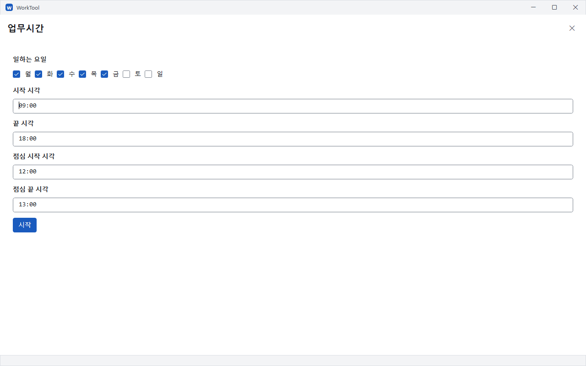

그림 파일: `mockups/worktool-manual-01-first-start.png`

- 업무 PC. `apps/WorkTool/dist/WorkTool-WPF.ps1` 전체를 복사해 같은 이름으로 저장합니다.
- 개인 PC. `worktool.zip`을 받아 압축을 풀고 `Start-WorkTool.cmd`를 실행합니다.
- PowerShell 실행. 파일을 저장한 폴더에서 `pwsh -File .\WorkTool-WPF.ps1`을 실행합니다.
- 업무시간. 처음 켤 때 일하는 요일과 시작·끝·점심 시각을 정하고 **시작**을 누릅니다.
- 업무시간 수정. **설정 → 업무시간**에서 고칩니다. 근태의 초과근무 계산에도 적용됩니다.

## 2. 화면 구성

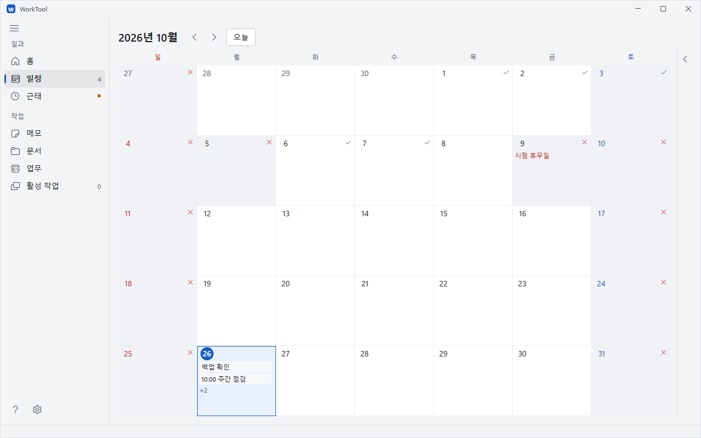

그림 파일: `mockups/worktool-manual-16-sidebar-collapsed.png`

- **일과** 메뉴. 홈·일정·근태로 이동합니다.
- **작업** 메뉴. 메모·문서·업무·활성 작업으로 이동합니다.
- 오른쪽 사이드바. 날짜별 일정이나 근태 요약을 봅니다. 머리글의 접기 단추로 본문 폭을 넓힙니다.
- **Ctrl + Shift + B**. 오른쪽 사이드바 접기 → 왼쪽 메뉴 접기 → 왼쪽 메뉴 펼치기 → 오른쪽 사이드바 펼치기 순서로 바꿉니다.
- 아래쪽 단추. 물음표는 **도움말**, 톱니바퀴는 **설정**을 엽니다.

## 3. 홈

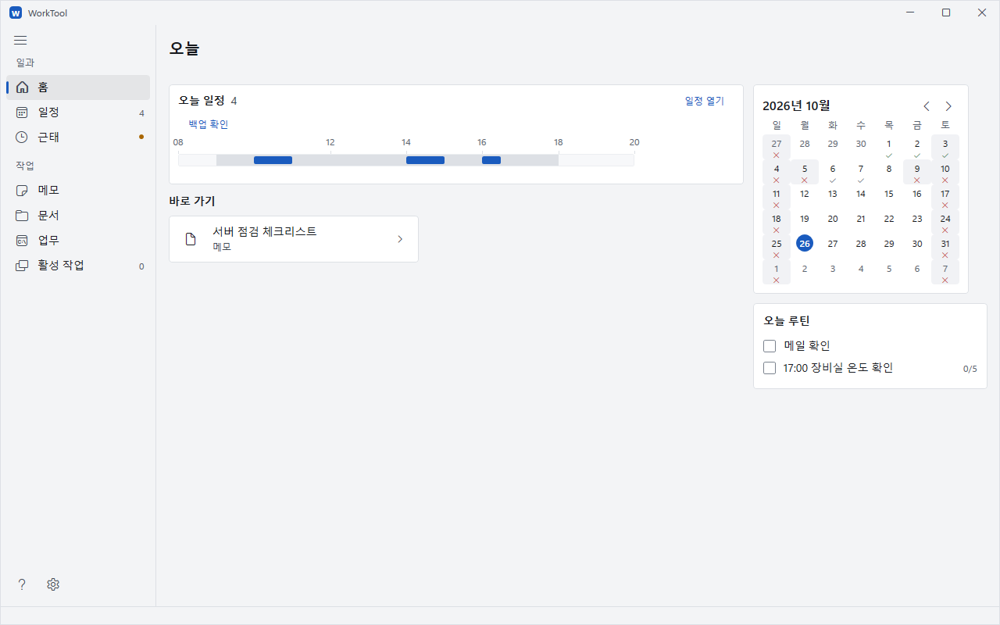

그림 파일: `mockups/worktool-manual-02-home.png`

- 오늘 일정. 시간 막대에 마우스를 올려 제목·시각을 확인합니다. 누르면 일정 편집으로 이동합니다.
- 작은 달력. 날짜를 누르면 해당 날짜의 일정으로 이동합니다.
- 오늘 루틴. 끝낸 항목을 체크합니다. 시간마다 반복하는 루틴은 다음 차례와 진행 횟수를 표시합니다.
- 바로 가기. 자주 연 메모·문서·업무를 다시 엽니다. 항목을 우클릭해 **홈에 고정**을 고릅니다.

## 4. 일정

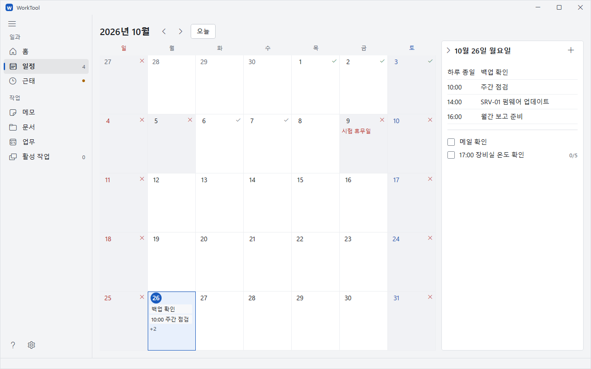

그림 파일: `mockups/worktool-manual-03-calendar.png`

- 월 달력. 화살표로 달을 바꾸고 **오늘**로 돌아옵니다. 날짜를 누르면 오른쪽 목록이 바뀝니다.
- 달력 기호. **✔**는 근무 기록, **X**는 쉬는 날입니다. 마우스를 올리면 근무 시각이나 쉬는 이유를 표시합니다.
- 일정 추가. 오른쪽 위 **+**의 **새 일정**을 고릅니다. 제목·날짜·시각·반복·알람을 정하고 **저장**합니다. 하루 전체 일정은 **하루 종일**을 체크합니다.
- 일정 편집. 오른쪽 일정 항목을 누릅니다. 반복 일정을 고치면 적용 범위를 고릅니다.
- 루틴 추가. **+ → 새 루틴**에서 반복 규칙을 정합니다. 끝낸 루틴은 체크하고, 잘못 체크하면 다시 눌러 풉니다.
- 남은 일정. 달력 칸의 **+숫자**에 마우스를 올려 나머지 제목을 확인합니다.

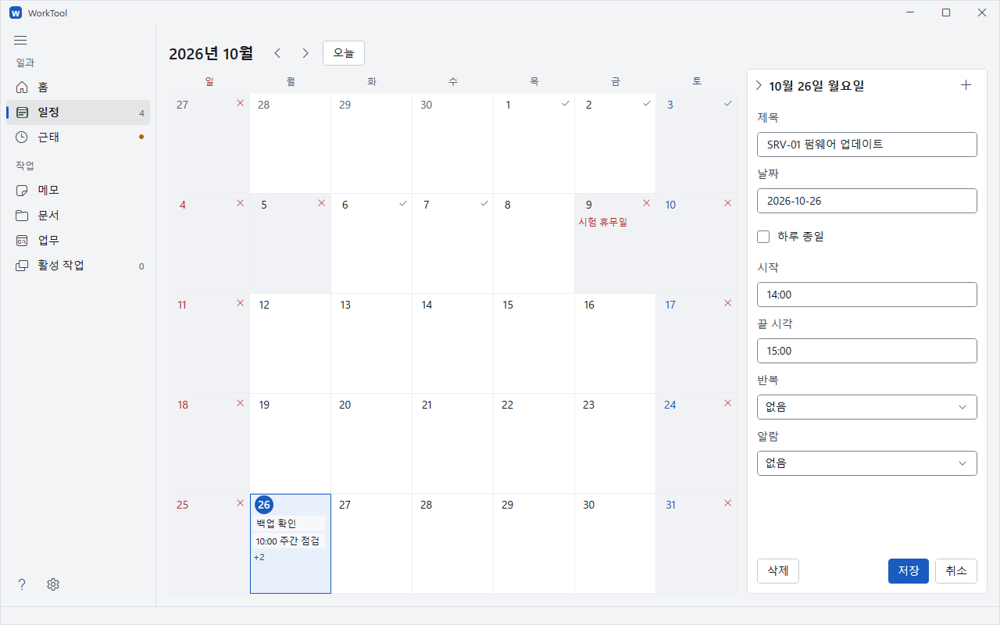

그림 파일: `mockups/worktool-manual-04-schedule-edit.png`

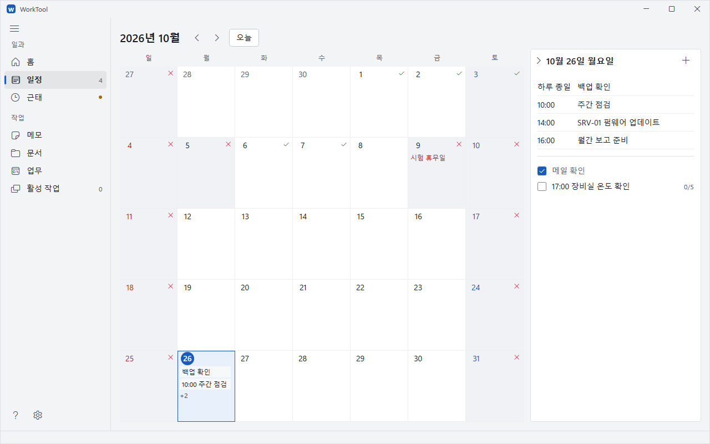

그림 파일: `mockups/worktool-manual-05-routine.png`

## 5. 근태

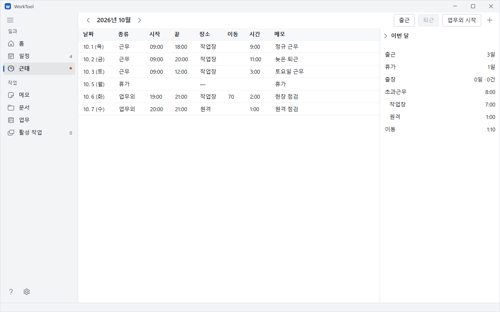

그림 파일: `mockups/worktool-manual-06-attendance.png`

- 기록 입력. **출근·퇴근**은 현재 시각을 기록합니다. **업무외 시작·업무외 끝**은 별도 작업을 기록합니다. **+**(직접 입력)으로 과거 기록·휴가·출장을 입력하고, 기존 행을 눌러 고칩니다.
- 이번 달. 출근·휴가·출장과 초과근무·이동 합계를 봅니다. 위쪽 화살표로 조회 월을 바꿉니다.
- 근무일 초과근무. 설정한 업무시간과 점심시간을 제외한 구간을 셉니다.
- 쉬는 날 초과근무. 기록한 근무·업무외 시간을 전부 셉니다.
- 장소별 초과근무. 근무 기록은 **작업장**, 업무외 기록은 고른 **작업장·원격·장소 없음**으로 셉니다. 겹친 시간은 작업장 → 원격 → 장소 없음 순으로 한 번만 셉니다.
- 이동. 업무외 기록의 가는 길·오는 길을 분으로 입력합니다. 초과근무에 더하지 않고 따로 합산합니다.

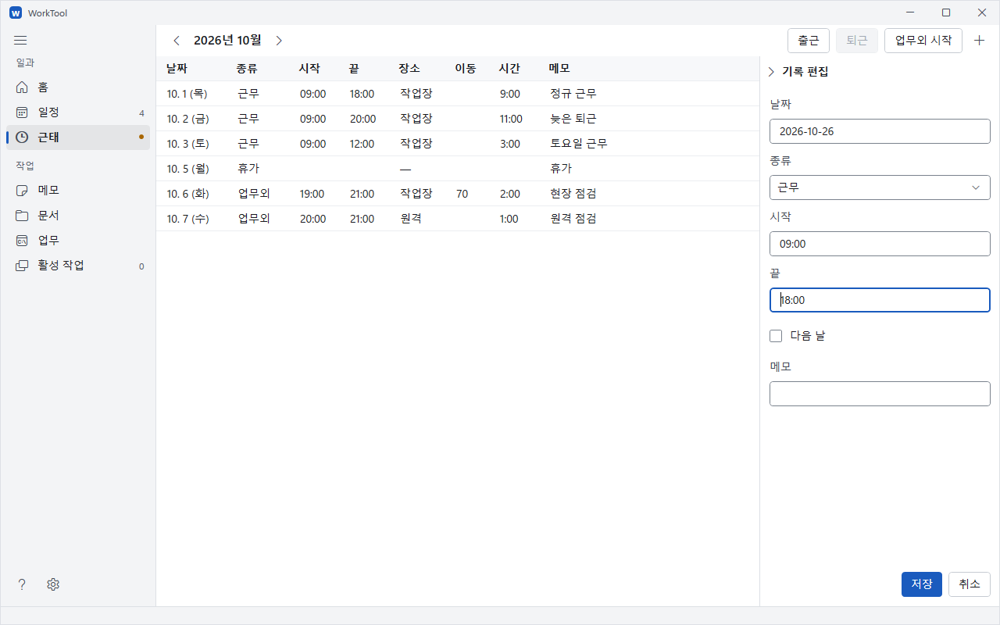

그림 파일: `mockups/worktool-manual-07-attendance-edit.png`

## 6. 메모

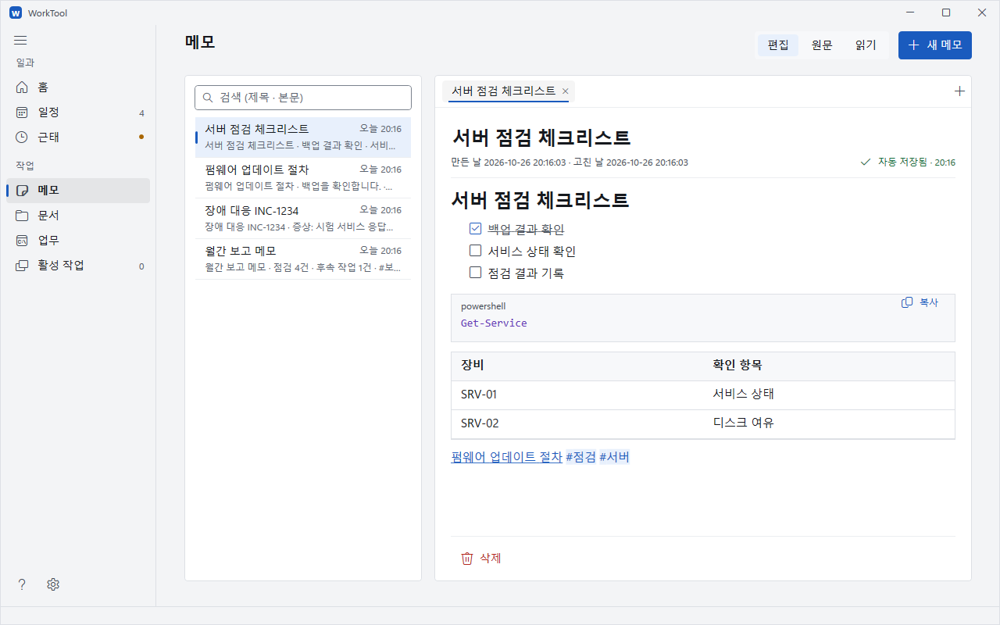

그림 파일: `mockups/worktool-manual-08-memo-edit.png`

- **새 메모**. 제목과 본문을 입력합니다. 자동 저장하며 **Ctrl + S**로 바로 저장합니다.
- 보기 전환. **편집·원문·읽기**를 고릅니다. **Ctrl + E**는 편집/읽기, **Ctrl + /**는 편집/원문을 바꿉니다.
- 마크다운 본문. 제목·할 일 목록·코드 블록·표를 씁니다. 할 일의 체크박스로 완료 상태를 바꿉니다.
- 메모 연결. `[[메모 제목]]`으로 연결합니다. 본문의 `#태그`를 누르면 해당 태그로 검색합니다.
- 목록 검색. 제목·본문의 낱말로 찾습니다. **Ctrl + O**는 메모 이름으로 찾아 엽니다.
- 여러 메모. **Ctrl + 클릭**으로 새 탭에 열고 **Ctrl + \**로 오른쪽에 나눠 엽니다.

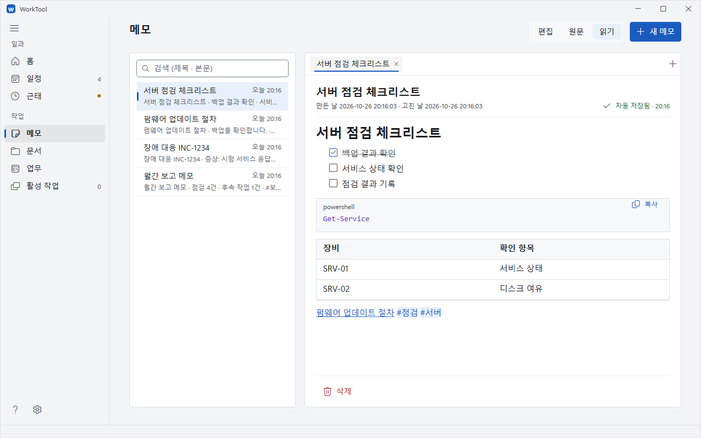

그림 파일: `mockups/worktool-manual-09-memo-read.png`

## 7. 문서

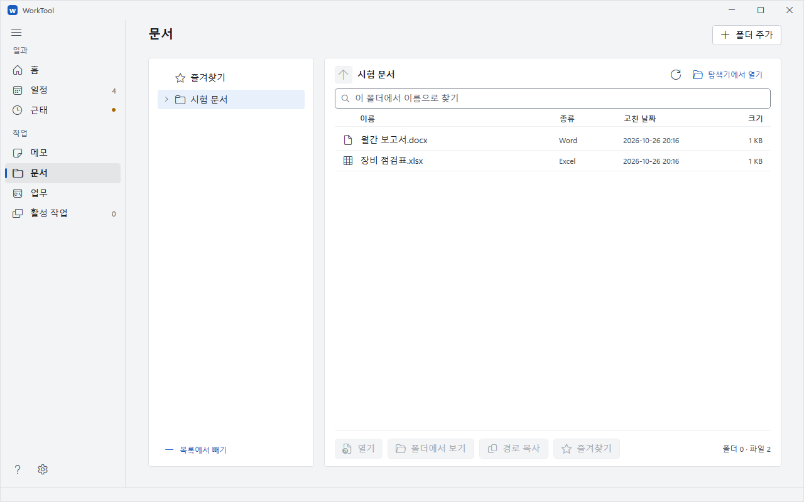

그림 파일: `mockups/worktool-manual-10-documents.png`

- **폴더 추가**. 문서가 있는 폴더를 왼쪽 목록에 넣습니다.
- **열기**. 파일을 고르고 누르거나 두 번 클릭합니다. Excel·Word 등 원래 프로그램으로 엽니다.
- **즐겨찾기**. 고른 파일·폴더를 등록합니다. 다시 고르면 **즐겨찾기에서 빼기**로 해제합니다.
- 이름 검색. **Ctrl + F**로 검색칸에 이동합니다. 띄어 쓴 낱말이 모두 들어간 이름을 찾습니다.
- **F5·Alt + ↑**. 목록을 다시 읽거나 위 폴더로 이동합니다.

## 8. 업무

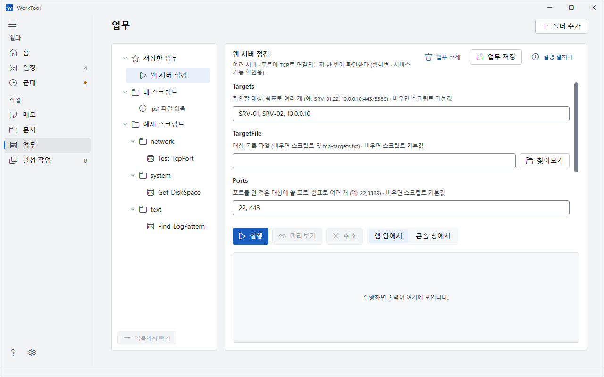

그림 파일: `mockups/worktool-manual-11-workflow-form.png`

- 내 스크립트. 기본 데이터 폴더의 `문서\WorkTool\scripts`에 `.ps1`을 넣고 **F5**로 목록을 다시 읽습니다.
- 예제 스크립트. 개인 PC용 ZIP에는 `scripts` 폴더가 들어 있습니다. 업무 PC에서는 저장소 `scripts/`의 필요한 파일을 내 스크립트 폴더에 복사합니다.
- 입력 폼. 왼쪽에서 스크립트를 고르고 값을 넣습니다. **실행**으로 작업을 시작하고 **취소**로 실행 중인 작업을 멈춥니다.
- 저장한 업무. **업무로 저장**으로 이름·입력값·실행 방식을 보관합니다. 다시 고른 뒤 **업무 저장**으로 바꾼 값을 저장합니다.
- 실행 방식. **앱 안에서**는 아래 출력칸, **콘솔 창에서**는 별도 PowerShell 창을 사용합니다.
- 실행 결과. 상태·종료 코드·출력을 확인합니다. 아래 그림은 `127.0.0.1`의 포트 `1`을 확인한 결과입니다. 포트가 닫혀도 점검 스크립트 자체는 **성공**으로 끝납니다.

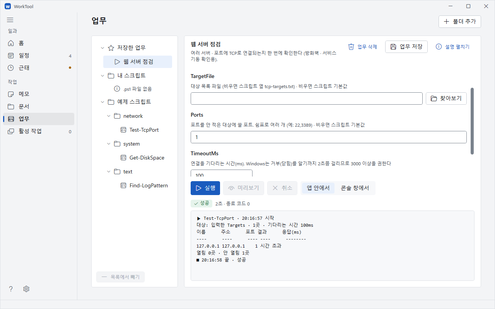

그림 파일: `mockups/worktool-manual-12-workflow-result.png`

## 9. 활성 작업

- 열린 창·브라우저 탭. 프로그램별로 모아 봅니다.
- 선택 닫기. 확인한 항목을 골라 닫습니다.
- 새로 고침. **F5**로 다시 읽습니다. **새로 고침**의 우클릭 메뉴에서 수동·자동 간격을 정합니다.

## 10. 설정

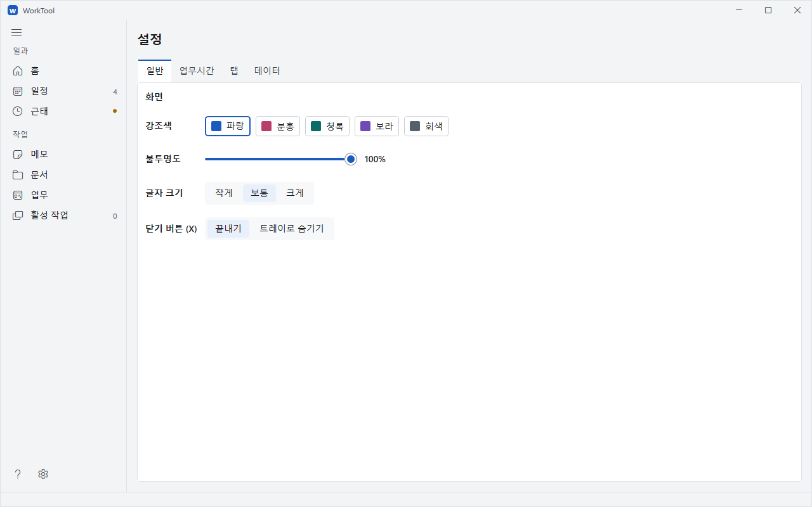

그림 파일: `mockups/worktool-manual-13-settings-general.png`

- **일반 → 강조색·글자 크기**. 화면 색과 글자 크기를 바꿉니다.
- **일반 → 불투명도**. 창의 투명도를 정합니다. 100%와 그 아래 값을 오가면 다시 시작해 적용합니다.
- **일반 → 닫기 버튼 (X)**. **끝내기** 또는 **트레이로 숨기기**를 고릅니다. 트레이에 숨겼다면 트레이 아이콘 우클릭 → **종료**로 끝냅니다.
- **업무시간**. 요일은 누를 때, 시각은 고친 입력칸에서 다른 곳으로 이동할 때 저장합니다. 시각은 `HH:mm`으로 입력합니다.
- **탭**. 메뉴에 표시할 탭을 고릅니다.

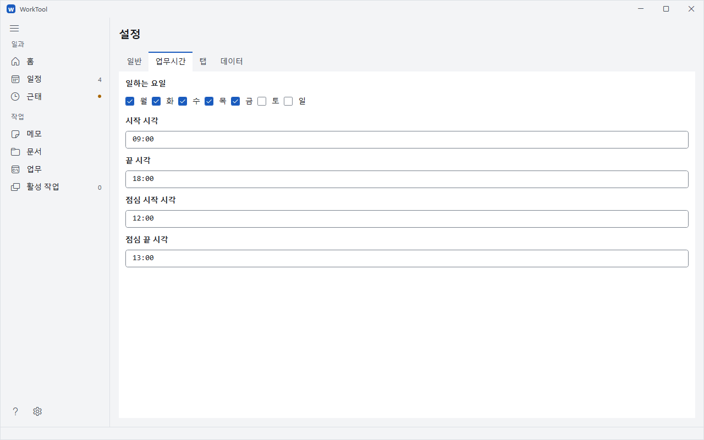

그림 파일: `mockups/worktool-manual-14-settings-workhours.png`

## 11. 단축키

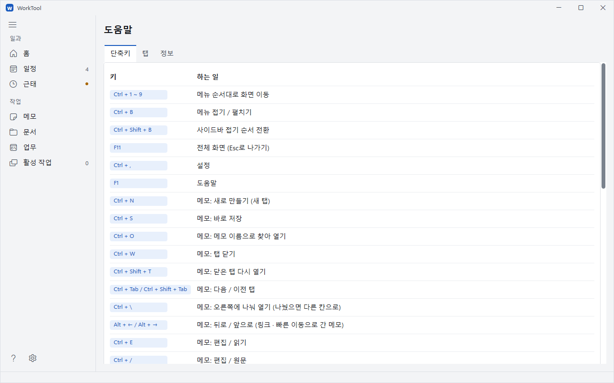

그림 파일: `mockups/worktool-manual-15-shortcuts.png`

- **F1 → 단축키**. 공통 키와 탭별 키를 확인합니다.
- 목록 스크롤. 아래로 내려 메모 편집과 문서·업무·활성 작업의 키를 확인합니다.
- 적용 범위. 아래 목록은 도움말의 키·하는 일을 그대로 옮겼습니다.

| 키 | 하는 일 |
| --- | --- |
| Ctrl + 1 ~ 9 | 메뉴 순서대로 화면 이동 |
| Ctrl + B | 메뉴 접기 / 펼치기 |
| Ctrl + Shift + B | 사이드바 접기 순서 전환 |
| F11 | 전체 화면 (Esc로 나가기) |
| Ctrl + , | 설정 |
| F1 | 도움말 |
| Ctrl + N | 메모: 새로 만들기 (새 탭) |
| Ctrl + S | 메모: 바로 저장 |
| Ctrl + O | 메모: 메모 이름으로 찾아 열기 |
| Ctrl + W | 메모: 탭 닫기 |
| Ctrl + Shift + T | 메모: 닫은 탭 다시 열기 |
| Ctrl + Tab / Ctrl + Shift + Tab | 메모: 다음 / 이전 탭 |
| Ctrl + \ | 메모: 오른쪽에 나눠 열기 (나눴으면 다른 칸으로) |
| Alt + ← / Alt + → | 메모: 뒤로 / 앞으로 (링크 · 빠른 이동으로 간 메모) |
| Ctrl + E | 메모: 편집 / 읽기 |
| Ctrl + / | 메모: 편집 / 원문 |
| Ctrl + Shift + F | 메모: 목록 검색칸으로 |
| Ctrl + 클릭 · 가운데 클릭 | 메모: 목록 · 링크를 새 탭에서 열기 |
| Ctrl + B / Ctrl + I | 메모: 굵게 / 기울임 (다시 누르면 풀기) |
| Ctrl + K | 메모: 링크 만들기 |
| Alt + Shift + 5 | 메모: 취소선 |
| &#96; (글을 고르고) | 메모: 코드로 감싸기 (여러 줄이면 코드 블록) |
| &#96;&#96;&#96; | 메모: 줄 맨 앞에 치면 닫는 &#96;&#96;&#96; 를 자동으로 |
| [[ | 메모: 메모 링크 자동 완성 (↑↓ 고르기 · Enter) |
| Enter | 메모: 목록 · 할 일 이어 쓰기 (빈 항목에서 Enter = 목록 끝) |
| Tab / Shift + Tab | 메모: 목록 들여쓰기 / 내어쓰기 |
| Ctrl + L | 메모: 할 일 체크박스 넣기 · 완료 / 해제 |
| Alt + ↑ / Alt + ↓ | 메모: 줄 옮기기 |
| Ctrl + F / Ctrl + H / F3 | 메모: 찾기 / 바꾸기 / 다음 찾기 |
| Ctrl + Z / Ctrl + Y | 메모: 실행 취소 / 다시 실행 |
| Ctrl + Shift + V | 메모: 바꾸지 않고 붙여넣기 |
| 붙여넣기 | 메모: 글을 고르고 URL을 붙이면 링크, 파일 경로는 경로 링크로 |
| 끌어 놓기 | 메모: 탐색기의 파일 · 폴더를 놓으면 링크 |
| Enter | 문서: 고른 파일 열기 · 폴더 들어가기 |
| Alt + ↑ | 문서: 위 폴더 |
| F5 | 문서 · 활성 작업: 새로 고침 |
| Ctrl + F | 문서 · 활성 작업: 이름으로 필터링 |
| F5 | 업무: 스크립트 목록 새로 고침 |
| Shift + F10 | 활성 작업: 새로 고침 수동 / 자동 메뉴 |

## 12. 데이터와 백업

그림 파일: `mockups/worktool-manual-13-settings-general.png`

- 데이터 폴더. 기본 위치는 Windows의 `문서\WorkTool`입니다. **설정 → 데이터**에서 현재 위치를 확인합니다.
- 수동 백업. 앱을 끝낸 뒤 데이터 폴더 전체를 날짜 붙은 별도 폴더에 복사합니다.
- 형식 이전. 파일 형식을 올리기 전에 원본을 `파일명.json.schema번호.날짜-시각.bak`으로 자동 백업합니다.
- 직전 저장본. 일반 저장 때는 직전 파일을 `.bak`으로 남깁니다. 여러 시점의 백업은 따로 보관합니다.
- 다른 판으로 이동. 새 판이 쓴 일정·근태 파일은 옛 판에서 읽기 전용으로 열립니다. 편집은 새 판에서 이어갑니다. 옛 판으로 돌아가기 전에는 데이터 폴더를 별도로 복사합니다.

그림은 가짜 데이터로 찍었습니다.
