WorkTool WPF의 시작 방법과 탭별 사용법을 설명합니다.
기준 판: 2026-11-07 일정 · 근태 4단계 판(일정 체크 · 메모 연결 · 할 일 · 찾기 · 근태 휴가 · 업무시간 기간).

# WorkTool 사용 매뉴얼

## 1. 시작하기

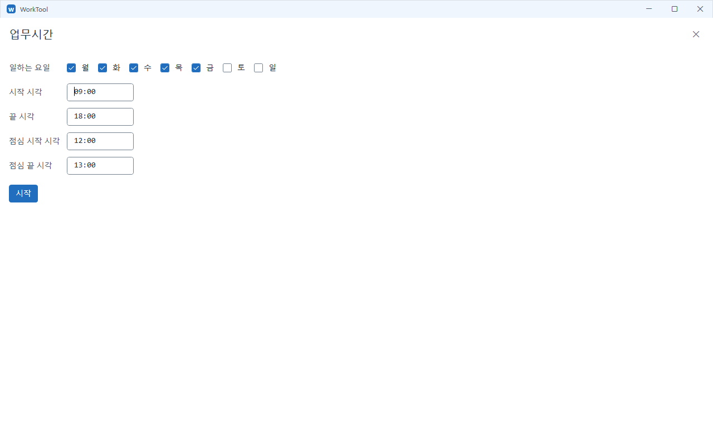

그림 파일: `mockups/worktool-manual-01-first-start.png`

- 업무 PC. `apps/WorkTool/dist/WorkTool-WPF.ps1` 전체를 복사해 같은 이름으로 저장합니다.
- 개인 PC. `worktool.zip`을 받아 압축을 풀고 `Start-WorkTool.cmd`를 실행합니다.
- PowerShell 실행. 파일을 저장한 폴더에서 `pwsh -NoLogo -NoProfile -STA -File .\WorkTool-WPF.ps1`을 실행합니다. 앱은 콘솔 없이 별도로 실행되므로 터미널을 닫아도 됩니다. `pwsh -File`로 연 실행용 프로세스는 자동으로 끝납니다.
- 업무시간. 처음 켤 때 일하는 요일과 시작·끝·점심 시각을 정하고 **시작**을 누릅니다.
- 업무시간 수정. **설정 → 업무시간**에서 고칩니다. 근태의 초과근무 계산에도 적용됩니다. 회사 규칙이 바뀌면 적용 시작일을 정해 새 기간을 더합니다(10. 설정).

## 2. 화면 구성

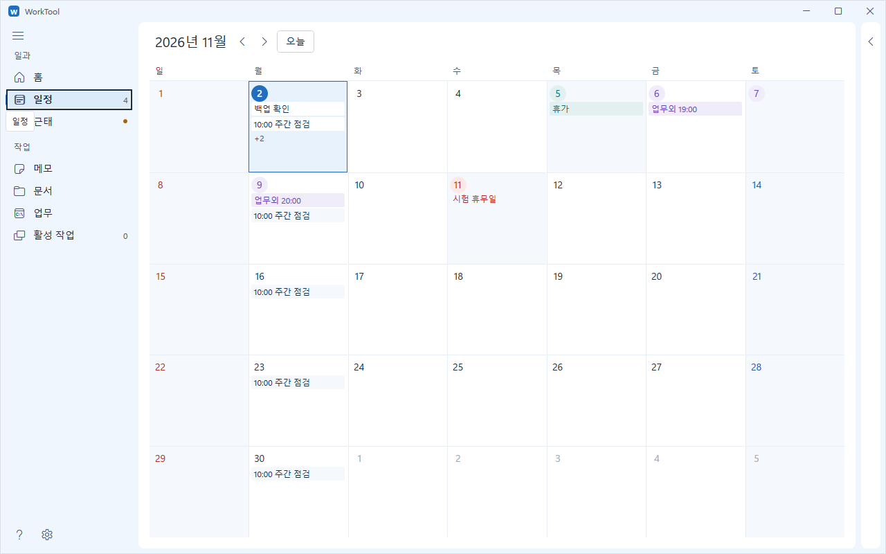

그림 파일: `mockups/worktool-manual-16-sidebar-collapsed.png`

- **일과** 메뉴. 홈·일정·근태로 이동합니다.
- **작업** 메뉴. 메모·문서·업무·활성 작업으로 이동합니다.
- 오른쪽 사이드바. 날짜별 일정이나 근태 요약을 봅니다. 머리글의 접기 단추로 본문 폭을 넓힙니다.
- **Ctrl + Shift + B**. 오른쪽 사이드바 접기 → 왼쪽 메뉴 접기 → 왼쪽 메뉴 펼치기 → 오른쪽 사이드바 펼치기 순서로 바꿉니다.
- 아래쪽 단추. 물음표는 **도움말**, 톱니바퀴는 **설정**을 엽니다.

## 3. 홈

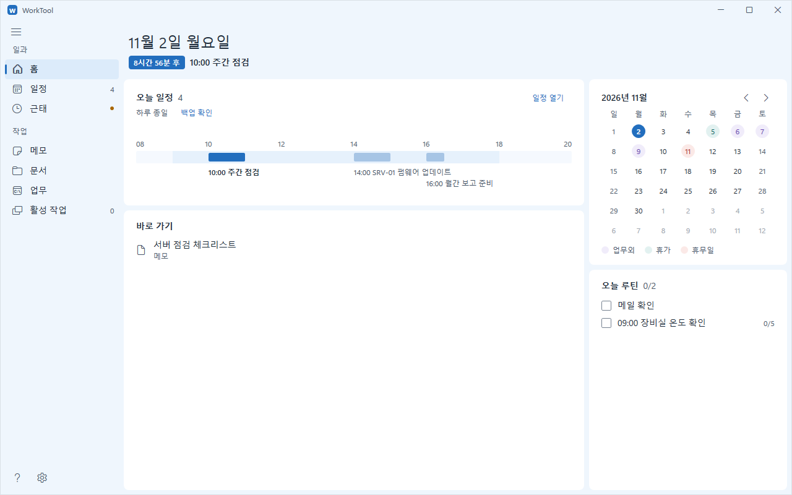

그림 파일: `mockups/worktool-manual-02-home.png`

- 오늘 일정. 시간 막대에 마우스를 올려 제목·시각을 확인합니다. 누르면 일정 편집으로 이동합니다.
- 작은 달력. 날짜를 누르면 해당 날짜의 일정으로 이동합니다.
- 오늘 루틴. 끝낸 항목을 체크합니다. 시간마다 반복하는 루틴은 다음 차례와 진행 횟수를 표시합니다.
- 바로 가기. 자주 연 메모·문서·업무를 다시 엽니다. 항목을 우클릭해 **홈에 고정**을 고릅니다.

## 4. 일정

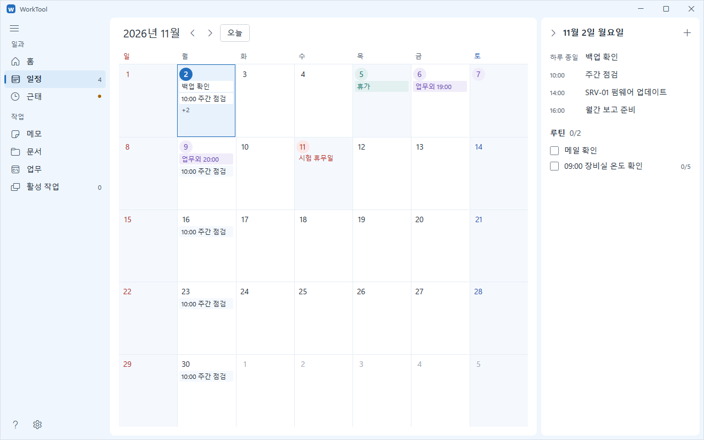

그림 파일: `mockups/worktool-manual-03-calendar.png`

- 달 이동. 머리줄의 **2026년 11월 ⌄**를 누르면 해와 달을 골라 바로 갑니다. 그 안의 **오늘**은 이번 달·오늘로 돌아옵니다. 달력 칸에서는 **PageUp · PageDown**으로 달을 옮깁니다.
- 날짜 고르기. 날짜를 누르면 오른쪽 목록이 그날의 일정과 루틴으로 바뀝니다.
- 달력 칸. 일정과 근태의 휴가·업무외(정규 시간 밖 작업 기록, 5. 근태) 기록이 칩으로 보입니다. 여러 날 일정은 이어진 막대이고, 끝낸 일정은 앞에 ✓를 붙여 흐리게 보입니다. 칸에 다 안 들어가면 **+숫자**에 마우스를 올려 나머지 제목을 봅니다.
- 날짜 색. 날짜 숫자의 바탕이 보라면 업무외 기록이나 쉬는 날 근무, 청록이면 휴가, 빨강이면 휴무일입니다. 쉬는 날(일하는 요일이 아닌 날·휴무일·하루 종일 휴가) 칸은 회색입니다. 반차 날은 쉬는 날이 아니라 칸을 칠하지 않습니다. 마우스를 올리면 이유를 봅니다.
- 일정 체크. 오른쪽 목록의 체크 상자로 그 회차를 끝냄으로 표시합니다. 반복 일정은 회차마다 따로 남고, 다시 누르면 풉니다.
- 일정 추가. 오른쪽 위 **+**의 **새 일정**을 고릅니다. 제목·날짜·시각·반복·알람·태그를 정하고 **저장**합니다. 날짜와 시각은 「시작 ~ 끝」 한 줄입니다. 끝 날짜가 시작보다 뒤면 **하루 종일**로 고정됩니다. 태그는 쉼표로 나눠 씁니다(예: `점검, 작업`).
- 일정 편집. 오른쪽 일정 항목을 누릅니다. 반복 일정을 고치면 **이 회차만** · **이후 모두**를 고릅니다.
- 루틴 추가. **+ → 새 루틴**에서 매일·요일·시간마다를 고릅니다. 매일·요일 루틴에 **시각**(선택)을 넣으면 목록에서 시각순으로 놓입니다. 끝낸 루틴은 체크하고, 잘못 체크하면 다시 눌러 풉니다. 휴무일과 하루 종일 휴가에는 루틴을 쉽니다(반차 날은 그대로).
- 날짜 우클릭. **새 일정 · 새 루틴 · 휴가 넣기 › · 회사 휴무로 지정**이 있습니다. 그날 휴무일이 있으면 **회사 휴무로 지정** 대신 **휴무일 해제**입니다. 개인 휴무는 **설정 → 휴무일**에서 넣습니다.

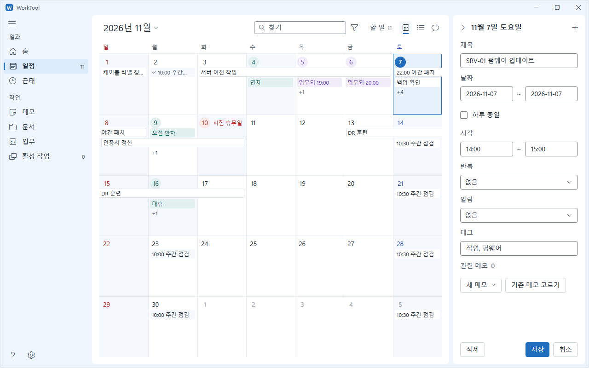

그림 파일: `mockups/worktool-manual-04-schedule-edit.png`

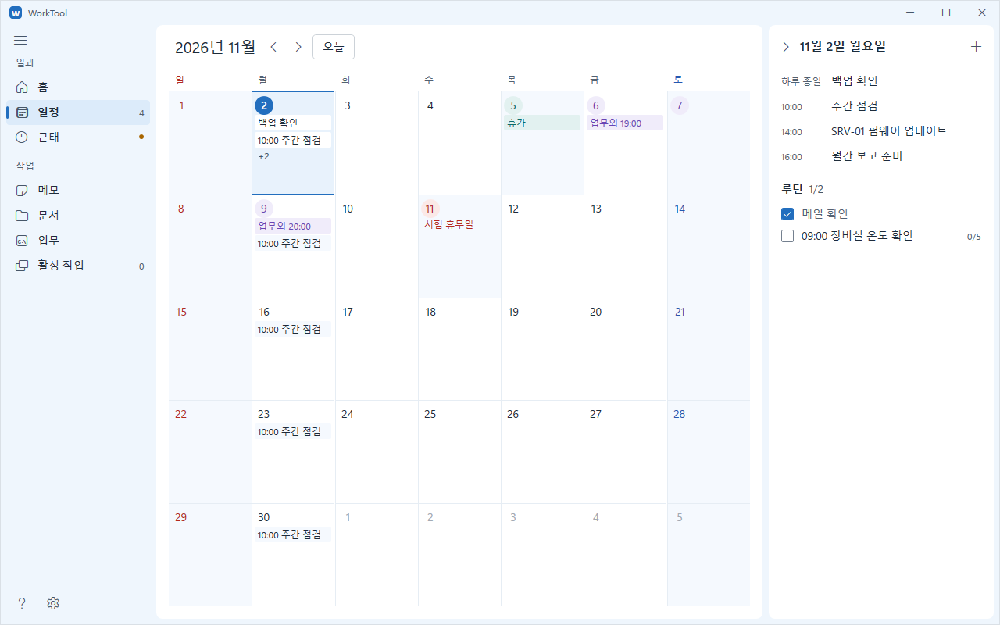

그림 파일: `mockups/worktool-manual-05-routine.png`

### 보기 · 할 일 · 찾기

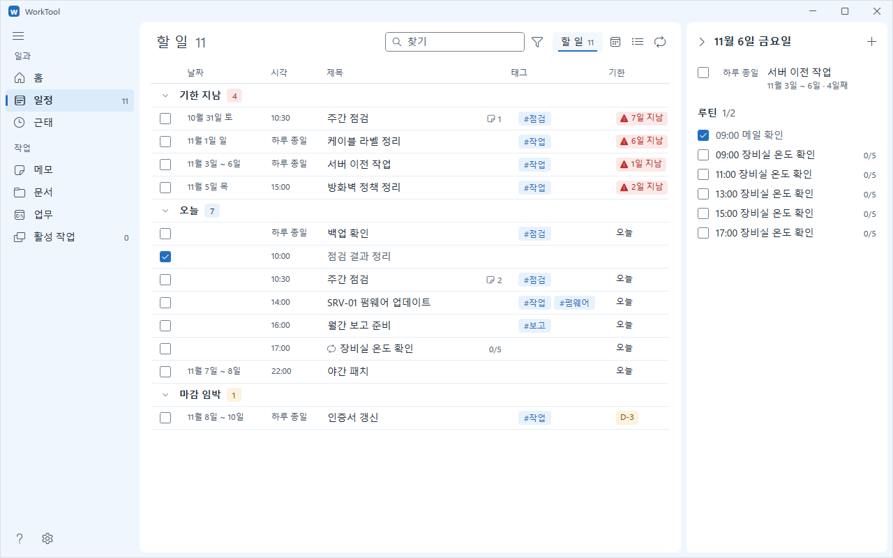

그림 파일: `mockups/worktool-manual-17-schedule-due.png`

- 보기 전환. 머리줄 오른쪽의 **할 일 · 달력 · 표 · 루틴**으로 바꿉니다. 마지막에 본 보기를 기억합니다.
- 기한. 하루짜리 일정은 그날, 하루 종일 여러 날 일정은 마지막 날이 기한입니다.
- 할 일. **기한 지남**(지난 7일 안에 기한이 지났는데 안 끝낸 일정) → **오늘**(오늘 일정과 루틴) → **마감 임박**(3일 안에 끝나는 여러 날 일정) 순서입니다. 7일보다 오래 지난 일정은 할 일에 넣지 않습니다. 묶음 머리를 누르면 접고 폅니다.
- 할 일 수. **할 일** 옆 숫자는 세 묶음에서 아직 안 끝낸 일정과, 오늘 차례를 다 끝내지 않은 루틴의 수입니다. 왼쪽 메뉴 **일정** 옆 숫자와 같습니다.
- 기한 칸의 색. 빨강 `2일 지남`은 기한이 지난 일정, 주황 `D-1` ~ `D-3`은 3일 안에 끝나는 여러 날 일정입니다. 나머지(`오늘`, 하루짜리 일정의 `D-2`, `D-5` 등)는 글자로만 보입니다.
- 표. 보는 달의 일정과 오늘 루틴을 표로 봅니다. **‹ 오늘 ›**이나 **PageUp · PageDown**으로 달을 옮깁니다. 줄을 누르거나 **Enter**를 누르면 편집하고, **Space**로 체크합니다.

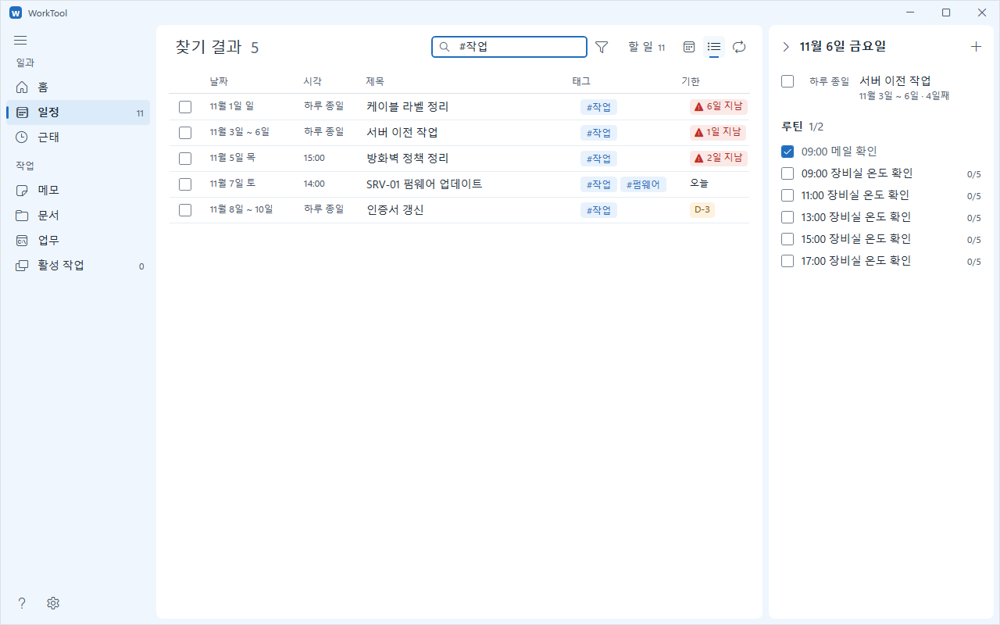

그림 파일: `mockups/worktool-manual-18-schedule-find.png`

- 찾기. 머리줄의 찾기 칸에 씁니다. 달력·루틴 보기에서 쓰면 표 보기로 바뀌어 결과를 보여 줍니다. 오늘 앞뒤 1년에서 찾고, 식에 쓴 날짜가 그 밖이면 그 날짜까지 넓힙니다.
- 찾기 식. 낱말, `#태그`, `title:제목`, 날짜 `2026-11-05`, 기간 `2026-10-01..2026-10-31`, `<2026-11-01`(그날 전) · `>2026-11-01`(그날 뒤), `is:done`(끝낸 것) · `is:open`(안 끝낸 것) · `is:routine`(루틴)을 씁니다. 띄어 쓰면 모두 맞는 것만 찾습니다(예: `#점검 is:open`은 안 끝낸 #점검 일정). 빼기는 `-`, 또는은 `OR`, 묶음은 `( )`입니다.
- 깔때기. 찾기 칸 옆 깔때기에서 상태·종류·태그를 고르면 찾기 칸에 조건이 들어가고, 다시 고르면 빠집니다.

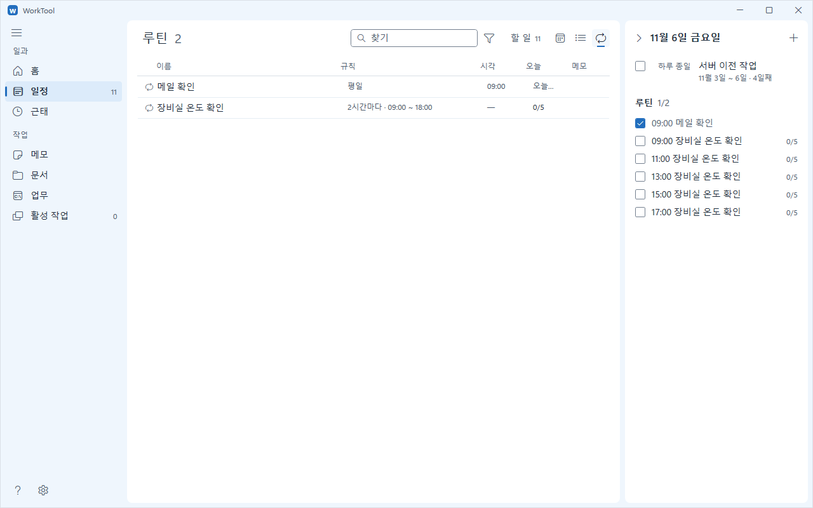

그림 파일: `mockups/worktool-manual-19-schedule-routines.png`

- 루틴 보기. 모든 루틴의 규칙·시각·오늘 진행·관련 메모 수를 봅니다. 줄을 누르면 편집하고, 우클릭이나 **Delete**로 지웁니다.

### 관련 메모

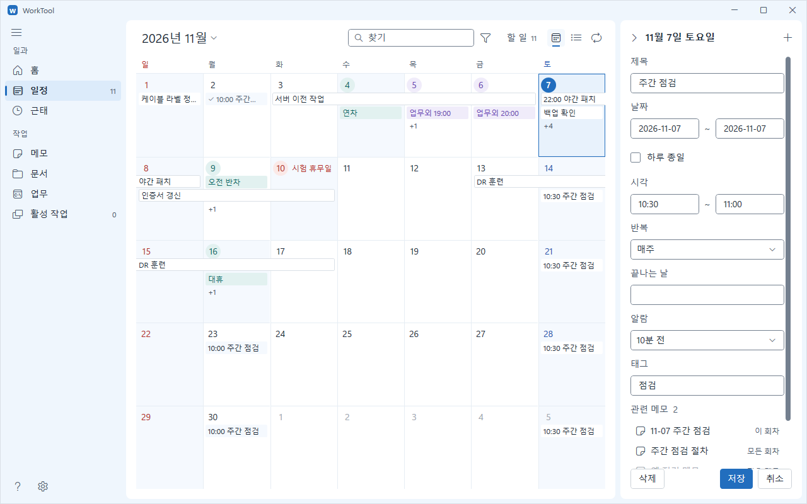

그림 파일: `mockups/worktool-manual-20-schedule-memo.png`

- 메모 붙이기. 일정·루틴 편집 폼 맨 아래 **관련 메모**에서 **새 메모 ⌄**(빈 메모 · 통화 메모)나 **기존 메모 고르기**를 누릅니다. 새 메모는 그 회차에만, 고른 메모는 모든 회차에 붙습니다. 루틴은 늘 모든 날에 붙습니다.
- 메모 보기. 메모 줄을 누르면 읽기 보기 새 창이 열립니다. 이 창에서는 할 일 체크만 됩니다. 고치려면 **메모 탭에서 열기**를 누릅니다.
- 연결 빼기. 메모 줄을 우클릭해 **연결 빼기**를 고릅니다. 메모는 지워지지 않습니다.
- 메모 수. 메모가 붙은 일정·루틴은 줄 끝에 메모 아이콘과 개수가 보입니다.

### 휴가 넣기

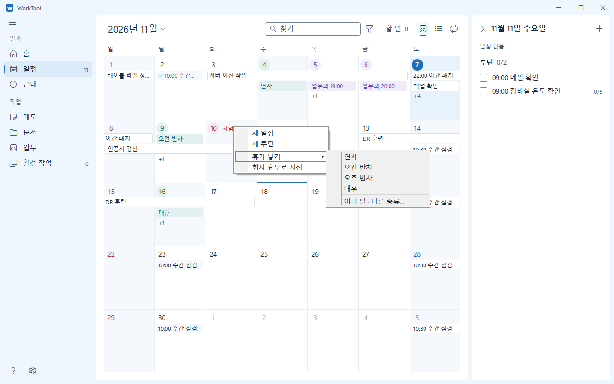

그림 파일: `mockups/worktool-manual-21-leave-menu.png`

- 바로 넣기. 날짜를 우클릭해 **휴가 넣기 ›**에서 **연차 · 오전 반차 · 오후 반차 · 대휴**를 고르면 그날 하루 휴가가 근태에 바로 들어갑니다.
- 다른 휴가. 여러 날 휴가나 병가·경조사는 **여러 날 · 다른 종류…**로 근태 폼을 엽니다.
- 휴가 보기. 그날 휴가가 이미 있으면 같은 자리가 **휴가 보기 · 오전 반차**처럼 바뀝니다. 누르면 근태 탭의 그 기록을 엽니다.

## 5. 근태

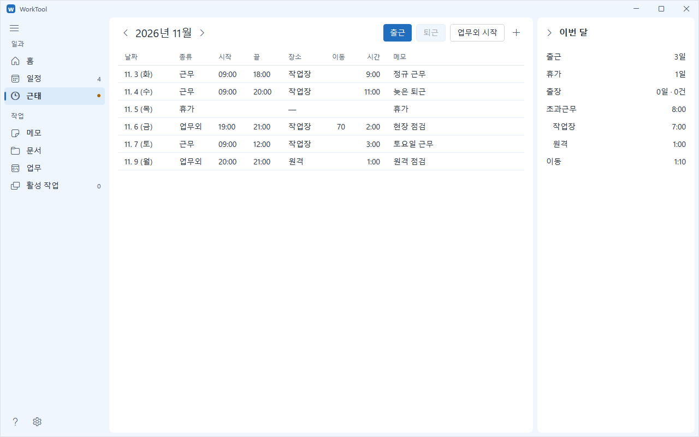

그림 파일: `mockups/worktool-manual-06-attendance.png`

- 기록 입력. **출근·퇴근**은 현재 시각을 기록합니다. **업무외 시작·업무외 끝**은 별도 작업을 기록합니다. **+**(직접 입력)으로 과거 기록·휴가·출장·대휴 발생을 입력하고, 기존 행을 눌러 고칩니다.
- 이번 달. 출근·휴가·출장과 초과근무·이동 합계를 봅니다. 위쪽 화살표로 조회 월을 바꿉니다.
- 휴가. 종류 **휴가**를 고르면 **휴가 종류**(연차 · 오전 반차 · 오후 반차 · 대휴 · 병가 · 경조사 · 기타)가 나옵니다. 여러 날 휴가는 **끝 날짜**를 적습니다. 표의 종류 칸에는 휴가 종류, 시간 칸에는 그 달에 쓴 일수(`0.5일` · `1일`)가 보입니다.
- 반차. 오전·오후 반차를 고르면 시작·끝이 **설정 → 업무시간**의 반차 시각으로 채워집니다. 그대로 저장하면 그날의 규칙을 따르고, 그날만 시각이 다르면 고쳐서 저장합니다.
- 대휴. 대휴가 생기면 종류 **대휴 발생**으로 날짜·일수(0.5일 단위)·사유를 넣습니다. 사이드바 아래에 **대휴 남음 · 발생 · 사용**이 보입니다. 이 세 수는 조회 월과 상관없이 처음부터 쌓인 수입니다. 남음은 발생에서 사용을 뺀 수이고, 사용에는 앞으로 쓰기로 넣어 둔 대휴도 들어갑니다.
- 근무일 초과근무. 정규 시간(그날 업무시간의 시작~끝에서 점심시간을 뺀 시간) 밖에 일한 시간을 셉니다. 반차 날은 반차 시간도 정규 시간에서 빼므로, 반차 시간에 일한 것도 초과근무입니다.
- 쉬는 날 초과근무. 기록한 근무·업무외 시간을 전부 셉니다.
- 장소별 초과근무. 근무 기록은 **작업장**, 업무외 기록은 고른 **작업장·원격·장소 없음**으로 셉니다. 겹친 시간은 작업장 → 원격 → 장소 없음 순으로 한 번만 셉니다.
- 이동. 업무외 기록의 가는 길·오는 길을 분으로 입력합니다. 초과근무에 더하지 않고 따로 합산합니다.
- 오늘 안 찍음. 왼쪽 메뉴 **근태** 옆 점은 오늘 출근을 아직 안 찍었다는 뜻입니다. 쉬는 날(일하는 요일이 아닌 날·휴무일·하루 종일 휴가)에는 뜨지 않습니다. 토요일을 일하는 요일로 정했다면 토요일에도 뜹니다.

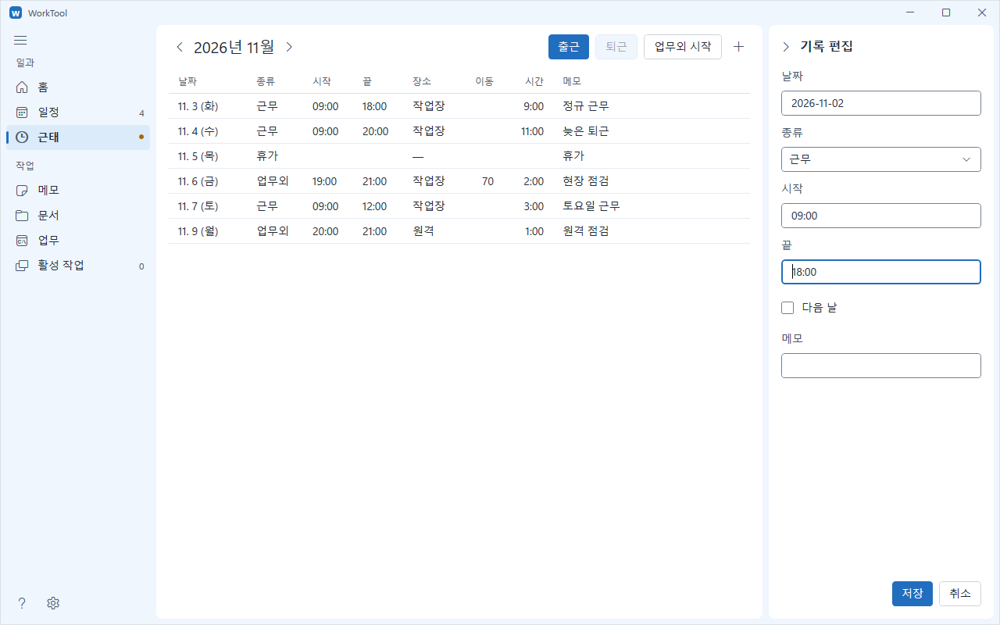

그림 파일: `mockups/worktool-manual-07-attendance-edit.png`

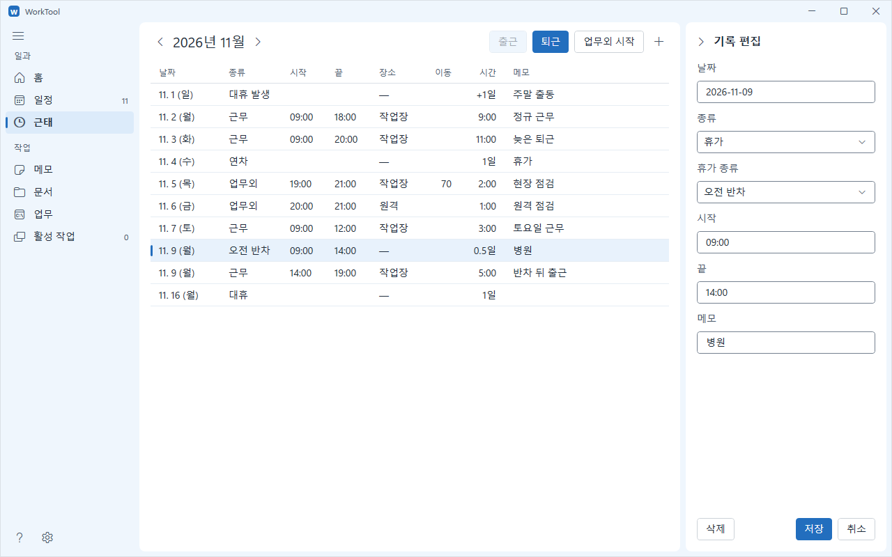

그림 파일: `mockups/worktool-manual-22-attendance-leave.png`

## 6. 메모

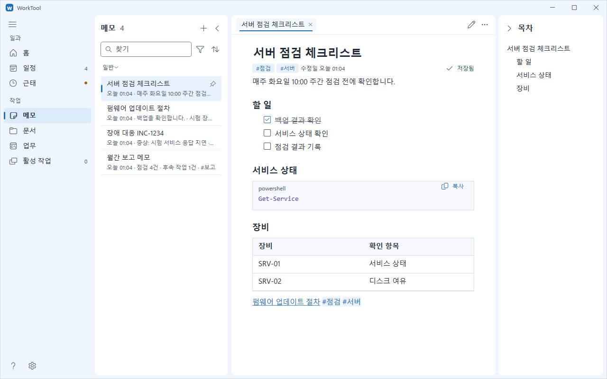

그림 파일: `mockups/worktool-manual-08-memo-edit.png`

- **새 메모**. 목록의 **+** 또는 **Ctrl + N**으로 만듭니다. 자동 저장하며 **Ctrl + S**로 바로 저장합니다. 제목을 비우면 저장 시각이 제목이 됩니다.
- 보기 전환. **Ctrl + E**를 누를 때마다 **편집 → 원문 → 읽기** 순서로 바뀝니다. **Ctrl + /**는 편집과 원문을 오갑니다. 보기는 탭마다 기억합니다.
- 마크다운 본문. 제목·할 일 목록·코드 블록·표를 씁니다. 할 일의 체크박스로 완료 상태를 바꿉니다.
- 메모 연결. `[[메모 제목]]`으로 연결합니다. 본문의 `#태그`를 누르면 해당 태그로 검색합니다.
- 목록 찾기. 제목·본문의 낱말로 찾습니다. `#태그`, `folder:업무`, `updated:7d` 같은 조건도 씁니다. **Enter**로 조건을 칩으로 옮기고, **조건 더하기** 단추로도 넣습니다.
- 보기와 정렬. **보기 고르기**로 고정·최근·보관 메모를 보고, **정렬** 단추로 순서를 바꿉니다. 지금 조건은 **새 보기로 저장**으로 남깁니다.
- 메모 정리. 목록 항목 우클릭이나 **메모 정리** 단추로 고정·보관·폴더 옮기기·삭제를 합니다. 삭제 직후에는 **실행 취소**로 되돌립니다.
- 목차. 오른쪽 카드에 메모의 제목을 모아 보여 줍니다. 누르면 그 줄로 이동합니다.
- 빠른 이동. **Ctrl + O**는 메모 이름으로 찾아 엽니다.
- 여러 메모. **Ctrl + 클릭**으로 새 탭에 열고 **Ctrl + \\**로 오른쪽에 나눠 엽니다.

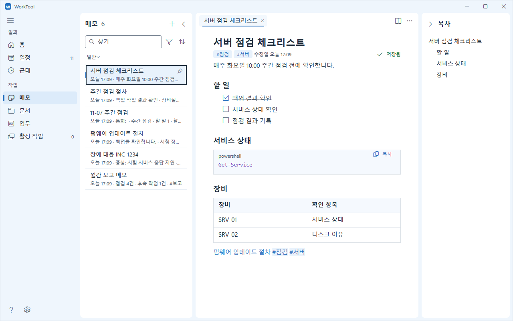

그림 파일: `mockups/worktool-manual-09-memo-read.png`

## 7. 문서

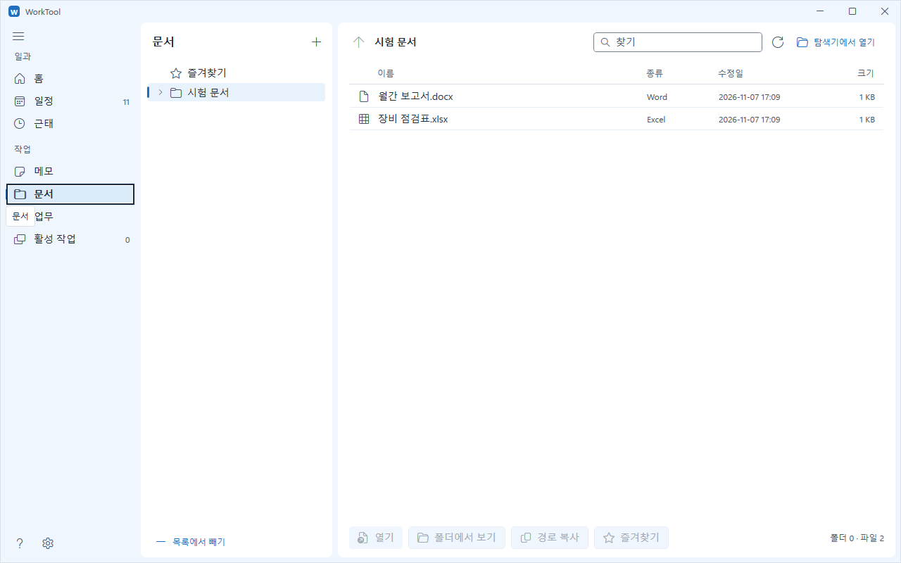

그림 파일: `mockups/worktool-manual-10-documents.png`

- **폴더 추가**. 문서가 있는 폴더를 왼쪽 목록에 넣습니다.
- **열기**. 파일을 고르고 누르거나 두 번 클릭합니다. Excel·Word 등 원래 프로그램으로 엽니다.
- **즐겨찾기**. 고른 파일·폴더를 등록합니다. 다시 고르면 **즐겨찾기 해제**로 뺍니다.
- 이름 검색. 머리줄의 검색칸을 씁니다. **Ctrl + F**로 이동합니다. 띄어 쓴 낱말이 모두 들어간 이름을 찾습니다.
- **F5·Alt + ↑**. 목록을 다시 읽거나 위 폴더로 이동합니다.

## 8. 업무

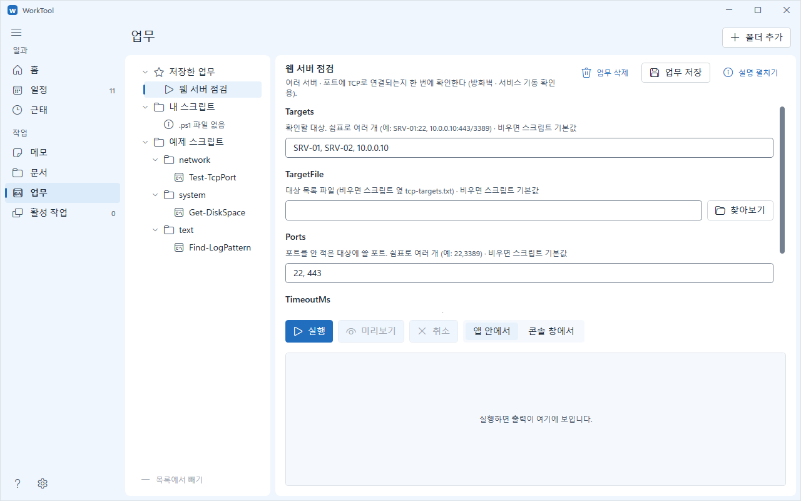

그림 파일: `mockups/worktool-manual-11-workflow-form.png`

- 내 스크립트. 기본 데이터 폴더의 `문서\WorkTool\scripts`에 `.ps1`을 넣고 **F5**로 목록을 다시 읽습니다.
- 예제 스크립트. 개인 PC용 ZIP에는 `scripts` 폴더가 들어 있습니다. 업무 PC에서는 저장소 `scripts/`의 필요한 파일을 내 스크립트 폴더에 복사합니다.
- 입력 폼. 왼쪽에서 스크립트를 고르고 값을 넣습니다. **실행**으로 작업을 시작하고 **취소**로 실행 중인 작업을 멈춥니다.
- 저장한 업무. **업무로 저장**으로 이름·입력값·실행 방식을 보관합니다. 다시 고른 뒤 **업무 저장**으로 바꾼 값을 저장합니다.
- 실행 방식. **앱 안에서**는 아래 출력칸, **콘솔 창에서**는 별도 PowerShell 창을 사용합니다.
- 실행 결과. 상태·종료 코드·출력을 확인합니다. 아래 그림은 `127.0.0.1`의 포트 `1`을 확인한 결과입니다. 포트가 닫혀도 점검 스크립트 자체는 **성공**으로 끝납니다.

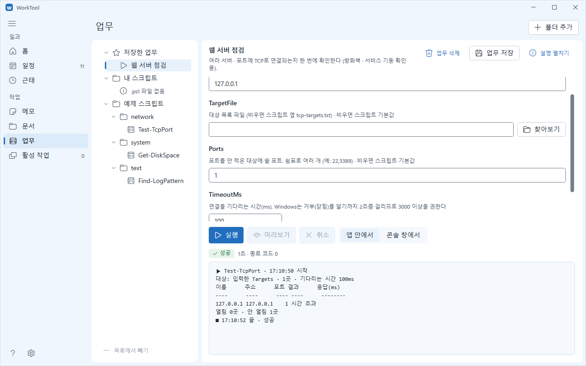

그림 파일: `mockups/worktool-manual-12-workflow-result.png`

## 9. 활성 작업

- 열린 창·브라우저 탭. 프로그램별로 모아 봅니다.
- 선택 닫기. 확인한 항목을 골라 닫습니다.
- 새로 고침. **F5**로 다시 읽습니다. **새로 고침**의 우클릭 메뉴에서 수동·자동 간격을 정합니다.

## 10. 설정

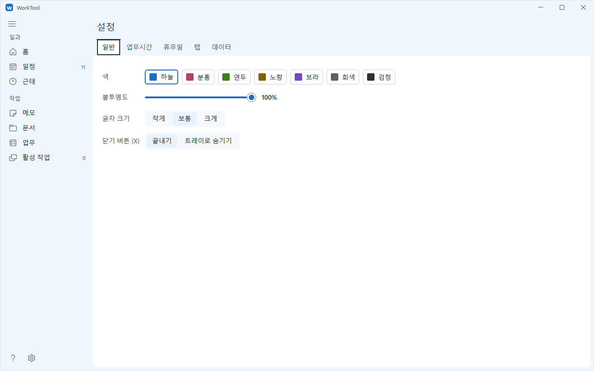

그림 파일: `mockups/worktool-manual-13-settings-general.png`

- **일반 → 색·글자 크기**. 화면 색 7가지 중 하나를 고르고 글자 크기를 바꿉니다.
- **일반 → 불투명도**. 창의 투명도를 정합니다. 100%와 그 아래 값을 오가면 다시 시작해 적용합니다.
- **일반 → 닫기 버튼 (X)**. **끝내기** 또는 **트레이로 숨기기**를 고릅니다. 트레이에 숨겼다면 트레이 아이콘 우클릭 → **종료**로 끝냅니다.
- **업무시간**. 일하는 요일, 시작·끝·점심 시각, 반차 나누는 시각을 정합니다. 요일은 누를 때, 시각은 고친 입력칸에서 다른 곳으로 이동할 때 저장합니다. 시각은 `HH:mm`으로 입력합니다.
- **업무시간 → 반차 나누는 시각**. 오전 반차는 시작 시각부터 이 시각까지, 오후 반차는 이 시각부터 끝 시각까지입니다. 비우면 점심을 뺀 정규 시간을 반으로 나누는 시각입니다(09:00 ~ 18:00 · 점심 12:00 ~ 13:00이면 14:00). 옆에 지금 값으로 계산한 시간대가 보입니다.
- **업무시간 → 적용 기간**. 업무시간은 기간마다 따로 둡니다. 근태 계산·달력·루틴은 그날 적용되는 기간의 규칙을 씁니다.
  - 규칙이 바뀌면 **새 기간**에 바뀌는 날(적용 시작일)을 넣어 기간을 더한 뒤, 그 기간을 골라 값을 고칩니다. 앞 기간의 날은 앞 규칙 그대로라 지난 달 초과근무가 바뀌지 않습니다.
  - 이미 있는 기간의 값을 고치면 그 기간에 든 모든 날(지난 날 포함)의 계산이 바뀝니다. 잘못 넣은 값을 바로잡을 때 씁니다.
  - 필요 없는 기간은 **기간 지우기**로 지웁니다. 그 기간의 날은 앞 기간 규칙을 따릅니다.
- **휴무일**. 공휴일은 앱이 해마다 자동으로 넣습니다(설 · 추석 · 대체공휴일 포함, 인터넷은 쓰지 않음). 임시공휴일·선거일·회사 휴무·개인 휴무(교대 휴무 등)는 **휴무일 추가**로 넣습니다. 행을 우클릭해 이름을 바꾸거나 지웁니다.
- **탭**. 메뉴에 표시할 탭을 고릅니다.

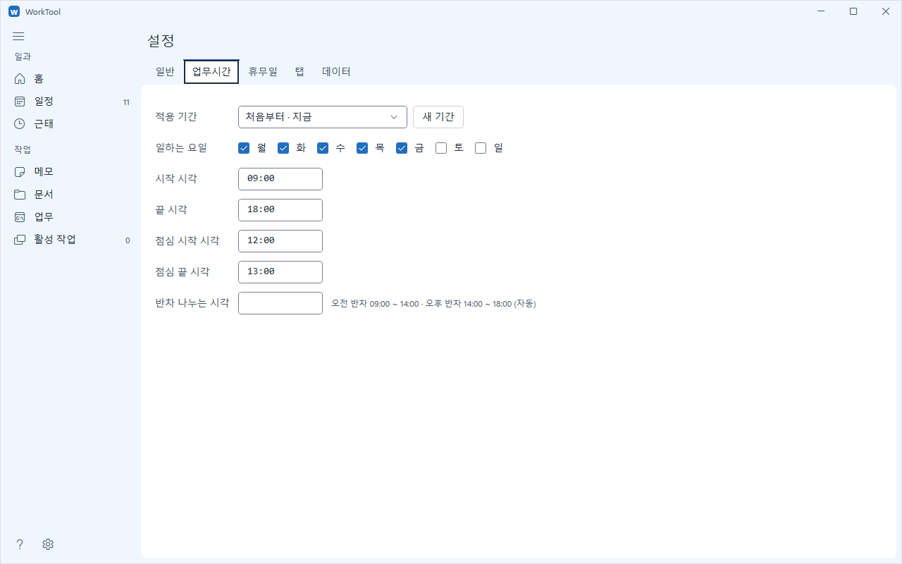

그림 파일: `mockups/worktool-manual-14-settings-workhours.png`

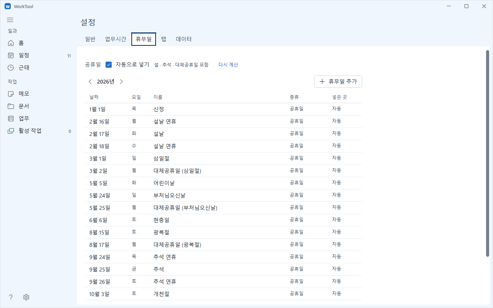

그림 파일: `mockups/worktool-manual-23-settings-holidays.png`

## 11. 단축키

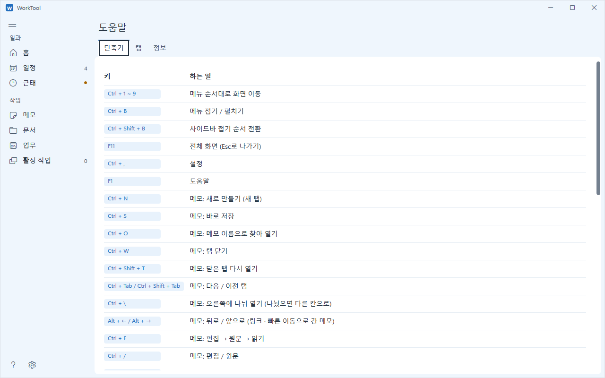

그림 파일: `mockups/worktool-manual-15-shortcuts.png`

- **F1 → 단축키**. 공통 키와 탭별 키를 확인합니다.
- 목록 스크롤. 아래로 내려 일정·메모 편집과 문서·업무·활성 작업의 키를 확인합니다.
- 같은 키. **Ctrl + B**는 메모 편집 칸에서는 굵게, 그 밖에서는 메뉴 접기·펼치기입니다.
- 표의 출처. 아래 목록은 도움말의 키·하는 일을 그대로 옮겼습니다.

| 키 | 하는 일 |
| --- | --- |
| Ctrl + 1 ~ 9 | 메뉴 순서대로 화면 이동 |
| Ctrl + B | 메뉴 접기 / 펼치기 |
| Ctrl + Shift + B | 사이드바 접기 순서 전환 |
| F11 | 전체 화면 (Esc로 나가기) |
| Ctrl + , | 설정 |
| F1 | 도움말 |
| PageUp / PageDown | 일정: 달력 칸 · 표에서 이전 달 / 다음 달 |
| Enter / Space | 일정: 표에서 줄 열기 / 체크 |
| Ctrl + N | 메모: 새로 만들기 (새 탭) |
| Ctrl + S | 메모: 바로 저장 |
| Ctrl + O | 메모: 메모 이름으로 찾아 열기 |
| Ctrl + W | 메모: 탭 닫기 |
| Ctrl + Shift + T | 메모: 닫은 탭 다시 열기 |
| Ctrl + Tab / Ctrl + Shift + Tab | 메모: 다음 / 이전 탭 |
| Ctrl + \ | 메모: 오른쪽에 나눠 열기 (나눴으면 다른 칸으로) |
| Alt + ← / Alt + → | 메모: 뒤로 / 앞으로 (링크 · 빠른 이동으로 간 메모) |
| Ctrl + E | 메모: 편집 → 원문 → 읽기 |
| Ctrl + / | 메모: 편집 / 원문 |
| Ctrl + Shift + F | 메모: 목록 검색칸으로 |
| Ctrl + 클릭 · 가운데 클릭 | 메모: 목록 · 링크를 새 탭에서 열기 |
| Ctrl + B / Ctrl + I | 메모: 굵게 / 기울임 (다시 누르면 풀기) |
| Ctrl + K | 메모: 링크 만들기 |
| Alt + Shift + 5 | 메모: 취소선 |
| &#96; (글을 고르고) | 메모: 코드로 감싸기 (여러 줄이면 코드 블록) |
| &#96;&#96;&#96; | 메모: 줄 맨 앞에 치면 닫는 &#96;&#96;&#96; 를 자동으로 |
| [[ | 메모: 메모 링크 자동 완성 (↑↓ 고르기 · Enter) |
| Enter | 메모: 목록 · 할 일 이어 쓰기 (빈 항목에서 Enter = 목록 끝) |
| Tab / Shift + Tab | 메모: 목록 들여쓰기 / 내어쓰기 |
| Ctrl + L | 메모: 할 일 체크박스 넣기 · 완료 / 해제 |
| Alt + ↑ / Alt + ↓ | 메모: 줄 옮기기 |
| Ctrl + F / Ctrl + H / F3 | 메모: 찾기 / 바꾸기 / 다음 찾기 |
| Ctrl + Z / Ctrl + Y | 메모: 실행 취소 / 다시 실행 |
| Ctrl + Shift + V | 메모: 바꾸지 않고 붙여넣기 |
| 붙여넣기 | 메모: 글을 고르고 URL을 붙이면 링크, 파일 경로는 경로 링크로 |
| 끌어 놓기 | 메모: 탐색기의 파일 · 폴더를 놓으면 링크 |
| Enter | 문서: 고른 파일 열기 · 폴더 들어가기 |
| Alt + ↑ | 문서: 위 폴더 |
| F5 | 문서 · 활성 작업: 새로 고침 |
| Ctrl + F | 문서 · 활성 작업: 이름으로 필터링 |
| F5 | 업무: 스크립트 목록 새로 고침 |
| Shift + F10 | 활성 작업: 새로 고침 수동 / 자동 메뉴 |

## 12. 데이터와 백업

그림 파일: `mockups/worktool-manual-13-settings-general.png`

- 데이터 폴더. 기본 위치는 Windows의 `문서\WorkTool`입니다. **설정 → 데이터**에서 현재 위치를 확인합니다.
- 수동 백업. 앱을 끝낸 뒤 데이터 폴더 전체를 날짜 붙은 별도 폴더에 복사합니다.
- 형식 이전. 파일 형식을 올리기 전에 원본을 `파일명.json.schema번호.날짜-시각.bak`으로 자동 백업합니다.
- 직전 저장본. 일반 저장 때는 직전 파일을 `.bak`으로 남깁니다. 여러 시점의 백업은 따로 보관합니다.
- 캐시. `memo-index-cache.json`은 메모 탭을 빨리 열려고 만든 파일입니다. 지워도 메모는 그대로이고 다시 만듭니다.
- 다른 판으로 이동. 새 판이 쓴 일정·근태 파일은 옛 판에서 읽기 전용으로 열립니다. 편집은 새 판에서 이어갑니다. 옛 판으로 돌아가기 전에는 데이터 폴더를 별도로 복사합니다.

그림은 가짜 데이터로 찍었습니다.
